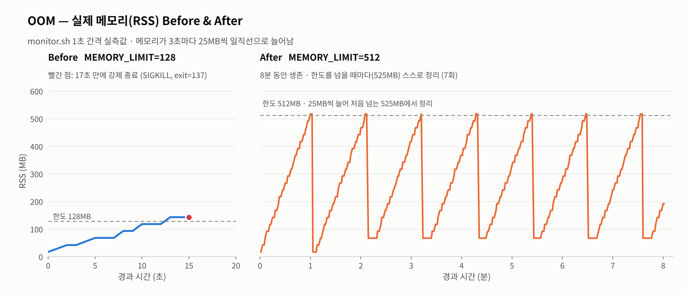
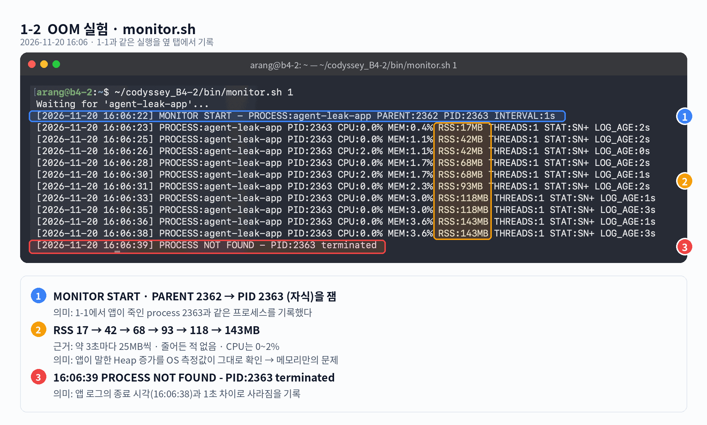
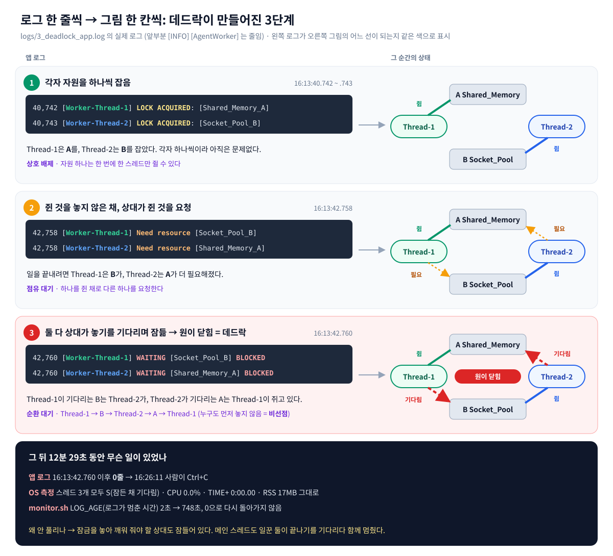

# B4-2 · 컴퓨터가 갑자기 느려지거나 멈췄을 때 원인 찾아 고치기

> 일부러 고장 나게 만든 프로그램을 실행해서 **3가지 장애를 직접 일으키고**,
> 관제 데이터와 로그를 증거로 원인을 밝혀 **GitHub Issue 형식의 리포트 3건**으로 남겼습니다.

**환경** UTM · Ubuntu Server 22.04.5 (x86_64) · CPU 2코어 · RAM 4GB
**범위** 필수 요구사항만 (보너스 제외)

<br>

## 📖 이 문서 읽는 법

이 README 하나에 **과제 설명 → 평가표 답변 → 리포트 3건 → 증거**가 모두 들어 있습니다.

| 부분 | 내용 | 바로 가기 |
|:--|:--|:--|
| **Part 1** 과제 이해와 수행 | 무슨 과제인지, 어떤 프로그램인지, 어떻게 분석했고 결과가 무엇인지 (실험 3가지의 로그·그래프·결론 포함) | [이 과제는 무엇인가](#-이-과제는-무엇인가) |
| **Part 2** 평가표 기준 설명 | 평가표 20문항을 원문 순서대로, 질문마다 답과 근거(그래프·로그·스크린샷) | [한눈에 보는 답](#-한눈에-보는-답-20문항) |
| └ 리포트 3건 | GitHub Issue 형식 (현상 → 증거 → 원인 → 조치) | [1-7](#1-7-format-리포트-3건의-issue-구조) |
| └ 스크린샷 16장 | 사진마다 강조와 근거·의미 설명 | [1-8](#1-8-evidence-pid--타임스탬프--핵심-로그-증거) |
| 부록 | 실행한 명령 전체, 폴더 구조 | [부록](#-부록) |

<br>

---

# Part 1. 과제 이해와 수행

## 🧩 이 과제는 무엇인가

### 상황

서버에서 돌던 프로그램이 **갑자기 꺼지거나**, 꺼지지는 않았는데 **아무 반응이 없는** 일이 생겼습니다.
이때 바로 재부팅하면 원인이 사라져서 같은 장애가 또 일어납니다.
그래서 **증거를 먼저 남기고, 원인을 찾고, 고친 뒤 정말 나아졌는지 비교**하는 연습을 하는 과제입니다.

> 🏥 **쉬운 비유:** 환자(프로그램)가 쓰러졌을 때 바로 약부터 주지 않고,
> 먼저 **검사 기록**(로그·관제 데이터)을 보고 **병명**(장애 원인)을 찾은 뒤,
> **처방**(환경변수 조정)을 하고 **경과**(Before & After)를 확인해서 **진료 기록**(리포트)을 남기는 것과 같습니다.

### 과제가 준 것과 요구한 것

| 구분 | 내용 |
|:--|:--|
| **받은 것** | 일부러 고장 나게 만든 프로그램 `agent-leak-app` → [아래에서 설명](#-지급된-프로그램-agent-leak-app) |
| **일으킬 장애** | 🔴 **OOM** 메모리가 넘쳐서 꺼짐 · 🟠 **CPU Spike** CPU를 과하게 써서 꺼짐 · 🟣 **Deadlock** 살아 있는데 멈춤 |
| **해야 할 일** | ① 장애를 재현하고 ② 증거를 남기고 ③ 원인을 설명하고 ④ 환경변수로 임시 조치한 뒤 ⑤ 전후를 비교 |
| **최종 결과물** | GitHub Issue 형식(현상 → 증거 → 원인 → 조치)의 **리포트 3건** |

<br>

## 📦 지급된 프로그램: agent-leak-app

과제가 `agent-app-leak.zip`을 줬고, 압축을 풀면 실행 파일 2개가 나옵니다. 이번에는 Intel Mac이라 `x86`을 썼습니다.

| 파일 | 대상 |
|:--|:--|
| `agent-leak-app-x86` | Intel · AMD |
| `agent-leak-app-arm64` | Apple M칩 |

과제 문서에는 실행 조건만 있어서 **직접 실행해 보고** 하는 일을 확인했습니다. → [수행과정 §1](수행과정.md#1-제공-앱-분석)

> **한 줄 요약:** 켤 때 내 세팅을 6가지로 검사하고, 켜진 뒤에는 **환경변수 3개의 값을 보고 어떤 장애를 일으킬지** 고르는 연습용 프로그램

### ① 켤 때: 실행 조건 6가지를 검사한다

| 단계 | 검사 내용 | 맞추는 방법 |
|:--:|:--|:--|
| 1/6 | root가 아닌 일반 계정인가 | 계정 `arang`으로 실행 (`sudo` 금지) |
| 2/6 | 필수 환경변수 5개 | `AGENT_HOME` · `AGENT_PORT=15034` · `AGENT_UPLOAD_DIR` · `AGENT_KEY_PATH` · `AGENT_LOG_DIR` |
| 3/6 | 키 파일 | `api_keys/secret.key` 내용 = `agent_api_key_test` |
| 4/6 | 포트 | 15034가 비어 있어야 함 |
| 5/6 | 로그 폴더 | 있어야 하고 쓰기 권한 필요 |
| 6/6 | 실험용 환경변수 3개 | 아래 표의 범위 안 |

하나라도 틀리면 `System Boot Failed`로 꺼지고, 모두 맞으면 `Agent READY`가 나옵니다. → [📸 0-1](#-0-실행-환경--앱-구조)

### ② 켜진 뒤: 환경변수 3개로 장애를 고른다

| 환경변수 | 범위 | 안전한 값 | 장애가 나는 값 | 일어나는 일 |
|:--|:--|:--:|:--:|:--|
| `MEMORY_LIMIT` | 50~512 (MB) | 512 | 128 | 🔴 메모리가 계속 늘다가 **MemoryGuard가 강제 종료** |
| `CPU_MAX_OCCUPY` | 10~100 (%) | 40 | 100 | 🟠 부하가 50%를 넘는 순간 **Watchdog이 종료** |
| `MULTI_THREAD_ENABLE` | true / false | false | true | 🟣 스레드 둘이 서로를 기다리며 **멈춤** |

세 값이 모두 안전하면 `Scenario Selected: [Healthy System Monitoring]` → 장애 없이 계속 동작합니다. 이 정상 실행을 세 실험의 **After**로 썼습니다.

### ③ 알아 둘 동작

| 관찰 | 분석에 준 영향 |
|:--|:--|
| 실행하면 **프로세스가 2개** 뜬다 (부모 = 껍데기, 자식 = 실제 일꾼) | monitor.sh는 **자식**을 재야 함 → [📸 0-2, 0-3](#-0-실행-환경--앱-구조) |
| 앱이 스스로 우선순위를 낮춘다 (`nice=10`) | 부하를 줘도 다른 프로세스를 덜 방해 |
| 로그를 `~/agent-app/logs/agent_app.log`에 쓴다 | 단, 마지막 경고(`SELF-TERMINATED`, `WATCHDOG`)는 **화면에만** 나옴 → 화면 캡처 필요 |

### ④ 과제 문서와 다른 점

직접 실행해 보니 문서와 다른 부분이 있어서 **실제 앱 동작을 기준**으로 했습니다.

| 과제 문서 | 실제 앱 |
|:--|:--|
| 실행 파일 `agent-app-leak-x86` | `agent-leak-app-x86` |
| 부팅 검사 단계 수 언급 없음 | 6단계 (실험용 환경변수 3개도 검사) |
| `CPU_MAX_OCCUPY`로 종료 기준 조정 | 이 값은 부하의 **상한**. 종료 기준은 약 50%로 고정 |
| top/ps로 CPU 급상승 확인 | 앱이 보고한 부하(51%)와 실제 CPU(0~10%)가 다름 → 둘 다 기록 |

### 이 프로그램으로 할 일

위의 3가지 장애를 하나씩 일으키고, 모두 같은 흐름(증거 → 원인 → 조치 → 비교)으로 분석합니다.


<br>

## 🔍 어떻게 분석했나

분석 과정을 **질문 5개**로 나눠 하나씩 풀었습니다. 앞 단계에서 알게 된 사실이 다음 단계의 방법을 정했습니다.


| 단계 | 궁금했던 것 | 한 일 | 알게 된 것 | 결과물 |
|:--:|:--|:--|:--|:--|
| **1** 앱 파악 | 이 앱은 무엇을 하나? | 문서에 조건만 있어서 **직접 실행** | 부팅 검사 6단계, 값에 따라 시나리오가 바뀜, **프로세스가 2개** → [위의 설명](#-지급된-프로그램-agent-leak-app) | [수행과정 §1](수행과정.md#1-제공-앱-분석) |
| **2** 관제 준비 | 무엇을 재야 하나? | B4-1 monitor.sh를 고쳐서 **자식 PID를 1초마다** 기록 | 부모는 메모리가 1MB에서 그대로라, 자식을 재야 누수가 보임 | [bin/monitor.sh](bin/monitor.sh) |
| **3** 실험 설계 | 원인을 어떻게 증명하나? | 정상값(512/40/false)에서 **값 하나만** 바꿔 4번 실행 | 바꾼 값 하나가 장애를 일으킨 원인이라고 말할 수 있음 | [logs/](logs/) |
| **4** 교차 확인 | 앱의 말이 사실인가? | **앱 로그**와 **OS 측정값**(ps·top·monitor.sh)을 나란히 비교 | 메모리는 일치, **CPU는 불일치**(앱 51% vs 실제 0~10%), 데드락은 PID 있음 + CPU 0 | [1-3 · 1-4](#1-3-cpu-임계치-초과--종료-패턴) |
| **5** 기록 | 동료가 읽고 알 수 있나? | Issue 형식으로 PID·시각·로그·스크린샷을 붙여 정리 | 3건 모두 같은 4칸 구조 | [1-7 리포트](#1-7-format-리포트-3건의-issue-구조) |

**장애를 구분한 기준** - 결국 세 가지 질문으로 어떤 장애인지 가렸습니다.

| 질문 | 확인 도구 | OOM | CPU Spike | Deadlock |
|:--|:--|:--:|:--:|:--:|
| 프로세스가 살아 있나? | `ps -ef` | ✘ 꺼짐 | ✘ 꺼짐 | ✔ **살아 있음** |
| 마지막 로그는? | 앱 로그 | `MemoryGuard` | `WATCHDOG` | `BLOCKED` |
| 무엇이 변했나? | monitor.sh | **메모리** 증가 | 앱이 보고한 **부하** 증가 | 아무것도 안 변함 (**로그만 멈춤**) |

<br>

## 📌 결과 한눈에

| | 🔴 [OOM](#1-1-oom-메모리-선형-증가--강제-종료-패턴) | 🟠 [CPU Spike](#1-3-cpu-임계치-초과--종료-패턴) | 🟣 [Deadlock](#1-5-deadlock-살아-있지만-멈춘-상태-식별) |
|:--|:--|:--|:--|
| **증상** | 17초 만에 꺼짐 | 46초 만에 꺼짐 | 꺼지지 않고 **멈춤** |
| **원인** | 메모리를 빌리고 반납 안 함 | 부하 상한이 종료 기준보다 높음 | 두 스레드가 서로를 기다림 |
| **누가 껐나** | MemoryGuard (SIGKILL) | Watchdog (SIGTERM) | 아무도 안 끔 → 사람이 Ctrl+C |
| **조치** | `MEMORY_LIMIT` 128 → **512** | `CPU_MAX_OCCUPY` 100 → **40** | `MULTI_THREAD_ENABLE` → **false** |
| **After** | ✅ 8분 이상 생존 | ✅ 8분 이상 생존 | ✅ 로그가 계속 쌓임 |

> 실험별 로그·그래프는 바로 아래 [🧪 실험 3가지](#-실험-3가지-무엇을-바꿨고-무엇이-보였나)에, 평가표 답은 장애 이름을 누르면 Part 2로 이동합니다. 리포트 3건 전문은 [1-7](#1-7-format-리포트-3건의-issue-구조)에 있습니다.

<br>

## 🧪 실험 3가지: 무엇을 바꿨고 무엇이 보였나

**실험 방법** - 정상값(`512 / 40 / false`)에서 **값 하나만** 바꿔 실행하고, 다른 탭에서 monitor.sh로 1초마다 기록했습니다. 고친 값(After)은 정상 실행 한 번(PID 7633, 8분)으로 세 실험을 함께 비교합니다.

각 실험은 **① 무엇을 바꿨나 → ② 앱 화면(스크린샷) → ③ 그래프(왼쪽 Before / 오른쪽 After) → ④ 결론** 순서입니다.

### 🔴 실험 1. OOM - 메모리가 한도를 넘는가

| 바꾼 값 | 실행 | PID · 시각 | 결과 |
|:--|:--|:--|:--|
| `MEMORY_LIMIT` 512 → **128** | `MEMORY_LIMIT=128 ./agent-leak-app-x86` | 2363 · 16:06:21 ~ 16:06:38 | **17초 만에 강제 종료** (exit=137) |

**📸 1-1 앱 화면 - 메모리가 25MB씩 늘다가 150MB에서 MemoryGuard가 강제 종료 (exit=137)**




- **Before (128MB)** - 메모리가 3초마다 25MB씩 계단처럼 오르다가, 한도 128MB를 넘자 강제 종료(빨간 점)
- **After (512MB)** - 똑같이 오르지만 한도 512MB를 넘는 순간(25MB 단위라 **525MB**) 앱이 스스로 정리하고 다시 오름(톱니 7번) → **8분 이상 생존**
- **결론** - 오르는 속도는 둘이 같습니다. **한도만 높여 시간을 번 임시 조치**이고, 근본 해결은 [4-4 코드 개선](#4-4-코드-레벨-개선)입니다

<details>
<summary><b>📸 같은 실험의 관제 기록</b> · 1장 펼치기</summary>

<br>

**1-2 monitor.sh - 같은 실행의 RSS가 일직선으로 늘다가 PROCESS NOT FOUND**



</details>

📸 [스크린샷 전체 설명 1-1 · 1-2](#-1--oom-실험) · 📄 [리포트](#bug-oom---메모리가-3초마다-25mb씩-쌓이다가-17초-만에-memoryguard가-프로세스를-강제-종료) · ✅ 평가표 [1-1](#1-1-oom-메모리-선형-증가--강제-종료-패턴) · [1-2](#1-2-oom-memory_limit-조정-before--after)

### 🟠 실험 2. CPU Spike - 부하가 종료 기준을 넘는가

| 바꾼 값 | 실행 | PID · 시각 | 결과 |
|:--|:--|:--|:--|
| `CPU_MAX_OCCUPY` 40 → **100** | `CPU_MAX_OCCUPY=100 ./agent-leak-app-x86` | 2606 · 16:09:03 ~ 16:09:48 | **46초 만에 종료** (exit=143) |

**📸 2-1 앱 화면 - 부하가 3초마다 오르다 51.22%에서 Watchdog이 SIGTERM으로 종료 (exit=143)**


- **Before (100%)** - 앱이 보고한 부하(파랑)가 계속 올라 빨간 점선(약 50%)을 넘는 순간 종료. 같은 설정으로 6번 실행해 6번 모두 50~57%에서 종료
- **After (40%)** - 40%에 닿으면 식혔다가 다시 오름 → 점선에 한 번도 닿지 않고 **8분 이상 생존**
- **결론** - 주황선(OS가 잰 실제 CPU)은 내내 0~10%입니다. 종료를 결정한 것은 **앱이 스스로 보고한 수치**이고, 부하 상한(100)이 종료 기준(50)보다 높게 설정된 것이 원인입니다

<details>
<summary><b>📸 같은 실험의 관제 기록 · 실제 CPU</b> · 2장 펼치기</summary>

<br>

**2-2 monitor.sh - 같은 실행의 실제 CPU는 0~10%**


**2-3 top - 실제 CPU를 직접 확인 (리허설 실행)**


</details>

📸 [스크린샷 전체 설명 2-1 ~ 2-3](#-2--cpu-spike-실험) · 📄 [리포트](#bug-cpu-spike---앱이-보고한-cpu-부하가-50를-넘는-순간-watchdog이-sigterm으로-종료) · ✅ 평가표 [1-3](#1-3-cpu-임계치-초과--종료-패턴) · [1-4](#1-4-cpu-cpu_max_occupy-조정-before--after)

### 🟣 실험 3. Deadlock - 살아 있는데 일을 하는가

| 바꾼 값 | 실행 | PID · 시각 | 결과 |
|:--|:--|:--|:--|
| `MULTI_THREAD_ENABLE` false → **true** | `MULTI_THREAD_ENABLE=true ./agent-leak-app-x86` | 2916 · 16:13:33 ~ | **꺼지지 않고 멈춤** (12분 29초 뒤 Ctrl+C) |

**📸 3-1 앱 화면 - 두 일꾼이 열쇠를 하나씩 쥔 뒤 서로를 기다리며 둘 다 BLOCKED**


- 세로축 **LOG_AGE** = 앱 로그가 마지막으로 바뀐 뒤 지난 시간. 일하는 앱은 로그를 계속 쓰므로 곧바로 0으로 돌아갑니다
- **Before (true)** - 로그가 멈춰 LOG_AGE가 **748초까지 직선으로 증가**. 프로세스는 살아 있고 CPU 0%, 메모리 그대로
- **After (false)** - 0→1→2→0을 반복하며 **8분 동안 한 번도 3초를 넘지 않음** → 로그가 계속 쌓임. ⚠ 오른쪽 그래프는 세로축이 **0~5초**로 확대되어 있습니다
- **결론** - CPU·메모리만 보면 "쉬는 중"과 구분이 안 됩니다. **로그가 멈췄다는 사실**이 멈춤의 증거이고, 원인은 아래 그림처럼 두 일꾼이 서로의 열쇠를 기다리는 **순환 대기**입니다



<details>
<summary><b>📸 살아 있지만 멈춘 상태를 진단한 과정</b> · 5장 펼치기</summary>

<br>

**3-2 monitor.sh - CPU·메모리는 그대로, LOG_AGE만 계속 증가**


**3-3 ps -ef - 프로세스는 살아 있음 (PID 존재)**


**3-4 ps -L - 스레드 3개 모두 대기(S)**


**3-5 top -H - 스레드별 CPU 0.0%**


**3-6 Ctrl+C - 12분 29초 뒤 사람이 종료**


</details>

📸 [스크린샷 전체 설명 3-1 ~ 3-6](#-3--deadlock-실험) · 📄 [리포트](#bug-deadlock---멀티스레드-모드에서-두-스레드가-서로의-자원을-기다리며-12분-넘게-무응답) · ✅ 평가표 [1-5](#1-5-deadlock-살아-있지만-멈춘-상태-식별) · [1-6](#1-6-deadlock-multi_thread_enable-재현과-회피)

<br>

## 💡 핵심 개념

| 용어 | 쉬운 말 |
|:--|:--|
| **프로세스 / PID** | 실행 중인 프로그램 하나 / 그 번호. "살아 있다" = PID가 있다 |
| **스레드** | 한 프로세스 안의 일꾼 여러 명 |
| **RSS** | 프로세스가 **실제로 차지한** 메모리 |
| **메모리 누수** | 빌린 메모리를 반납하지 않아 계속 쌓이는 것 |
| **MemoryGuard / Watchdog** | 앱 안의 감시 장치. 기준을 넘으면 **자기 자신을** 끈다 |
| **SIGTERM / SIGKILL** | "정리하고 꺼져"(15) / "지금 당장 꺼져"(9). 종료 코드 = 128 + 번호 → 143 / 137 |
| **락 (Lock)** | 공용 자원의 열쇠. 쥔 스레드만 쓸 수 있다 |
| **데드락** | 서로가 서로의 열쇠를 기다리며 영원히 멈추는 것 |

<details>
<summary><b>그림으로 보기 (메모리 누수 · CPU 과점유 · 데드락)</b></summary>

<br>


</details>

<br>

---

# Part 2. 평가표 기준 설명

> 평가표 질문 **원문 순서**대로, 질문마다 답과 근거를 바로 아래에 두었습니다.

## ✅ 한눈에 보는 답 (20문항)

> 번호를 누르면 자세한 답과 근거로 이동합니다.

#### 항목 1. 결과물 - 증거가 있는가

| # | 질문 | 답 | 핵심 증거 |
|:--:|:--|:--:|:--|
| [1-1](#1-1-oom-메모리-선형-증가--강제-종료-패턴) | OOM 선형 증가 → 강제 종료 패턴 | ✅ | RSS 17 → 143MB (3초마다 25MB) → `MemoryGuard Self-terminating process 2363` |
| [1-2](#1-2-oom-memory_limit-조정-before--after) | `MEMORY_LIMIT` Before & After | ✅ | 128 → **17초** 종료 / 512 → **8분 이상** 생존 |
| [1-3](#1-3-cpu-임계치-초과--종료-패턴) | CPU 임계치 초과 → 종료 패턴 | ✅ | Load 51.22% → `CPU Threshold Violated!` → `WATCHDOG (SIGTERM)` · exit=143 |
| [1-4](#1-4-cpu-cpu_max_occupy-조정-before--after) | `CPU_MAX_OCCUPY` Before & After | ✅ | 100 → **46초** 종료 / 40 → **8분 이상** 생존 |
| [1-5](#1-5-deadlock-살아-있지만-멈춘-상태-식별) | 살아 있지만 멈춘 상태 식별 | ✅ | PID 2916 존재 · 스레드 3개 CPU 0% · LOG_AGE 0 → 748초 |
| [1-6](#1-6-deadlock-multi_thread_enable-재현과-회피) | `MULTI_THREAD_ENABLE` 재현/회피 | ✅ | true → 12분 29초 멈춤 / false → 로그 계속 쌓임 |
| [1-7](#1-7-format-리포트-3건의-issue-구조) | 리포트 4칸 구조 | ✅ | 3건 모두 현상 → 증거 → 원인 → 조치 |
| [1-8](#1-8-evidence-pid--타임스탬프--핵심-로그-증거) | PID · 시각 · 로그 증거 | ✅ | 스크린샷 16장 + 로그 원본 8개 |

#### 항목 2. 도구와 명령 - 어떻게 쟀는가

| # | 질문 | 한 줄 답 |
|:--:|:--|:--|
| [2-1](#2-1-monitorsh-메모리-추적-명령과-추출-방법) | 메모리 추적 명령 | `pgrep -P`로 **자식 PID**를 찾고 `ps -p PID -o rss=`로 **RSS**를 1초마다 시각과 함께 기록 |
| [2-2](#2-2-cpu-확인-도구와-옵션의-의미) | CPU 도구와 옵션 | `top -b -n 2 -d 0.5 -p PID` · ps의 %cpu는 **평균**이라 **순간값**인 top을 선택 |
| [2-3](#2-3-살아-있지만-멈춘-상태의-진단-순서) | 멈춘 상태 진단 순서 | ① `ps -ef` 살아 있나 → ② `top -H`·`ps -L` 일하나 → ③ LOG_AGE가 정상(3초)을 넘었나 → ④ `tail` 무엇을 기다리나 |

#### 항목 3. 원리 - 왜 그런가

| # | 질문 | 한 줄 답 |
|:--:|:--|:--|
| [3-1](#3-1-메모리-보호-정책이-강제-종료하는-이유) | 메모리 보호 정책이 끄는 이유 | 놔두면 스왑 → OS OOM Killer가 **엉뚱한 서비스까지** 죽임 → 범인 하나만 먼저 끊음 |
| [3-2](#3-2-cpu-과점유-시-프로세스-하나만-끄는-이유) | 프로세스 하나만 끄는 이유 | CPU를 독차지하면 sshd·웹 서버까지 **대기열에서 지연** → 범인만 끄면 나머지는 정상 |
| [3-3](#3-3-데드락-원리-상호-배제와-순환-대기) | 상호 배제 · 순환 대기 | 열쇠는 한 명만 쥠(상호 배제) + T1 → B → T2 → A → T1 원(순환 대기) |
| [3-4](#3-4-로그에서-순환-의존-ab-ba-추적) | A→B, B→A 추적 | 마지막 로그를 **스레드별로 나눠** "쥔 것 / 기다리는 것" 표로 정리 |

#### 항목 4. 응용과 회고 - 나라면 어떻게 하나

| # | 질문 | 한 줄 답 |
|:--:|:--|:--|
| [4-1](#4-1-장애-전-누수-탐지를-위한-monitorsh-개선) | 사전 탐지 개선 | RSS **계속 증가 추세** 경고 + 한도 **도달 시간 예측** + 알림 · 상시 실행 |
| [4-2](#4-2-가장-치명적인-장애와-근본-예방) | 가장 치명적인 장애 | **Deadlock** - 살아 있어서 발견이 어렵고 스스로 회복 못 함 · 잠금 순서 고정 + 타임아웃 |
| [4-3](#4-3-oom과-deadlock-동시-발생-시-순서) | 동시 발생 시 순서 | 데드락 증거 1분 저장 → **OOM 먼저**(서버 전체로 번짐) → 데드락 분석 |
| [4-4](#4-4-코드-레벨-개선) | 코드 레벨 개선 | OOM: 다 쓴 데이터 지우기·캐시 크기 제한 / CPU: 쉬는 시간·작업 나누기 / Deadlock: 잠금 순서·타임아웃 |
| [4-5](#4-5-다시-한다면-다르게-할-점) | 다르게 할 점 | 재는 대상(부모·자식) 먼저 확인 · 짧은 간격으로 계속 기록 · 앱 값과 OS 값 처음부터 비교 |

---

## 항목 1. 결과물

### 1-1. [OOM] 메모리 선형 증가 → 강제 종료 패턴

> [OOM] 메모리 사용량이 선형적으로 증가하다가 프로세스가 강제 종료되는 패턴이 로그에 기록되어 있는가?

✅ **있음** · 실행: `MEMORY_LIMIT=128` · PID **2363** · 2026-11-20 16:06:21 ~ 16:06:38

**monitor.sh 기록** - 실제 메모리(RSS)가 약 3초마다 25MB씩 **일직선으로** 증가, 줄어든 적 없음

| 시각 | 16:06:23 | :25 | :28 | :31 | :33 | :36 | :39 |
|:--|:--:|:--:|:--:|:--:|:--:|:--:|:--:|
| RSS | 17MB | 42MB | 68MB | 93MB | 118MB | 143MB | **사라짐** |

**앱 로그** - 한도를 넘자 MemoryGuard가 같은 PID를 스스로 종료

```
16:06:38,954 [INFO] [MemoryWorker] Current Heap: 150MB
16:06:38,954 [CRITICAL] [MemoryGuard] Memory limit exceeded (150MB >= 128MB) / (Recommend Over 256MB)
16:06:38,955 [CRITICAL] [MemoryGuard] Self-terminating process 2363 to prevent system instability.
>>> [SYSTEM] SELF-TERMINATED (Memory Limit Exceeded) <<<      ← 화면 출력
Killed / exit=137 (= 128 + 9 → SIGKILL)                       ← 화면 출력
```

원본 로그: [logs/1_oom_monitor.log](logs/1_oom_monitor.log) · [logs/1_oom_app.log](logs/1_oom_app.log) · 스크린샷: [📸 1-1, 1-2](#-1--oom-실험)

### 1-2. [OOM] MEMORY_LIMIT 조정 Before & After

> [OOM] 환경변수(MEMORY_LIMIT) 조정 후 프로세스 생존 시간이 늘어난 Before & After 비교 결과가 있는가?

✅ **있음** · 값 하나만 바꿔 2번 실행


| | Before `MEMORY_LIMIT=128` | After `MEMORY_LIMIT=512` |
|:--|:--|:--|
| PID | 2363 | 7633 |
| 메모리 동작 | 25MB씩 증가 → 150MB에서 한도 초과 | 25MB씩 증가 → 한도 512를 넘는 525MB에서 스스로 정리 → 다시 증가 (7번) |
| **생존 시간** | **17초** (SIGKILL, exit=137) | **8분 이상** (16:29:17 ~ 16:37:16, 사람이 Ctrl+C) |

> 한도를 올려도 메모리는 여전히 늘어납니다(톱니 모양). **시간을 번 임시 조치**이고, 근본 해결은 [4-4 코드 개선](#4-4-코드-레벨-개선)입니다.

### 1-3. [CPU] 임계치 초과 → 종료 패턴

> [CPU] CPU 사용률이 임계치를 초과하여 프로세스가 종료되는 패턴이 로그에 기록되어 있는가?

✅ **있음** · 실행: `CPU_MAX_OCCUPY=100` · PID **2606** · 2026-11-20 16:09:03 ~ 16:09:48

**앱 로그** - 부하가 3초마다 오르다 약 50%를 넘는 순간 Watchdog이 종료

```
16:09:05,126 [INFO] [CpuWorker] Started. Maximum CPU Limit: 100%
16:09:33,220 [INFO] [CpuWorker] Current Load: 40.87%
16:09:48,836 [INFO] [CpuWorker] Current Load: 51.22%
16:09:48,939 [CRITICAL] [CpuWorker] CPU Threshold Violated! (51.22%).
>>> [SYSTEM] WATCHDOG: INITIATING EMERGENCY ABORT (SIGTERM) <<<   ← 화면 출력
Terminated / exit=143 (= 128 + 15 → SIGTERM)                       ← 화면 출력
```

- 같은 설정으로 **6번 실행해서 6번 모두** 50.23 ~ 56.88%에서 종료
- 같은 시간 monitor.sh가 `top`으로 잰 **실제 CPU는 0~10%** → Watchdog은 **앱이 보고한 내부 수치**로 동작 ([과제 문서와 다른 점](#-과제-문서와-다른-점))

원본 로그: [logs/2_cpu_app.log](logs/2_cpu_app.log) · [logs/2_cpu_monitor.log](logs/2_cpu_monitor.log) · 스크린샷: [📸 2-1 ~ 2-3](#-2--cpu-spike-실험)

### 1-4. [CPU] CPU_MAX_OCCUPY 조정 Before & After

> [CPU] 환경변수(CPU_MAX_OCCUPY) 조정 후 프로세스 종료 여부/생존 시간이 변화한 Before & After 비교 결과가 있는가?

✅ **있음**


| | Before `CPU_MAX_OCCUPY=100` | After `CPU_MAX_OCCUPY=40` |
|:--|:--|:--|
| 부하 동작 | 5 → 51.22%까지 계속 상승 | 40%에 닿으면 식혔다가 다시 상승 (10번, 한 번도 안 넘음) |
| **종료 여부 · 생존 시간** | **46초 만에 종료** (SIGTERM, exit=143) | **종료 없음 · 8분 이상** |

### 1-5. [Deadlock] 살아 있지만 멈춘 상태 식별

> [Deadlock] 프로세스가 살아있으나(PID 존재) CPU/메모리 변화 없이 로그가 멈춘 상태를 식별했는가?

✅ **식별함** · 실행: `MULTI_THREAD_ENABLE=true` · PID **2916** · 16:13:42 이후 로그 정지

| 확인 | 도구 | 결과 |
|:--|:--|:--|
| 살아 있나 | `ps -ef` | PID 2915(부모), 2916(자식) **존재** |
| CPU · 메모리 | `ps -L`, `top -H` | 스레드 3개 모두 `S`(대기) · `%CPU 0.0` · `TIME+ 0:00.00` · RSS 18140KB 그대로 |
| 로그가 멈췄나 | monitor.sh `LOG_AGE` | 0 → **748초**, 0으로 돌아가지 않음 (정상은 최대 3초) |
| 마지막 로그 | `tail` | 두 일꾼 스레드 모두 `WAITING for [...] (Status: BLOCKED)` |

**② 관제로 본 결과** - CPU·메모리는 데드락 전후가 똑같아서 구분이 안 됩니다. 그래서 monitor.sh에 **LOG_AGE**(앱 로그가 마지막으로 바뀐 뒤 지난 시간)를 넣었습니다.


| | Before `MULTI_THREAD_ENABLE=true` | After `false` |
|:--|:--|:--|
| 프로세스 | 살아 있음 (PID 2916) | 살아 있음 |
| CPU · 메모리 | 0% · 17MB 그대로 | 평소처럼 오르내림 |
| LOG_AGE | 2초 → **748초**, 0으로 안 돌아감 | 8분 내내 **0~3초** |
| 결과 | **데드락 재현** (사람이 Ctrl+C로 종료) | **데드락 회피** (서로 기다릴 일꾼이 없음) |

> 판단 기준: **PID 있음 + CPU 0 근처 + LOG_AGE가 정상 최대(3초)를 크게 넘어 계속 증가** → "살아 있지만 멈춤". 그 원인이 "서로 기다림"이라는 것은 ①의 로그로 증명합니다.

스크린샷: [📸 3-1 ~ 3-6](#-3--deadlock-실험) · 원인 추적은 [3-4](#3-4-로그에서-순환-의존-ab-ba-추적)

### 1-6. [Deadlock] MULTI_THREAD_ENABLE 재현과 회피

> [Deadlock] 환경변수(MULTI_THREAD_ENABLE) 조정 후 데드락 재현/회피 비교 결과가 있는가?

✅ **있음**

| | Before `true` | After `false` |
|:--|:--|:--|
| 일꾼 스레드 | 2개가 서로의 잠금을 기다림 | 서로 기다리는 잠금 처리가 실행되지 않음 |
| 로그 | 16:13:42 이후 **0줄** | 8분 동안 계속 쌓임 (372줄) |
| 결과 | **데드락 재현** (12분 29초 무응답 → Ctrl+C) | **데드락 회피** |

### 1-7. [Format] 리포트 3건의 Issue 구조

> [Format] 3건의 리포트 모두 GitHub Issue 구조(현상 → 증거 → 원인 → 조치)를 갖추고 있는가?

✅ **갖춤** - 3건 모두 맨 위 요약 + 같은 4칸 구조입니다. **아래를 누르면 리포트 전문이 펼쳐집니다.**

| 리포트 | 1. 현상 | 2. 증거 | 3. 원인 | 4. 조치 · 검증 |
|:--|:--:|:--:|:--:|:--:|
| 🔴 OOM | ✅ | ✅ | ✅ | ✅ |
| 🟠 CPU Spike | ✅ | ✅ | ✅ | ✅ |
| 🟣 Deadlock | ✅ | ✅ | ✅ | ✅ |

<details>
<summary><b>🔴 [Bug] OOM - 메모리가 3초마다 25MB씩 쌓이다가 17초 만에 MemoryGuard가 프로세스를 강제 종료</b></summary>

<br>

#### [Bug] OOM - 메모리가 3초마다 25MB씩 쌓이다가 17초 만에 MemoryGuard가 프로세스를 강제 종료

> **요약**
> - 메모리가 3초마다 25MB씩 늘고 줄지 않았다 (메모리 누수).
> - 한도 128MB를 넘자 앱의 MemoryGuard가 **자기 자신을 SIGKILL로 강제 종료**했다 (17초, exit=137).
> - 한도를 512MB로 올리자 앱이 525MB마다 스스로 정리하며 **8분 이상 살아남았다.** 단, 누수 자체는 그대로다.

| 항목 | 내용 |
|---|---|
| 장애 유형 | Memory Leak → OOM (메모리 한도 초과로 강제 종료) |
| 대상 | `agent-leak-app-x86` · PID **2363** (부모 2362) |
| 발생 시각 | 2026-11-20 16:06:21 시작 → **16:06:38 종료** (약 17초) |
| 환경 | UTM VM, Ubuntu Server 22.04.5 (x86_64), CPU 2코어, RAM 4GB, 계정 `arang` |
| 재현 조건 | `MEMORY_LIMIT=128` (나머지는 정상값 `CPU_MAX_OCCUPY=40`, `MULTI_THREAD_ENABLE=false`) |
| 조치 | `MEMORY_LIMIT=512`로 올림 → **8분 동안 종료 없이 동작** 확인 |


---

##### 1. Description (현상 설명)

- **무엇이:** 앱을 켜고 약 17초 뒤, 터미널에 `SELF-TERMINATED (Memory Limit Exceeded)`와 `Killed`가 찍히며 프로세스가 사라졌습니다. 오류 창이나 경고 없이 갑자기 꺼졌습니다.
- **언제, 어떤 조건에서:** `MEMORY_LIMIT`을 앱이 권장하는 값(256MB)보다 낮은 **128MB**로 두고 실행했을 때 발생합니다. 부팅할 때부터 앱이 `[ MEMORY ] Limit: 128MB [ WARNING: Recommend Over 256MB ]`라고 경고했습니다.
- **재현:** 같은 조건으로 실행하면 매번 같은 패턴으로 종료됩니다 (리허설 15:55, 본 실험 16:06 두 번 모두 150MB에서 종료).

```bash
cd ~/agent-app; MEMORY_LIMIT=128 ./agent-leak-app-x86; echo "exit=$?"
```

##### 2. Evidence & Logs (증거 자료)

###### ① monitor.sh 관제 로그 - 실제 메모리(RSS)가 일직선으로 증가

전체: [logs/1_oom_monitor.log](logs/1_oom_monitor.log)

```
[2026-11-20 16:06:22] MONITOR START - PROCESS:agent-leak-app PARENT:2362 PID:2363 INTERVAL:1s
[2026-11-20 16:06:23] PROCESS:agent-leak-app PID:2363 CPU:0.0% MEM:0.4% RSS:17MB  THREADS:1 STAT:SN+ LOG_AGE:2s
[2026-11-20 16:06:25] PROCESS:agent-leak-app PID:2363 CPU:0.0% MEM:1.1% RSS:42MB  THREADS:1 STAT:SN+ LOG_AGE:2s
[2026-11-20 16:06:28] PROCESS:agent-leak-app PID:2363 CPU:0.0% MEM:1.7% RSS:68MB  THREADS:1 STAT:SN+ LOG_AGE:2s
[2026-11-20 16:06:31] PROCESS:agent-leak-app PID:2363 CPU:0.0% MEM:2.3% RSS:93MB  THREADS:1 STAT:SN+ LOG_AGE:2s
[2026-11-20 16:06:33] PROCESS:agent-leak-app PID:2363 CPU:0.0% MEM:3.0% RSS:118MB THREADS:1 STAT:SN+ LOG_AGE:1s
[2026-11-20 16:06:36] PROCESS:agent-leak-app PID:2363 CPU:0.0% MEM:3.6% RSS:143MB THREADS:1 STAT:SN+ LOG_AGE:1s
[2026-11-20 16:06:39] PROCESS NOT FOUND - PID:2363 terminated
```

| 시각 | 16:06:23 | 16:06:25 | 16:06:28 | 16:06:31 | 16:06:33 | 16:06:36 | 16:06:39 |
|---|---|---|---|---|---|---|---|
| RSS | 17MB | 42MB | 68MB | 93MB | 118MB | 143MB | **사라짐** |

- RSS(실제로 차지한 물리 메모리)가 **약 3초마다 25MB씩, 일정한 속도로** 늘었습니다. 줄어든 적은 한 번도 없습니다.
- 같은 시간 CPU는 0~2%, 스레드는 1개로 그대로입니다. **CPU 문제가 아니라 메모리만의 문제**라는 뜻입니다.
- 이 실행에서는 monitor.log에 같은 줄이 두 번씩 기록되었습니다(위 발췌는 중복을 뺀 것). monitor.sh가 실수로 두 개 실행되었던 것으로 보이며, 값 자체는 두 줄이 같습니다.

###### ② 프로그램 실행 로그 - 종료 직전 핵심 구간

전체: [logs/1_oom_app.log](logs/1_oom_app.log)

```
2026-11-20 16:06:23,827 [INFO] [MemoryWorker] Current Heap: 25MB
2026-11-20 16:06:26,852 [INFO] [MemoryWorker] Current Heap: 50MB
2026-11-20 16:06:29,881 [INFO] [MemoryWorker] Current Heap: 75MB
2026-11-20 16:06:32,908 [INFO] [MemoryWorker] Current Heap: 100MB
2026-11-20 16:06:35,924 [INFO] [MemoryWorker] Current Heap: 125MB
2026-11-20 16:06:38,954 [INFO] [MemoryWorker] Current Heap: 150MB
2026-11-20 16:06:38,954 [CRITICAL] [MemoryGuard] Memory limit exceeded (150MB >= 128MB) / (Recommend Over 256MB)
2026-11-20 16:06:38,955 [CRITICAL] [MemoryGuard] Self-terminating process 2363 to prevent system instability.
```

화면에만 출력된 마지막 부분 (로그 파일에는 없음):

```
>>> [SYSTEM] SELF-TERMINATED (Memory Limit Exceeded) <<<
Killed
exit=137
```

- 앱이 말하는 Heap 증가(25MB씩)와 monitor.sh가 잰 RSS 증가(25MB씩)가 **같은 속도**입니다. 앱이 실제로 메모리를 잡고 놓지 않는다는 뜻입니다.
- `Self-terminating process 2363` = monitor.sh가 잡은 `PID:2363`과 **같은 프로세스**입니다.
- 종료 코드 **137 = 128 + 9** → 9번 신호 **SIGKILL**로 강제 종료되었습니다.

###### ③ 스크린샷

**앱 화면** - `Memory limit exceeded` → `SELF-TERMINATED` → `Killed` → `exit=137`


**monitor.sh 화면** - RSS 17 → 143MB → `PROCESS NOT FOUND`


##### 3. Root Cause Analysis (원인 분석)


**원인: 메모리 누수 (Memory Leak)**

- 앱의 `MemoryWorker`가 3초마다 25MB씩 메모리(Heap)를 새로 잡고, **다 쓴 메모리를 반납하지 않습니다.** 그래서 사용량이 계단처럼 한 방향으로만 올라갑니다.
- Heap은 프로그램이 실행 중에 필요할 때마다 빌려 쓰는 메모리 공간입니다. 빌린 것을 돌려주지 않으면 OS 입장에서는 "아직 쓰는 중"이라 다른 곳에 줄 수 없습니다.

**왜 앱이 스스로 죽었나: MemoryGuard (앱의 메모리 보호 정책)**

- 앱 안에는 `MemoryGuard`라는 감시 장치가 있어서, 사용량이 `MEMORY_LIMIT`(128MB)을 넘자 **자기 자신을 SIGKILL로 종료**했습니다 (`to prevent system instability`).
- 이 종료는 **OS가 아니라 앱이 스스로 한 것**입니다. OS의 OOM Killer라면 `dmesg`에 `Out of memory: Killed process`가 남지만, 이번에는 앱 로그에 `[MemoryGuard] Self-terminating`이 남았습니다.

**관련 OS 동작 원리 - 왜 미리 죽는 게 낫나**

| 그대로 두면 | 일어나는 일 |
|---|---|
| 1단계 | RAM이 부족해지면 OS가 디스크를 메모리처럼 쓰는 **스왑**을 시작 → 디스크는 RAM보다 훨씬 느려 서버 전체가 느려짐 |
| 2단계 | 스왑도 바닥나면 OS의 **OOM Killer**가 점수를 매겨 프로세스를 골라 죽임 → **엉뚱한 다른 서비스(DB, sshd 등)가 죽을 수도** 있음 |
| MemoryGuard | 누수가 있는 **범인 프로세스 하나만** 한도에서 미리 끊음 → 나머지 서비스는 보호됨 |

##### 4. Workaround & Verification (조치 및 검증)

###### 조치: `MEMORY_LIMIT`을 128 → 512로 상향

```bash
cd ~/agent-app; ./agent-leak-app-x86      # ~/.bashrc 기본값 MEMORY_LIMIT=512
```

###### Before & After 비교

| | Before | After |
|---|---|---|
| 설정 | `MEMORY_LIMIT=128` | `MEMORY_LIMIT=512` |
| PID | 2363 | 7633 |
| 부팅 경고 | `WARNING: Recommend Over 256MB` | `[ OK ]` |
| 메모리 동작 | 25MB씩 증가 → 150MB에서 한도 초과 | 25MB씩 증가 → 525MB에서 `Starting cleanup...` → 25MB로 돌아가 다시 증가 |
| 결과 | **17초 만에 강제 종료** (SIGKILL, exit=137) | **8분 동안 종료 없음** (16:29:17 ~ 16:37:16, 사람이 Ctrl+C로 종료) |
| 정리 횟수 | - | 7번 (16:30:21, 16:31:26, 16:32:32, 16:33:38, 16:34:43, 16:35:49, 16:36:54) |
| 근거 로그 | [1_oom_app.log](logs/1_oom_app.log) · [1_oom_monitor.log](logs/1_oom_monitor.log) | [4_healthy_app.log](logs/4_healthy_app.log) · [4_healthy_monitor.log](logs/4_healthy_monitor.log) |

After 실행의 정리 순간 (앱 로그와 monitor.sh가 같은 순간에 맞아떨어짐):

```
2026-11-20 16:30:21,374 [WARNING] [MemoryWorker] Memory Usage Reached Limit (525MB). Starting cleanup...
2026-11-20 16:30:21,390 [INFO] [System] Memory Cache Flushed. Process Stabilized.

[2026-11-20 16:30:21] PROCESS:agent-leak-app PID:7633 ... MEM:13.2% RSS:517MB ...
[2026-11-20 16:30:22] PROCESS:agent-leak-app PID:7633 ... MEM:0.4%  RSS:17MB  ...
```

**After 앱 화면** - 525MB → `Starting cleanup...` → `MEMORY RECOVERED`


**After monitor.sh** - 정리 순간 RSS 517MB → 67MB


###### 한계: 이것은 임시 조치입니다

- 한도를 올려도 **메모리는 여전히 3초마다 25MB씩 늘어납니다.** 그래프의 톱니 모양이 그 증거입니다. 한도가 넉넉해져서 앱의 정리 동작이 먼저 실행될 뿐, 누수 자체는 그대로입니다.
- 한도를 올린 만큼 이 프로세스가 서버 메모리를 더 많이(최대 약 517MB, RAM의 13%) 차지합니다.

###### 근본적 해결을 위한 제안

1. **코드:** 다 쓴 데이터를 리스트·딕셔너리에서 지우기(`del`, `pop`), 캐시에 최대 크기 두기(예: 오래된 것부터 버리는 LRU)
2. **관제:** monitor.sh에 "RSS가 N분 동안 계속 오르면 경고" 규칙 추가 → 한도에 닿기 **전에** 알림
3. **운영:** 메모리 한도를 앱 안이 아니라 OS 차원(systemd `MemoryMax=`, cgroup)에서도 걸어 이중 보호

</details>

<details>
<summary><b>🟠 [Bug] CPU Spike - 앱이 보고한 CPU 부하가 50%를 넘는 순간 Watchdog이 SIGTERM으로 종료</b></summary>

<br>

#### [Bug] CPU Spike - 앱이 보고한 CPU 부하가 50%를 넘는 순간 Watchdog이 SIGTERM으로 종료

> **요약**
> - 앱의 `CpuWorker`가 부하를 3초마다 올렸고, **50%를 넘는 순간 Watchdog이 SIGTERM으로 종료**했다 (46초, exit=143).
> - 같은 시간 OS가 잰 실제 CPU는 0~10%였다. 종료는 **앱이 보고한 내부 수치** 기준이다.
> - 상한을 40%로 낮추자 부하가 40%에서 멈췄다 내려가기를 반복하며 **8분 이상 살아남았다.**

| 항목 | 내용 |
|---|---|
| 장애 유형 | CPU 과점유 → Watchdog 보호 종료 |
| 대상 | `agent-leak-app-x86` · PID **2606** (부모 2605) |
| 발생 시각 | 2026-11-20 16:09:03 시작 → **16:09:48 종료** (약 46초) |
| 환경 | UTM VM, Ubuntu Server 22.04.5 (x86_64), CPU 2코어, RAM 4GB, 계정 `arang` |
| 재현 조건 | `CPU_MAX_OCCUPY=100` (나머지는 정상값 `MEMORY_LIMIT=512`, `MULTI_THREAD_ENABLE=false`) |
| 조치 | `CPU_MAX_OCCUPY=40`으로 낮춤 → **8분 동안 종료 없이 동작** 확인 |


---

##### 1. Description (현상 설명)

- **무엇이:** 앱을 켜면 `[CpuWorker] Current Load`가 3초마다 오르다가, 약 46초 뒤 `CPU Threshold Violated!` → `WATCHDOG: INITIATING EMERGENCY ABORT (SIGTERM)` → `Terminated`와 함께 꺼졌습니다.
- **언제, 어떤 조건에서:** `CPU_MAX_OCCUPY`를 50보다 크게 두었을 때 발생합니다. 부팅할 때 앱이 `[ CPU ] Limit: 100% [ WARNING: Recommend Under 50% ]`라고 경고했습니다.
- **재현:** `CPU_MAX_OCCUPY=100`으로 **6번 실행해서 6번 모두** 부하가 50%를 넘는 순간 종료되었습니다 (50.42%, 56.64%, 56.88%, 54.78%, 50.23%, 본 실험 51.22%).

```bash
cd ~/agent-app; CPU_MAX_OCCUPY=100 ./agent-leak-app-x86; echo "exit=$?"
```

##### 2. Evidence & Logs (증거 자료)

###### ① 프로그램 실행 로그 - 부하 상승과 Watchdog 종료

전체: [logs/2_cpu_app.log](logs/2_cpu_app.log)

```
2026-11-20 16:09:05,126 [INFO] [CpuWorker] Started. Maximum CPU Limit: 100%
2026-11-20 16:09:05,126 [INFO] [CpuWorker] Current Load: 5.00%
2026-11-20 16:09:17,608 [INFO] [CpuWorker] Current Load: 23.16%
2026-11-20 16:09:33,220 [INFO] [CpuWorker] Current Load: 40.87%
2026-11-20 16:09:45,708 [INFO] [CpuWorker] Current Load: 48.62%
2026-11-20 16:09:48,836 [INFO] [CpuWorker] Current Load: 51.22%
2026-11-20 16:09:48,939 [CRITICAL] [CpuWorker] CPU Threshold Violated! (51.21999999999999%).
```

화면에만 출력된 마지막 부분 (로그 파일에는 없음):

```
>>> [SYSTEM] WATCHDOG: INITIATING EMERGENCY ABORT (SIGTERM) <<<
Terminated
exit=143
```

- 종료 코드 **143 = 128 + 15** → 15번 신호 **SIGTERM**으로 종료되었습니다. 앱이 "오류로 죽은 것"이 아니라 **Watchdog이 보낸 종료 신호**로 꺼졌다는 증거입니다.
- OOM(SIGKILL, 137)과 신호가 다릅니다. SIGTERM은 "정리하고 꺼져"라는 부드러운 신호라서 프로세스가 마무리할 기회가 있습니다.

###### ② monitor.sh 관제 로그 - 같은 시간의 실제 CPU

전체: [logs/2_cpu_monitor.log](logs/2_cpu_monitor.log)

```
[2026-11-20 16:09:04] MONITOR START - PROCESS:agent-leak-app PARENT:2605 PID:2606 INTERVAL:1s
[2026-11-20 16:09:11] PROCESS:agent-leak-app PID:2606 CPU:4.0%  MEM:0.4% RSS:17MB THREADS:1 STAT:SN+ LOG_AGE:0s
[2026-11-20 16:09:33] PROCESS:agent-leak-app PID:2606 CPU:10.0% MEM:0.4% RSS:17MB THREADS:1 STAT:SN+ LOG_AGE:0s
[2026-11-20 16:09:36] PROCESS:agent-leak-app PID:2606 CPU:8.0%  MEM:0.4% RSS:17MB THREADS:1 STAT:SN+ LOG_AGE:0s
[2026-11-20 16:09:48] PROCESS:agent-leak-app PID:2606 CPU:0.0%  MEM:0.4% RSS:17MB THREADS:1 STAT:SN+ LOG_AGE:3s
[2026-11-20 16:09:49] PROCESS NOT FOUND - PID:2606 terminated
```

| | 앱이 보고한 부하 (Current Load) | OS가 잰 실제 CPU (top) |
|---|---|---|
| 범위 | 5% → **51.22%** (계속 상승) | **0 ~ 10%** (대부분 0%) |
| 메모리 | - | 17MB로 변화 없음 |

- **두 값이 다릅니다.** 앱의 `Current Load`는 실제로 CPU를 그만큼 쓴 값이 아니라, 앱 안에서 계산해 올리는 **시뮬레이션 수치**로 판단됩니다. Watchdog은 이 앱 내부 수치를 보고 종료를 결정했습니다.
- 그래서 이 장애는 `top`으로는 "급상승"이 보이지 않고, **앱 로그로만 확인**됩니다. 관제 도구 값과 앱 로그를 **함께** 봐야 하는 이유입니다.
- `STAT:SN+`의 `N`은 우선순위를 낮춘 상태(nice)입니다. 앱 로그의 `[SafetyGuard] Process priority lowered (nice=10).`와 일치합니다.

###### ③ 스크린샷

**앱 화면** - Current Load 5% → 51.22% → `WATCHDOG ... SIGTERM` → `exit=143`


**monitor.sh 화면** - 같은 시간 실제 CPU 0~10%


**`top`으로 직접 본 실제 CPU** (리허설 실행, `CPU_MAX_OCCUPY=40`, PID 1220, 15:40:57)


- 같은 순간 앱 로그는 `15:40:57,774 [CpuWorker] Current Load: 25.34%`였지만, `top`의 자식 프로세스(NI 10) `%CPU`는 **1.3**, 서버 전체는 `99.5 id`(99.5% 놀고 있음)였습니다.

##### 3. Root Cause Analysis (원인 분석)


**원인: 부하 상한(`CPU_MAX_OCCUPY`)이 Watchdog 기준(약 50%)보다 높게 설정됨**

- `CpuWorker`는 부하를 3초마다 조금씩 올리며, **`CPU_MAX_OCCUPY`까지** 올라갑니다 (`Maximum CPU Limit: 100%`).
- 앱 안의 **Watchdog은 부하가 약 50%를 넘으면** 종료합니다. 이 기준은 `CPU_MAX_OCCUPY` 값과 상관없이 고정되어 있었습니다 (100으로 설정해도 50.23~56.88%에서 종료).
- 그래서 상한이 50보다 크면 → 부하가 50%를 뚫고 올라감 → Watchdog이 SIGTERM.

**관련 OS 동작 원리 - 왜 프로세스 하나를 끄나**

- CPU 코어는 한 순간에 한 프로세스만 실행합니다. OS의 **스케줄러**가 차례를 정해 시간을 나눠 주는데, 한 프로세스가 계속 CPU를 차지하면 나머지는 **실행 대기열(Run Queue)에서 기다려야** 합니다.
- 그 결과 sshd(원격 접속), 웹 서버, 관제 스크립트까지 **응답이 느려집니다**. 서버 전체를 재부팅하면 모든 서비스가 멈추지만, **범인 하나만 끄면** 나머지는 바로 정상으로 돌아옵니다.
- 이 앱은 스스로 `nice=10`으로 우선순위를 낮추는 `SafetyGuard`도 가지고 있습니다. 우선순위를 낮춰도 위험하다고 판단되면 Watchdog이 마지막 수단으로 종료합니다.

##### 4. Workaround & Verification (조치 및 검증)

###### 조치: `CPU_MAX_OCCUPY`를 100 → 40으로 하향 (앱 권장값 50 미만)

```bash
cd ~/agent-app; ./agent-leak-app-x86      # ~/.bashrc 기본값 CPU_MAX_OCCUPY=40
```

###### Before & After 비교

| | Before | After |
|---|---|---|
| 설정 | `CPU_MAX_OCCUPY=100` | `CPU_MAX_OCCUPY=40` |
| PID | 2606 | 7633 |
| 부팅 경고 | `WARNING: Recommend Under 50%` | `[ OK ]` |
| 부하 동작 | 5% → 51.22%까지 계속 상승 | 40%에 닿으면 `Peak reached (40.00%). Starting cooldown...` → 5%까지 내렸다가 다시 상승 |
| 결과 | **46초 만에 종료** (SIGTERM, exit=143) | **8분 동안 종료 없음** (16:29:17 ~ 16:37:16, 사람이 Ctrl+C로 종료) |
| 최고 부하 | 51.22% | 40.00% (10번 도달, 한 번도 넘지 않음) |
| 근거 로그 | [2_cpu_app.log](logs/2_cpu_app.log) · [2_cpu_monitor.log](logs/2_cpu_monitor.log) | [4_healthy_app.log](logs/4_healthy_app.log) · [4_healthy_monitor.log](logs/4_healthy_monitor.log) |

After 실행의 핵심 구간:

```
2026-11-20 16:29:47,927 [INFO] [CpuWorker] Peak reached (40.00%). Starting cooldown...
2026-11-20 16:30:12,895 [INFO] [CpuWorker] Cooldown complete (5.00%). Resuming load increase...
```

###### 한계와 근본적 해결 제안

- 이 조치는 **부하를 Watchdog 기준 아래로 묶어 두는 것**입니다. 실제 서비스라면 "처리량을 일부러 줄인 것"이기도 해서, 일이 많아지면 처리가 밀릴 수 있습니다.
- 제안:
  1. **코드:** 무거운 계산을 잘게 나눠 중간중간 쉬게 하기(`sleep`, 작업 큐), 바쁜 반복문(busy loop) 제거
  2. **운영:** OS 차원에서 CPU 상한 걸기 (systemd `CPUQuota=`, cgroup) → 앱이 실수해도 다른 서비스 보호
  3. **관제:** 앱 내부 수치(Current Load)와 OS 수치(top)를 **둘 다** 기록 → 이번처럼 두 값이 다를 때 바로 발견

</details>

<details>
<summary><b>🟣 [Bug] Deadlock - 멀티스레드 모드에서 두 스레드가 서로의 자원을 기다리며 12분 넘게 무응답</b></summary>

<br>

#### [Bug] Deadlock - 멀티스레드 모드에서 두 스레드가 서로의 자원을 기다리며 12분 넘게 무응답

> **요약**
> - Thread-1은 A를 쥐고 B를, Thread-2는 B를 쥐고 A를 기다려 **서로가 서로를 기다리는 원**이 생겼다.
> - 프로세스는 살아 있었지만 CPU 0% · 메모리 고정 · **로그 0줄로 12분 29초** 동안 멈춰 있었다.
> - 멀티스레드를 끄자 기다릴 상대가 없어져 **데드락이 사라졌다.**

| 항목 | 내용 |
|---|---|
| 장애 유형 | 교착상태 (Deadlock) → 프로세스는 살아 있으나 무응답 |
| 대상 | `agent-leak-app-x86` · PID **2916** (부모 2915) · 스레드 3개 |
| 발생 시각 | 2026-11-20 16:13:33 시작 → **16:13:42 이후 로그 정지** → 16:26:11 Ctrl+C (약 12분 29초 정지) |
| 환경 | UTM VM, Ubuntu Server 22.04.5 (x86_64), CPU 2코어, RAM 4GB, 계정 `arang` |
| 재현 조건 | `MULTI_THREAD_ENABLE=true` (나머지는 정상값 `MEMORY_LIMIT=512`, `CPU_MAX_OCCUPY=40`) |
| 조치 | `MULTI_THREAD_ENABLE=false` → 데드락 없이 **8분 동안 로그가 계속 쌓임** 확인 |


---

##### 1. Description (현상 설명)

- **무엇이:** 앱을 켜고 약 9초 뒤 `WAITING ... (Status: BLOCKED)` 두 줄을 끝으로 **로그가 완전히 멈췄습니다.** 프로세스는 꺼지지 않았고, 화면도 반응이 없었습니다.
- **OOM·CPU와 다른 점:** 앞의 두 장애는 프로세스가 **사라졌지만**, 이번에는 **살아 있는데 아무 일도 안 하는** 상태입니다. 그래서 "죽었나?"만 확인하는 관제로는 발견되지 않습니다.
- **언제, 어떤 조건에서:** `MULTI_THREAD_ENABLE=true`일 때 발생합니다. 부팅할 때 앱이 `[ THREAD ] Concurrency: True [ WARNING ]`, `SYSTEM WARNING: POTENTIAL DEADLOCK IN CONCURRENT MODE.`라고 경고했습니다.
- **재현:** 리허설(15:56)과 본 실험(16:13) 두 번 모두 같은 지점에서 멈췄습니다.

```bash
cd ~/agent-app; MULTI_THREAD_ENABLE=true ./agent-leak-app-x86; echo "exit=$?"
```

##### 2. Evidence & Logs (증거 자료)

###### ① 살아 있다 - PID 존재

```
$ ps -ef | grep [a]gent-leak
arang   2915   1031  0 16:13 pts/0  00:00:00 ./agent-leak-app-x86     ← 부모
arang   2916   2915  0 16:13 pts/0  00:00:00 ./agent-leak-app-x86     ← 자식 (실제 일꾼)
```

###### ② 아무 일도 안 한다 - 스레드별 CPU·메모리 변화 없음

```
$ ps -L -o pid,lwp,stat,pcpu,rss,etime -p 2916
    PID     LWP STAT %CPU   RSS   ELAPSED
   2916    2916 SNl+  0.0 18140     09:23      ← 메인 스레드
   2916    2962 SNl+  0.0 18140     09:16      ← 일꾼 스레드
   2916    2964 SNl+  0.0 18140     09:16      ← 일꾼 스레드
```

```
$ top -H -p 2916        (16:23:11)
Threads:   3 total,   0 running,   3 sleeping
  PID USER  PR NI   VIRT   RES   SHR S %CPU %MEM   TIME+ COMMAND
 2916 arang 30 10 173244 18140 10020 S  0.0  0.5 0:00.03 agent-leak-app-
 2962 arang 30 10 173244 18140 10020 S  0.0  0.5 0:00.00 agent-leak-app-
 2964 arang 30 10 173244 18140 10020 S  0.0  0.5 0:00.00 agent-leak-app-
```

- 3개 스레드 모두 `S`(잠든 채 기다림), `%CPU 0.0`, **`TIME+ 0:00.00`** → 9분 넘게 CPU를 단 1초도 쓰지 않았습니다.
- `STAT SNl+` = **S** 대기 · **N** 우선순위 낮춤(nice) · **l** 멀티스레드 · **+** 터미널 앞에서 실행 중
- 만약 무한 루프였다면 CPU가 100% 가까이 나왔을 것입니다. **CPU 0%로 멈춘 것은 "무언가를 기다리는 중"**이라는 뜻입니다.

###### ③ monitor.sh 관제 로그 - 로그가 멈춘 시간(LOG_AGE)만 계속 증가

전체: [logs/3_deadlock_monitor.log](logs/3_deadlock_monitor.log)

```
[2026-11-20 16:13:40] PROCESS:agent-leak-app PID:2916 CPU:0.0% MEM:0.4% RSS:17MB THREADS:1 STAT:SN+  LOG_AGE:5s
[2026-11-20 16:13:42] PROCESS:agent-leak-app PID:2916 CPU:0.0% MEM:0.4% RSS:17MB THREADS:3 STAT:SNl+ LOG_AGE:2s   ← 스레드 1→3
[2026-11-20 16:14:42] PROCESS:agent-leak-app PID:2916 CPU:0.0% MEM:0.4% RSS:17MB THREADS:3 STAT:SNl+ LOG_AGE:60s
[2026-11-20 16:20:02] PROCESS:agent-leak-app PID:2916 CPU:0.0% MEM:0.4% RSS:17MB THREADS:3 STAT:SNl+ LOG_AGE:380s
[2026-11-20 16:26:10] PROCESS:agent-leak-app PID:2916 CPU:0.0% MEM:0.4% RSS:17MB THREADS:3 STAT:SNl+ LOG_AGE:748s
```


- `LOG_AGE`는 monitor.sh가 앱 로그 파일의 마지막 수정 시각을 보고 계산한 값입니다. 정상이면 0~3초를 오가는데, 여기서는 **0초 → 748초(12분 28초)까지 쉬지 않고 증가**했습니다. (16:26:11에 0초로 돌아간 것은 Ctrl+C를 눌러 앱이 종료 로그를 썼기 때문입니다.)
- CPU 0%, RSS 17MB, 스레드 3개가 12분 동안 **한 번도 변하지 않았습니다.**

###### ④ 프로그램 실행 로그 - 마지막 기록

전체: [logs/3_deadlock_app.log](logs/3_deadlock_app.log)

```
16:13:40,741 [INFO] [Worker-Thread-1] Process Started. Attempting to lock [Shared_Memory_A]...
16:13:40,742 [INFO] [AgentWorker][Worker-Thread-1] LOCK ACQUIRED: [Shared_Memory_A]. (Holding...)
16:13:40,743 [INFO] [AgentWorker][Worker-Thread-2] Process Started. Attempting to lock [Socket_Pool_B]...
16:13:40,743 [INFO] [AgentWorker] Waiting for worker threads to complete transactions...
16:13:40,743 [INFO] [AgentWorker][Worker-Thread-2] LOCK ACQUIRED: [Socket_Pool_B]. (Holding...)
16:13:42,758 [INFO] [AgentWorker][Worker-Thread-1] Need resource [Socket_Pool_B] to finish job.
16:13:42,758 [INFO] [AgentWorker][Worker-Thread-2] Need resource [Shared_Memory_A] to write logs.
16:13:42,760 [INFO] [AgentWorker][Worker-Thread-1] WAITING for [Socket_Pool_B]... (Status: BLOCKED)
16:13:42,760 [INFO] [AgentWorker][Worker-Thread-2] WAITING for [Shared_Memory_A]... (Status: BLOCKED)
          ── 이후 12분 29초 동안 로그 0줄 ──
16:26:11,728 [INFO] User interrupted process. Shutting down gracefully...
```

###### ⑤ 스크린샷

**앱 화면** - 마지막 로그 `WAITING ... (Status: BLOCKED)` 두 줄


**monitor.sh** - CPU 0% · RSS 17MB 고정, LOG_AGE만 증가


**`ps -ef`** - PID 2915, 2916 살아 있음


**`ps -L`** - 스레드 3개 모두 `SNl+`, `%CPU 0.0`


**`top -H`** - 스레드 3개 모두 `S`, `TIME+ 0:00.00`


##### 3. Root Cause Analysis (원인 분석)

###### 로그로 추적한 순환 의존 (A→B, B→A)

마지막 로그를 **스레드별로 나눠서** 시간순으로 읽으면 다음과 같습니다.

| 시각 (16:13:__) | Worker-Thread-1 | Worker-Thread-2 |
|---|---|---|
| 40.742 | ① `Shared_Memory_A` **잠금 성공** (쥐고 있음) | |
| 40.743 | | ② `Socket_Pool_B` **잠금 성공** (쥐고 있음) |
| 42.758 | ③ 일을 끝내려면 `Socket_Pool_B`가 필요 | ③ 로그를 쓰려면 `Shared_Memory_A`가 필요 |
| 42.760 | ④ **B를 기다림** (BLOCKED) | ④ **A를 기다림** (BLOCKED) |

- Thread-1이 기다리는 **B는 Thread-2가 쥐고 있고**, Thread-2가 기다리는 **A는 Thread-1이 쥐고 있습니다.**
- 둘 다 "상대가 먼저 놓아주면 진행하겠다"고 기다리기 때문에 **누구도 영원히 진행할 수 없습니다.** → `T1 → B → T2 → A → T1` 원(순환)
- 메인 스레드도 `Waiting for worker threads to complete transactions...`(join)로 두 일꾼이 끝나기를 기다리고 있어서 **프로세스 전체가 멈췄습니다.** 그래서 스레드 3개가 모두 `S` 상태입니다.

###### 데드락 4가지 조건 (4개가 모두 성립해야 발생)


| 조건 | 쉬운 뜻 | 이번 로그에서 |
|---|---|---|
| **상호 배제** | 자원 하나는 한 번에 한 스레드만 쥘 수 있다 | `LOCK ACQUIRED ... (Holding...)` → A는 T1만, B는 T2만 |
| 점유 대기 | 하나를 쥔 채로 다른 하나를 기다린다 | T1은 A를 쥔 채 B 요청, T2는 B를 쥔 채 A 요청 |
| 비선점 | 남이 쥔 자원을 강제로 뺏을 수 없다 | 12분 29초 동안 누구도 놓거나 빼앗지 않음 |
| **순환 대기** | 기다림이 원을 이룬다 | T1 → B(T2 소유) → T2 → A(T1 소유) → T1 |

넷 중 **하나만 깨도** 데드락은 생기지 않습니다. 임시 조치(아래)는 스레드를 하나로 만들어 **순환 대기**를 깬 것입니다.

###### 끄는 과정에서 나온 추가 증거

`Ctrl + C`를 누르자 메인 스레드는 신호(SIGINT)를 받아 `Shutting down gracefully...`를 찍었지만, 이어서 다음 오류가 나왔습니다.

```
Exception ignored in: <module 'threading' from '/tmp/_MEIi5bPi2/threading.py'>
  File "threading.py", line 1567, in _shutdown
KeyboardInterrupt:
exit=0
```

- 파이썬은 끝나기 전에 일꾼 스레드가 끝나기를 기다리는데(`_shutdown`), 두 스레드는 **서로를 기다리느라 영원히 끝나지 않으므로** 그 기다림이 강제로 끊긴 것입니다. 데드락 상태를 한 번 더 보여 주는 기록입니다.


##### 4. Workaround & Verification (조치 및 검증)

###### 조치: `MULTI_THREAD_ENABLE`을 true → false

```bash
cd ~/agent-app; ./agent-leak-app-x86      # ~/.bashrc 기본값 MULTI_THREAD_ENABLE=false
```

###### Before & After 비교

| | Before | After |
|---|---|---|
| 설정 | `MULTI_THREAD_ENABLE=true` | `MULTI_THREAD_ENABLE=false` |
| PID | 2916 | 7633 |
| 부팅 화면 | `POTENTIAL DEADLOCK IN CONCURRENT MODE.` | `Scenario Selected: [Healthy System Monitoring]` |
| 잠금 동작 | T1·T2가 A·B를 하나씩 쥐고 서로 기다림 | 서로 기다리는 잠금 처리 자체가 실행되지 않음 |
| 로그 | 16:13:42 이후 **0줄** | 8분 동안 계속 기록 (372줄) |
| LOG_AGE (monitor.sh) | 0 → **748초**까지 증가 | 8분 내내 **0~3초** |
| 결과 | **데드락 재현** (12분 29초 무응답, Ctrl+C로 종료) | **데드락 회피** |
| 근거 로그 | [3_deadlock_app.log](logs/3_deadlock_app.log) · [3_deadlock_monitor.log](logs/3_deadlock_monitor.log) | [4_healthy_app.log](logs/4_healthy_app.log) · [4_healthy_monitor.log](logs/4_healthy_monitor.log) |

###### 한계와 근본적 해결 제안

- 멀티스레드를 끄면 데드락은 사라지지만, **여러 일을 동시에 처리하는 능력도 함께 잃습니다.**
- 제안 (코드 수정이 가능하다면):
  1. **잠금 순서 고정:** 모든 스레드가 항상 `A → B` 순서로만 잠그게 하기 → 순환 대기가 생길 수 없음
  2. **기다림에 시간 제한:** `lock.acquire(timeout=5)`처럼 일정 시간 안에 못 얻으면 쥐고 있던 것을 놓고 다시 시도 → 비선점·점유 대기를 깸
  3. **잠금 하나로 합치기:** A와 B를 항상 같이 쓴다면 잠금 하나로 묶기
  4. **관제:** monitor.sh의 `LOG_AGE`가 일정 시간(예: 60초) 넘으면 경고 → "살아 있지만 멈춘" 상태를 자동 발견

</details>

### 1-8. [Evidence] PID · 타임스탬프 · 핵심 로그 증거

> [Evidence] 리포트에 PID, 로그 타임스탬프, 핵심 로그 메시지가 포함된 증거(스크린샷 또는 로그 발췌)가 첨부되어 있는가?

✅ **포함** - 스크린샷 16장 + 로그 원본 8개([logs/](logs/))

| 리포트 | PID | 핵심 로그 (타임스탬프) | 스크린샷 |
|:--|:--:|:--|:--|
| 🔴 OOM | 2363 | `16:06:38,955 Self-terminating process 2363` | 1-1, 1-2 |
| 🟠 CPU | 2606 | `16:09:48,939 CPU Threshold Violated!` | 2-1, 2-2, 2-3 |
| 🟣 Deadlock | 2916 | `16:13:42,760 WAITING ... (Status: BLOCKED)` | 3-1 ~ 3-6 |

**📸 증거 스크린샷 16장**

모두 **내 VM에서 직접 찍은 화면**입니다. 사진마다 **맥 터미널 창 틀**(제목 = 실제로 친 명령), **봐야 할 줄 강조**(색 상자 + 번호), **근거와 의미 설명**을 붙였습니다.
손대지 않은 원본은 `screenshots/<실험>/original/`에 그대로 있습니다.

> ▶ 제목을 누르면 펼쳐집니다.

| 실험 | 사진 | 무엇을 보여 주나 |
|:--|:--|:--|
| 0. 실행 환경 · 앱 구조 | 0-1 · 0-2 · 0-3 | 부팅 검사 6단계 OK, 프로세스 2개(부모·자식) 확인 |
| 1. 🔴 OOM 실험 | 1-1 · 1-2 | MEMORY_LIMIT=128 → 메모리 누수 → MemoryGuard 강제 종료 |
| 2. 🟠 CPU Spike 실험 | 2-1 · 2-2 · 2-3 | CPU_MAX_OCCUPY=100 → Watchdog 종료, 실제 CPU와 비교 |
| 3. 🟣 Deadlock 실험 | 3-1 · 3-2 · 3-3 · 3-4 · 3-5 · 3-6 | MULTI_THREAD_ENABLE=true → 살아 있지만 멈춘 상태 진단 |
| 4. ✅ 정상 실행 (세 실험의 After) | 4-1 · 4-2 | 512 / 40 / false로 8분 동안 정상 동작 |

#### 📸 0. 실행 환경 · 앱 구조

<details>
<summary><b>부팅 검사 6단계 OK, 프로세스 2개(부모·자식) 확인</b> · 3장 펼치기</summary>

<br>

**0-1  첫 실행 · 부팅 검사 6단계** · 2026-11-20 07:24 · 첫 실행 (이때 기본값은 CPU_MAX_OCCUPY=100)


**0-2  프로세스는 2개 (부모 · 자식)** · 2026-11-20 14:38 · 리허설 실행 중 ps 확인


**0-3  일하는 쪽은 자식** · 2026-11-20 14:39:24 · 다시 실행해서 PID가 바뀜 (부모 1134 · 자식 1135)


</details>

#### 📸 1. 🔴 OOM 실험

<details>
<summary><b>MEMORY_LIMIT=128 → 메모리 누수 → MemoryGuard 강제 종료</b> · 2장 펼치기</summary>

<br>

**1-1  OOM 실험 · 앱 화면** · 2026-11-20 16:06 · PID 2363 · MEMORY_LIMIT=128 로 실행


**1-2  OOM 실험 · monitor.sh** · 2026-11-20 16:06 · 1-1과 같은 실행을 옆 탭에서 기록


</details>

#### 📸 2. 🟠 CPU Spike 실험

<details>
<summary><b>CPU_MAX_OCCUPY=100 → Watchdog 종료, 실제 CPU와 비교</b> · 3장 펼치기</summary>

<br>

**2-1  CPU 실험 · 앱 화면** · 2026-11-20 16:09 · PID 2606 · CPU_MAX_OCCUPY=100 으로 실행


**2-2  CPU 실험 · monitor.sh** · 2026-11-20 16:09 · 2-1과 같은 실행을 옆 탭에서 기록


**2-3  top으로 직접 본 실제 CPU** · 2026-11-20 15:40:57 · 리허설 실행 (CPU_MAX_OCCUPY=40, PID 1220)


</details>

#### 📸 3. 🟣 Deadlock 실험

<details>
<summary><b>MULTI_THREAD_ENABLE=true → 살아 있지만 멈춘 상태 진단</b> · 6장 펼치기</summary>

<br>

**3-1  Deadlock 실험 · 앱 화면** · 2026-11-20 16:13 · PID 2916 · MULTI_THREAD_ENABLE=true 로 실행


**3-2  Deadlock 실험 · monitor.sh** · 2026-11-20 16:13 ~ · 3-1과 같은 실행을 옆 탭에서 기록


**3-3  살아 있다 (PID 존재)** · 2026-11-20 16:23 · 데드락 약 9분 뒤


**3-4  스레드별 상태 (ps -L) · 누가 메인이고 누가 일꾼인가** · 2026-11-20 16:23 · 경과 9분 23초 · LWP = OS가 스레드마다 붙인 번호


**3-5  스레드별 CPU (top -H)** · 2026-11-20 16:23:11


**3-6  Ctrl+C로 종료** · 2026-11-20 16:26:11 · 마지막 로그(16:13:42)부터 12분 29초 뒤


</details>

#### 📸 4. ✅ 정상 실행 (세 실험의 After)

<details>
<summary><b>512 / 40 / false로 8분 동안 정상 동작</b> · 2장 펼치기</summary>

<br>

**4-1  정상 실행 · 앱 화면 (세 실험의 After)** · 2026-11-20 16:29 ~ 16:37 · PID 7633 · 512 / 40 / false (값을 바꾸지 않음)


**4-2  정상 실행 · monitor.sh** · 2026-11-20 16:36 ~ 16:37 · 4-1과 같은 실행의 마지막 부분


</details>

---

## 항목 2. 도구와 명령

### 2-1. monitor.sh 메모리 추적 명령과 추출 방법

> monitor.sh에서 메모리 증가 패턴을 추적하기 위해 사용한 명령어와 데이터 추출 방법을 구체적으로 답변할 수 있는가?

`시연:` `~/codyssey_B4-2/bin/monitor.sh 1` (앱을 켜 둔 상태에서)

| 단계 | 명령 ([bin/monitor.sh](bin/monitor.sh)) | 하는 일 |
|---|---|---|
| ① 앱 찾기 | `pgrep -o -f "^[^ ]*agent-leak-app"` (31줄) | 명령줄 **첫 단어**가 앱인 프로세스 중 가장 먼저 뜬 것(부모) |
| ② 진짜 일꾼 찾기 | `pgrep -P $PARENT` (41줄) | 부모의 **자식** PID |
| ③ 메모리 뽑기 | `ps -p $PID -o %mem=,rss=,nlwp=,stat=` (50줄) | `rss`(실제 메모리 KB), `%mem`, 스레드 수, 상태를 한 줄로 |
| ④ 단위 바꾸기 | `$((RSS_KB / 1024))` (67줄) | KB → MB |
| ⑤ 시간과 함께 쌓기 | `echo "[$(date ...)] ..." \| tee -a monitor.log` | 1초 간격 + 타임스탬프 → **추세**가 보임 |

💬 "메모리는 `ps`의 **RSS**로 쟀습니다. VSZ는 예약만 한 공간까지 포함해서 실제 사용량보다 크게 나오고, 과제는 '물리 메모리'를 보라고 했기 때문입니다. 핵심은 **자식 PID를 잰 것**입니다. 이 앱은 PyInstaller 실행 파일이라 프로세스가 2개 뜨는데, 부모는 1MB에서 변하지 않고 메모리가 늘어나는 건 자식(nice=10)입니다. 부모를 쟀다면 누수가 안 보였을 것입니다. `=`를 붙인 `-o rss=`는 머리글 없이 숫자만 뽑아서 `read`로 바로 변수에 넣기 위해서입니다."

| `ps`: 부모·자식 2개 | `top`: 부모 RES 1MB, 자식 RES 18MB + NI 10 |
|---|---|
|  |  |

### 2-2. CPU 확인 도구와 옵션의 의미

> 프로세스의 CPU 사용률을 확인하기 위해 선택한 도구와 적용한 옵션의 의미를 구분하여 서술할 수 있는가?

**선택한 도구: `top`** - `top -b -n 2 -d 0.5 -p $PID` ([monitor.sh 57줄](bin/monitor.sh))

| 옵션 | 의미 | 넣은 이유 |
|---|---|---|
| `-b` | 배치 모드 (화면 갱신 없이 글자로 출력) | 스크립트에서 `awk`로 잘라 쓰고 파일에 저장하려고 |
| `-n 2` | 2번 측정하고 끝 | **첫 번째 값은 기준점이라 부정확** → 두 번째 값을 씀 (`END { print c }`) |
| `-d 0.5` | 측정 간격 0.5초 | 두 측정 사이의 차이로 "지금 이 순간" 사용률을 계산 |
| `-p PID` | 이 프로세스만 | 다른 프로세스 줄을 걸러 낼 필요 없음 |

💬 "`ps`의 `%cpu`를 쓰지 않은 이유는, `ps`는 **시작부터 지금까지의 평균**이라서 급상승이 늦게, 작게 보이기 때문입니다. `top`은 짧은 구간의 **순간값**이라 급상승을 잡을 수 있습니다. 데드락 진단 때는 `top -H`(스레드별로 보기)와 `ps -L`(스레드마다 한 줄)을 썼습니다. 그리고 이번 앱은 앱이 보고한 부하(51%)와 `top`이 잰 실제 CPU(0~10%)가 달랐습니다. 그래서 OS 도구만 믿지 않고 **앱 로그와 함께** 봐야 한다는 것을 확인했습니다."

### 2-3. 살아 있지만 멈춘 상태의 진단 순서

> 프로세스가 "살아있지만 멈춰있는 상태"를 진단하기 위해 어떤 도구를 어떤 순서로 사용했는지, 본인의 판단 흐름을 논리적으로 제시할 수 있는가?


| 순서 | 질문 | 도구 | 이번 결과 | 판단 |
|---|---|---|---|---|
| 1 | 살아 있나? | `ps -ef \| grep [a]gent-leak` | PID 2915, 2916 있음 | 꺼진 게 아님 → OOM·CPU 아님 |
| 2 | 일하고 있나? | `top -H -p 2916`, `ps -L -p 2916` | 스레드 3개 모두 `S`, CPU 0.0, TIME+ 0:00.00 | 무한 루프(CPU 100%)도 아님 → **무언가를 기다리는 중** |
| 3 | 언제부터 멈췄나? | monitor.sh `LOG_AGE`, `tail` | 16:13:44 이후 LOG_AGE가 0으로 안 돌아가고 748초까지 증가 | 정상 실행은 최대 3초 → 이를 크게 넘으면 **멈춤** |
| 4 | 무엇을 기다리나? | `tail -n 10 agent_app.log` | T1은 B를, T2는 A를 `WAITING ... BLOCKED` | 서로의 자원을 기다림 → **데드락** |

💬 "가장 먼저 '죽었나, 살았나'로 크게 나눴습니다. 살아 있으면 다음은 'CPU를 쓰고 있나'입니다. CPU가 높으면 바쁜 것이고, 0이면 기다리는 것입니다. 그런데 CPU 0%는 '할 일이 없어 쉬는 중'일 때도 똑같아서, CPU·메모리만으로는 멈춘 건지 쉬는 건지 구분이 안 됩니다. 그래서 **로그가 멈춘 시간(LOG_AGE)**을 정상 실행(최대 3초)과 비교해 '멈췄다'를 판단했고, 마지막으로 '누구를 기다리나'를 앱 로그에서 찾아 데드락임을 확인했습니다."

> **판단 기준:** PID 있음 + CPU 0 근처 + LOG_AGE가 정상 최대(3초)를 크게 넘어 계속 증가 → "살아 있지만 멈춤". 원인이 "서로 기다림"이라는 것은 앱 로그의 `WAITING ... BLOCKED`로 증명.

---

## 항목 3. 원리

### 3-1. 메모리 보호 정책이 강제 종료하는 이유

> 메모리 누수가 발생했을 때 애플리케이션의 메모리 보호 정책이 해당 프로세스를 강제 종료하는 이유를 설명할 수 있는가?


💬 "누수는 메모리를 빌리고 반납하지 않는 것이라 **저절로 줄어들지 않습니다.** 그대로 두면 서버 RAM이 바닥나고, OS는 디스크를 메모리처럼 쓰는 스왑을 시작해서 서버 전체가 느려집니다. 스왑까지 바닥나면 OS의 OOM Killer가 프로세스를 골라 죽이는데, 이때 **누수와 상관없는 DB나 sshd가 죽을 수도** 있습니다. MemoryGuard는 그 전에 **범인 하나만 스스로 끊어서** 피해가 다른 서비스로 번지지 않게 합니다. 이번에는 SIGKILL(exit=137)이라 정리할 틈 없이 즉시 종료됐습니다."

### 3-2. CPU 과점유 시 프로세스 하나만 끄는 이유

> CPU 과점유 시 단일 프로세스를 종료하는 것이 시스템 보호에 왜 필요한지 근거를 제시할 수 있는가?


💬 "CPU 코어는 한 순간에 한 프로세스만 실행하고, 나머지는 실행 대기열에서 차례를 기다립니다. 한 프로세스가 CPU를 독차지하면 **sshd, 웹 서버, 관제 스크립트까지 모두 늦어집니다.** 원인이 프로세스 하나라면 그것만 끄는 게 서버 재부팅보다 피해가 훨씬 작습니다. 다른 서비스는 계속 돌기 때문입니다. 이 앱은 먼저 `nice=10`으로 자기 우선순위를 낮추고(SafetyGuard), 그래도 기준을 넘으면 SIGTERM으로 종료(Watchdog)하는 **2단계 보호**를 했습니다. SIGTERM(exit=143)은 마무리할 기회를 주는 부드러운 종료입니다."

### 3-3. 데드락 원리: 상호 배제와 순환 대기

> 교착 상태(Deadlock)가 발생하는 원리를 "상호 배제"와 "순환 대기" 개념으로 설명할 수 있는가?


💬 "**상호 배제**는 자원 하나를 한 번에 한 스레드만 쥘 수 있다는 것입니다. 이번 로그의 `LOCK ACQUIRED ... (Holding...)`처럼 A는 Thread-1만, B는 Thread-2만 쥐고 있었습니다. **순환 대기**는 기다림이 원을 이루는 것입니다. Thread-1은 Thread-2가 쥔 B를, Thread-2는 Thread-1이 쥔 A를 기다려서 `T1 → B → T2 → A → T1`이 되었습니다. 둘 다 상대가 먼저 놓기를 기다리니 아무도 진행하지 못합니다. 점유 대기와 비선점까지 4가지가 모두 성립해야 데드락이 생기고, **하나만 깨도** 생기지 않습니다."

💬 **왜 영원히 안 풀리나:** "기다리는 스레드는 실행 대기열에서 빠져 잠들어 있어서(`S` 상태, CPU 0%) 타임슬라이스를 받지 않습니다. 이 스레드를 깨울 수 있는 것은 **상대가 잠금을 놓고 커널에 깨움을 요청하는 것(시스템 콜, 넓은 뜻의 소프트웨어 인터럽트)**뿐인데, 그 상대도 잠들어 있어서 요청이 오지 않습니다. 그래서 밖에서 **Ctrl+C(SIGINT 시그널)**로 끝냈습니다."

### 3-4. 로그에서 순환 의존 A→B, B→A 추적

> 로그에서 스레드 간 순환 의존 관계(A→B, B→A)를 어떻게 파악했는지 추적 과정을 설명할 수 있는가?


💬 "마지막 로그를 **스레드 이름별로 나눠서** 시간순으로 읽었습니다."

| 시각 | 로그 | 읽은 것 |
|---|---|---|
| 40.742 | `[Worker-Thread-1] LOCK ACQUIRED: [Shared_Memory_A]` | T1이 **A를 쥠** |
| 40.743 | `[Worker-Thread-2] LOCK ACQUIRED: [Socket_Pool_B]` | T2가 **B를 쥠** |
| 42.758 | `[Worker-Thread-1] Need resource [Socket_Pool_B]` / `[Worker-Thread-2] Need resource [Shared_Memory_A]` | 서로 **상대가 쥔 것**이 필요 |
| 42.760 | 두 스레드 모두 `WAITING for ... (Status: BLOCKED)` | 둘 다 멈춤 |
| 이후 | 12분 29초 동안 로그 0줄, CPU 0% | 아무도 놓지 않음 = 원이 풀리지 않음 |

💬 "'누가 무엇을 **쥐고** 있나'와 '누가 무엇을 **기다리나**'를 표로 정리하니 A→B, B→A 원이 바로 보였습니다. 로그가 거기서 끝났고 CPU가 0이었다는 사실이, 이 원이 실제로 풀리지 않았다는 증거입니다."

---

## 항목 4. 응용과 회고

### 4-1. 장애 전 누수 탐지를 위한 monitor.sh 개선

> 만약 이번 미션의 agent-leak-app이 실제 운영 서버에서 동작하고 있었다면, 메모리 누수를 장애 발생 전에 탐지하기 위해 현재의 monitor.sh를 어떻게 개선하겠는가?

💬 "지금 monitor.sh는 값을 **기록만** 합니다. 한도에 닿기 **전에** 알 수 있도록 세 가지를 더하겠습니다."

1. **추세 경고:** 최근 N분 동안 RSS가 **한 번도 줄지 않고 계속 올랐으면** 경고. 이번 데이터처럼 3초마다 25MB씩 오르면 1분이면 판단할 수 있습니다.
2. **도달 시간 예측:** 증가 속도로 "한도까지 몇 분 남았나"를 계산해서 예: 10분 이내면 경고. 이번 OOM은 `(128-17)MB ÷ 25MB/3초 ≈ 13초`라서 시작하자마자 경고가 떴을 것입니다.
3. **알림과 자동 실행:** 경고를 화면이 아니라 Slack·메일로 보내고, cron(B4-1)이나 systemd로 서버가 켜질 때부터 항상 돌게 합니다.

### 4-2. 가장 치명적인 장애와 근본 예방

> 이번 미션에서 겪은 3가지 장애(OOM, CPU Spike, Deadlock) 중 실제 서비스 환경에서 가장 치명적인 것은 무엇이라고 생각하는가? 그 이유와 함께, 해당 장애를 근본적으로 예방하는 방법을 제안할 수 있는가?

💬 "**Deadlock**이 가장 치명적이라고 판단합니다."

| 기준 | OOM / CPU | Deadlock |
|---|---|---|
| 겉모습 | 프로세스가 **사라짐** | 프로세스가 **살아 있음** |
| 기존 관제로 발견 | `kill -0`, `ps`로 바로 발견 | "살아 있나"만 보면 **정상으로 보임** |
| 스스로 회복 | 보호 장치가 끊고, 재시작하면 됨 | **사람이 끄기 전까지 영원히** (이번 12분 29초) |
| 증상 | 한 번에 꺼짐 | 요청이 쌓이고 응답만 없음 → 원인 찾기 어려움 |

- **예방:** ① 잠금을 잡는 **순서를 하나로 고정**(항상 A → B) → 순환 대기가 생길 수 없음 ② `acquire(timeout=)`으로 기다림에 **시간 제한** ③ 관제에 "살아 있나"뿐 아니라 **"일하고 있나"**(LOG_AGE, 응답 확인)를 추가

### 4-3. OOM과 Deadlock 동시 발생 시 순서

> 만약 동일한 서버에서 OOM과 Deadlock이 동시에 발생했다면, 어떤 순서로 트러블슈팅을 진행하겠는가? 우선순위 판단의 근거를 설명할 수 있는가?

💬 "**OOM 쪽 메모리 문제를 먼저**, 그다음 데드락을 보겠습니다. 단, 데드락의 증거는 맨 처음에 빠르게 남겨 둡니다."

| 순서 | 할 일 | 근거 |
|---|---|---|
| 0 | 데드락 프로세스의 `ps -L`, `top -H`, 마지막 로그를 **먼저 저장** (1분) | 재시작하면 "누가 무엇을 기다렸나"가 사라짐 |
| 1 | **OOM 대응**: 메모리를 계속 먹는 프로세스 확인·격리 | 메모리 부족은 **서버 전체로 번짐**(스왑 → OS OOM Killer가 엉뚱한 프로세스까지 죽임). 시간이 지날수록 피해가 커짐 |
| 2 | **Deadlock 대응**: 저장한 증거로 원인 분석 → 프로세스 재시작 | 데드락은 해당 프로세스만 멈춤. 더 퍼지지 않음 |
| 3 | 둘의 관계 확인 | 데드락으로 요청이 쌓이며 메모리가 늘었을 수도 있음 → 같은 원인인지 확인 |

판단 기준은 **"피해가 번지는 속도"**와 **"사라지는 증거"** 두 가지입니다.

### 4-4. 코드 레벨 개선

> 이번 미션의 환경변수 조정은 임시 조치였다. 만약 소스 코드를 직접 수정할 수 있다면, 각 장애 유형별로 어떤 코드 레벨의 개선을 하겠는가?

| 장애 | 임시 조치 (이번) | 코드 개선 |
|---|---|---|
| **OOM** | `MEMORY_LIMIT` 128 → 512 | 다 쓴 데이터를 리스트·딕셔너리에서 **지우기**(`del`, `pop`), 캐시에 **최대 크기** 두기(오래된 것부터 버림), 큰 데이터는 한 번에 다 올리지 말고 나눠 처리 |
| **CPU** | `CPU_MAX_OCCUPY` 100 → 40 | 무거운 반복문 중간에 **쉬는 시간**(`sleep`) 넣기, 일을 작업 큐로 나눠 처리, 상한을 앱 내부 기준(50%)과 **같은 값으로 검증**해서 시작 시 막기 |
| **Deadlock** | `MULTI_THREAD_ENABLE` true → false | **잠금 순서 고정**(모든 스레드가 A → B), `lock.acquire(timeout=5)` 실패 시 쥔 것을 놓고 재시도, A·B를 항상 같이 쓰면 잠금 하나로 합치기 |

### 4-5. 다시 한다면 다르게 할 점

> 다시 이 미션을 처음부터 수행한다면, 트러블슈팅 과정에서 어떤 점을 다르게 접근하겠는가?

💬 이번에 실제로 겪은 일을 기준으로 세 가지입니다.

1. **"어떤 프로세스를 재는지"부터 확인하겠습니다.** 처음 만든 monitor.sh는 부모 PID를 잡을 수 있었습니다. 부모를 쟀다면 메모리가 1MB에서 그대로라 "누수 없음"으로 잘못 판단했을 것입니다. `ps -ef`로 부모·자식을 먼저 보고 나서 관제를 설계하겠습니다.
2. **띄엄띄엄 찍은 값으로 결론 내리지 않겠습니다.** 리허설 때 `ps`를 세 번 찍은 값(18 → 68 → 142MB)만 보고 "메모리가 정리 없이 계속 는다"고 잘못 판단했다가, 1초 간격 기록을 보고 톱니 모양이라는 것을 알았습니다. **처음부터 짧은 간격으로 계속 기록**하겠습니다.
3. **앱이 말하는 값과 OS가 잰 값을 처음부터 나란히 보겠습니다.** CPU 장애는 앱 로그로는 51%였지만 `top`으로는 0~10%였습니다. 한쪽만 봤다면 원인을 잘못 짚었을 것입니다.

---

## 📎 부록

| 위치 | 내용 |
|:--|:--|
| `README.md` | 지금 보는 문서 - 과제 설명 · 평가표 답변 · 리포트 3건 · 스크린샷 |
| [`수행과정.md`](수행과정.md) | VM 준비부터 실험 4번까지 실제로 친 명령 전체 |
| [`bin/monitor.sh`](bin/monitor.sh) | 관제 스크립트 |
| [`logs/`](logs/) | 실험 4번의 로그 원본 8개 (`1_oom` · `2_cpu` · `3_deadlock` · `4_healthy`) |
| `screenshots/` | 스크린샷 이미지 16장 · 원본은 각 폴더의 `original/` |
| `images/` | 개념 그림(`00`~`07`) · 실측 그래프(`chart_*`) |
