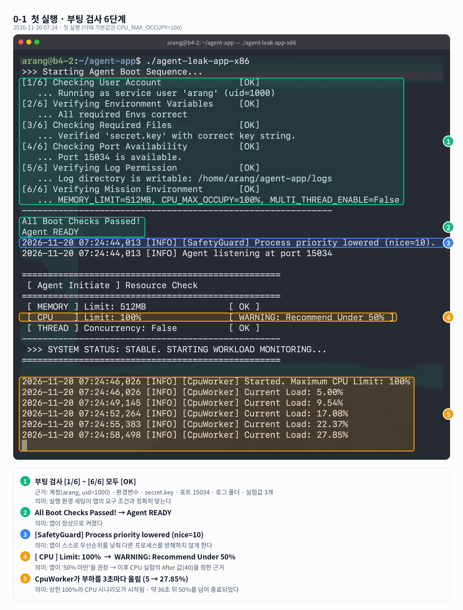
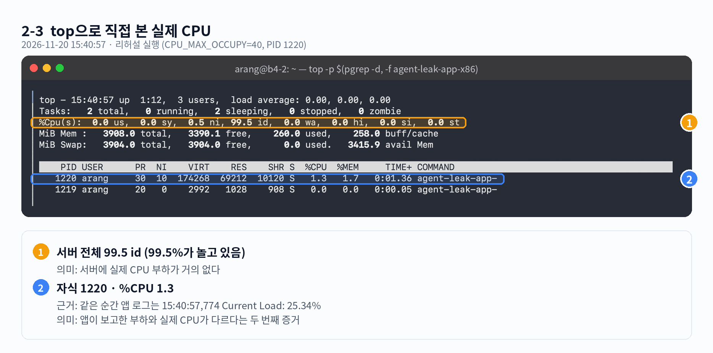
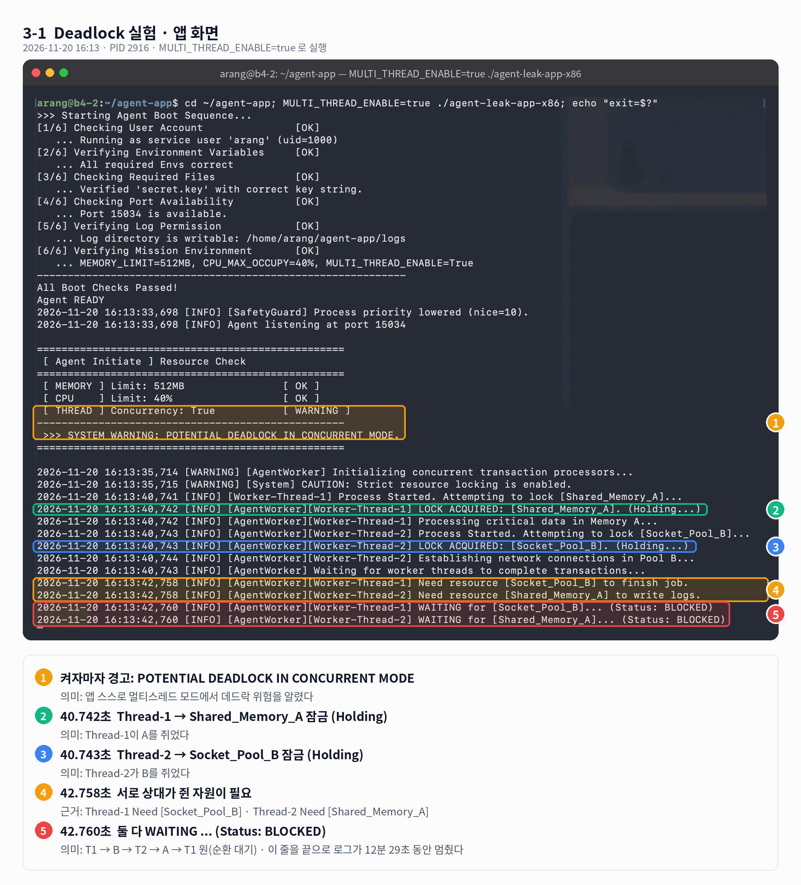
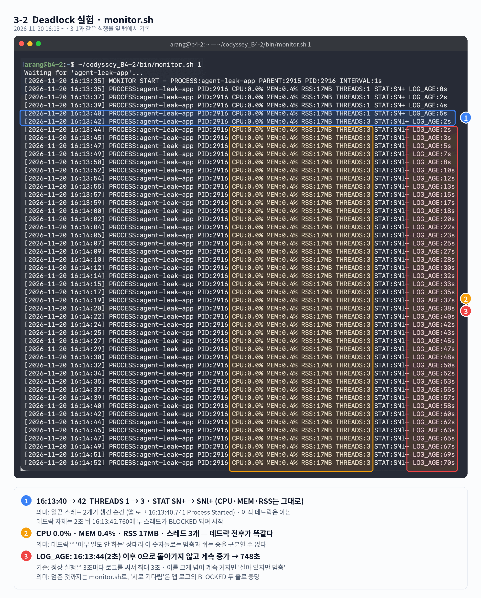
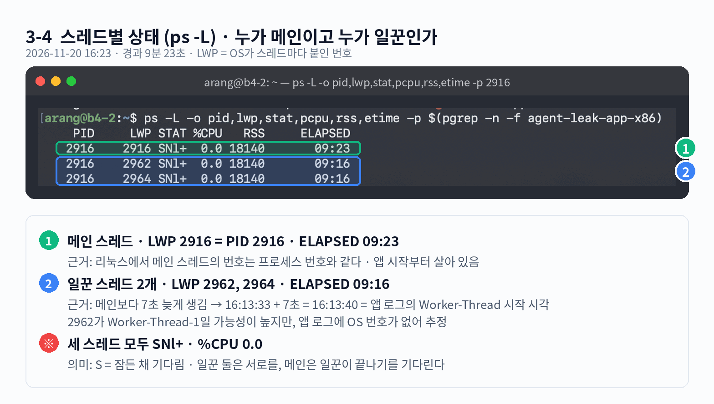

# B4-2 · 컴퓨터가 갑자기 느려지거나 멈췄을 때 원인 찾아 고치기

> 일부러 고장 나게 만든 프로그램을 실행해서 **3가지 장애를 직접 일으키고**,
> 관제 데이터와 로그를 증거로 원인을 밝혀 **GitHub Issue 형식의 리포트 3건**으로 남겼습니다.

**환경** UTM · Ubuntu Server 22.04.5 (x86_64) · CPU 2코어 · RAM 4GB
**범위** 필수 요구사항만 (보너스 제외)

 

## 📖 읽는 순서

| 순서 | 문서 | 내용 | 걸리는 시간 |
|:--:|:--|:--|:--:|
| 1 | **이 README** | 과제 소개 → 지급 프로그램 → 분석 방법 → 결과 → 스크린샷 → 그래프 → 개념 | 5분 |
| 2 | [수행과정.md](수행과정.md) | 제공 앱 분석 → VM 준비 → monitor.sh → 실험 4번 (명령 + 📸) | 10분 |
| 3 | [reports/](reports/) | 장애별 리포트 3건 | 각 5분 |
| 4 | [evaluation.md](evaluation.md) | 평가표 질문 원문 순서대로 답변 | 평가 때 |
| + | [📸 증거 스크린샷](#-증거-스크린샷) (이 README 안) | 증거 사진 16장, 사진마다 근거·의미 설명 | 필요할 때 |

 

## 🧩 이 과제는 무엇인가

### 상황

서버에서 돌던 프로그램이 **갑자기 꺼지거나**, 꺼지지는 않았는데 **아무 반응이 없는** 일이 생겼습니다.
이때 바로 재부팅하면 원인이 사라져서 같은 장애가 또 일어납니다.
그래서 **증거를 먼저 남기고, 원인을 찾고, 고친 뒤 정말 나아졌는지 비교**하는 연습을 하는 과제입니다.

> 🏥 **쉬운 비유:** 환자(프로그램)가 쓰러졌을 때 바로 약부터 주지 않고,
> 먼저 **검사 기록**(로그·관제 데이터)을 보고 **병명**(장애 원인)을 찾은 뒤,
> **처방**(환경변수 조정)을 하고 **경과**(Before & After)를 확인해서 **진료 기록**(리포트)을 남기는 것과 같습니다.

### 과제가 준 것과 요구한 것

| 구분 | 내용 |
|:--|:--|
| **받은 것** | 일부러 고장 나게 만든 프로그램 `agent-leak-app` → [아래에서 설명](#-지급된-프로그램-agent-leak-app) |
| **일으킬 장애** | 🔴 **OOM** 메모리가 넘쳐서 꺼짐 · 🟠 **CPU Spike** CPU를 과하게 써서 꺼짐 · 🟣 **Deadlock** 살아 있는데 멈춤 |
| **해야 할 일** | ① 장애를 재현하고 ② 증거를 남기고 ③ 원인을 설명하고 ④ 환경변수로 임시 조치한 뒤 ⑤ 전후를 비교 |
| **최종 결과물** | GitHub Issue 형식(현상 → 증거 → 원인 → 조치)의 **리포트 3건** |

 

## 📦 지급된 프로그램: agent-leak-app

과제가 `agent-app-leak.zip`을 줬고, 압축을 풀면 실행 파일 2개가 나옵니다. 이번에는 Intel Mac이라 `x86`을 썼습니다.

| 파일 | 대상 |
|:--|:--|
| `agent-leak-app-x86` | Intel · AMD |
| `agent-leak-app-arm64` | Apple M칩 |

과제 문서에는 실행 조건만 있어서 **직접 실행해 보고** 하는 일을 확인했습니다. → [수행과정 §1](수행과정.md#1-제공-앱-분석)

> **한 줄 요약:** 켤 때 내 세팅을 6가지로 검사하고, 켜진 뒤에는 **환경변수 3개의 값을 보고 어떤 장애를 일으킬지** 고르는 연습용 프로그램

### ① 켤 때: 실행 조건 6가지를 검사한다

| 단계 | 검사 내용 | 맞추는 방법 |
|:--:|:--|:--|
| 1/6 | root가 아닌 일반 계정인가 | 계정 `arang`으로 실행 (`sudo` 금지) |
| 2/6 | 필수 환경변수 5개 | `AGENT_HOME` · `AGENT_PORT=15034` · `AGENT_UPLOAD_DIR` · `AGENT_KEY_PATH` · `AGENT_LOG_DIR` |
| 3/6 | 키 파일 | `api_keys/secret.key` 내용 = `agent_api_key_test` |
| 4/6 | 포트 | 15034가 비어 있어야 함 |
| 5/6 | 로그 폴더 | 있어야 하고 쓰기 권한 필요 |
| 6/6 | 실험용 환경변수 3개 | 아래 표의 범위 안 |

하나라도 틀리면 `System Boot Failed`로 꺼지고, 모두 맞으면 `Agent READY`가 나옵니다. → [📸 0-1](#-0-실행-환경--앱-구조)

### ② 켜진 뒤: 환경변수 3개로 장애를 고른다

| 환경변수 | 범위 | 안전한 값 | 장애가 나는 값 | 일어나는 일 |
|:--|:--|:--:|:--:|:--|
| `MEMORY_LIMIT` | 50~512 (MB) | 512 | 128 | 🔴 메모리가 계속 늘다가 **MemoryGuard가 강제 종료** |
| `CPU_MAX_OCCUPY` | 10~100 (%) | 40 | 100 | 🟠 부하가 50%를 넘는 순간 **Watchdog이 종료** |
| `MULTI_THREAD_ENABLE` | true / false | false | true | 🟣 스레드 둘이 서로를 기다리며 **멈춤** |

세 값이 모두 안전하면 `Scenario Selected: [Healthy System Monitoring]` → 장애 없이 계속 동작합니다. 이 정상 실행을 세 실험의 **After**로 썼습니다.

### ③ 알아 둘 동작

| 관찰 | 분석에 준 영향 |
|:--|:--|
| 실행하면 **프로세스가 2개** 뜬다 (부모 = 껍데기, 자식 = 실제 일꾼) | monitor.sh는 **자식**을 재야 함 → [📸 0-2, 0-3](#-0-실행-환경--앱-구조) |
| 앱이 스스로 우선순위를 낮춘다 (`nice=10`) | 부하를 줘도 다른 프로세스를 덜 방해 |
| 로그를 `~/agent-app/logs/agent_app.log`에 쓴다 | 단, 마지막 경고(`SELF-TERMINATED`, `WATCHDOG`)는 **화면에만** 나옴 → 화면 캡처 필요 |

### ④ 과제 문서와 다른 점

직접 실행해 보니 문서와 다른 부분이 있어서 **실제 앱 동작을 기준**으로 했습니다.

| 과제 문서 | 실제 앱 |
|:--|:--|
| 실행 파일 `agent-app-leak-x86` | `agent-leak-app-x86` |
| 부팅 검사 단계 수 언급 없음 | 6단계 (실험용 환경변수 3개도 검사) |
| `CPU_MAX_OCCUPY`로 종료 기준 조정 | 이 값은 부하의 **상한**. 종료 기준은 약 50%로 고정 |
| top/ps로 CPU 급상승 확인 | 앱이 보고한 부하(51%)와 실제 CPU(0~10%)가 다름 → 둘 다 기록 |

### 이 프로그램으로 할 일

위의 3가지 장애를 하나씩 일으키고, 모두 같은 흐름(증거 → 원인 → 조치 → 비교)으로 분석합니다.

 

## 🔍 어떻게 분석했나

분석 과정을 **질문 5개**로 나눠 하나씩 풀었습니다. 앞 단계에서 알게 된 사실이 다음 단계의 방법을 정했습니다.

| 단계 | 궁금했던 것 | 한 일 | 알게 된 것 | 결과물 |
|:--:|:--|:--|:--|:--|
| **1** 앱 파악 | 이 앱은 무엇을 하나? | 문서에 조건만 있어서 **직접 실행** | 부팅 검사 6단계, 값에 따라 시나리오가 바뀜, **프로세스가 2개** → [위의 설명](#-지급된-프로그램-agent-leak-app) | [수행과정 §1](수행과정.md#1-제공-앱-분석) |
| **2** 관제 준비 | 무엇을 재야 하나? | B4-1 monitor.sh를 고쳐서 **자식 PID를 1초마다** 기록 | 부모는 메모리가 1MB에서 그대로라, 자식을 재야 누수가 보임 | [bin/monitor.sh](bin/monitor.sh) |
| **3** 실험 설계 | 원인을 어떻게 증명하나? | 정상값(512/40/false)에서 **값 하나만** 바꿔 4번 실행 | 바꾼 값 하나가 장애를 일으킨 원인이라고 말할 수 있음 | [logs/](logs/) |
| **4** 교차 확인 | 앱의 말이 사실인가? | **앱 로그**와 **OS 측정값**(ps·top·monitor.sh)을 나란히 비교 | 메모리는 일치, **CPU는 불일치**(앱 51% vs 실제 0~10%), 데드락은 PID 있음 + CPU 0 | [실측 그래프](#-실측-그래프) |
| **5** 기록 | 동료가 읽고 알 수 있나? | Issue 형식으로 PID·시각·로그·스크린샷을 붙여 정리 | 3건 모두 같은 4칸 구조 | [reports/](reports/) |

**장애를 구분한 기준** - 결국 세 가지 질문으로 어떤 장애인지 가렸습니다.

| 질문 | 확인 도구 | OOM | CPU Spike | Deadlock |
|:--|:--|:--:|:--:|:--:|
| 프로세스가 살아 있나? | `ps -ef` | ✘ 꺼짐 | ✘ 꺼짐 | ✔ **살아 있음** |
| 마지막 로그는? | 앱 로그 | `MemoryGuard` | `WATCHDOG` | `BLOCKED` |
| 무엇이 변했나? | monitor.sh | **메모리** 증가 | 앱이 보고한 **부하** 증가 | 아무것도 안 변함 (**로그만 멈춤**) |

 

## 📌 결과 한눈에

| | 🔴 [OOM](reports/01-oom.md) | 🟠 [CPU Spike](reports/02-cpu.md) | 🟣 [Deadlock](reports/03-deadlock.md) |
|:--|:--|:--|:--|
| **증상** | 17초 만에 꺼짐 | 46초 만에 꺼짐 | 꺼지지 않고 **멈춤** |
| **원인** | 메모리를 빌리고 반납 안 함 | 부하 상한이 종료 기준보다 높음 | 두 스레드가 서로를 기다림 |
| **누가 껐나** | MemoryGuard (SIGKILL) | Watchdog (SIGTERM) | 아무도 안 끔 → 사람이 Ctrl+C |
| **조치** | `MEMORY_LIMIT` 128 → **512** | `CPU_MAX_OCCUPY` 100 → **40** | `MULTI_THREAD_ENABLE` → **false** |
| **After** | ✅ 8분 이상 생존 | ✅ 8분 이상 생존 | ✅ 로그가 계속 쌓임 |

> 표의 장애 이름을 누르면 리포트(현상 → 증거 → 원인 → 조치)로 이동합니다.

 

## 📸 증거 스크린샷

모두 **내 VM에서 직접 찍은 화면**입니다. 사진마다 **맥 터미널 창 틀**(제목 = 실제로 친 명령), **봐야 할 줄 강조**(색 상자 + 번호), **근거와 의미 설명**을 붙였습니다.
손대지 않은 원본은 `screenshots/<실험>/original/`에 그대로 있습니다.

> ▶ 제목을 누르면 펼쳐집니다.

| 실험 | 사진 | 무엇을 보여 주나 |
|:--|:--|:--|
| 0. 실행 환경 · 앱 구조 | 0-1 · 0-2 · 0-3 | 부팅 검사 6단계 OK, 프로세스 2개(부모·자식) 확인 |
| 1. 🔴 OOM 실험 | 1-1 · 1-2 | MEMORY_LIMIT=128 → 메모리 누수 → MemoryGuard 강제 종료 |
| 2. 🟠 CPU Spike 실험 | 2-1 · 2-2 · 2-3 | CPU_MAX_OCCUPY=100 → Watchdog 종료, 실제 CPU와 비교 |
| 3. 🟣 Deadlock 실험 | 3-1 · 3-2 · 3-3 · 3-4 · 3-5 · 3-6 | MULTI_THREAD_ENABLE=true → 살아 있지만 멈춘 상태 진단 |
| 4. ✅ 정상 실행 (세 실험의 After) | 4-1 · 4-2 | 512 / 40 / false로 8분 동안 정상 동작 |

### 📸 0. 실행 환경 · 앱 구조

<b>부팅 검사 6단계 OK, 프로세스 2개(부모·자식) 확인</b> · 3장 펼치기

 

**0-1  첫 실행 · 부팅 검사 6단계** · 2026-11-20 07:24 · 첫 실행 (이때 기본값은 CPU_MAX_OCCUPY=100)

**0-2  프로세스는 2개 (부모 · 자식)** · 2026-11-20 14:38 · 리허설 실행 중 ps 확인

**0-3  일하는 쪽은 자식** · 2026-11-20 14:39:24 · 다시 실행해서 PID가 바뀜 (부모 1134 · 자식 1135)

### 📸 1. 🔴 OOM 실험

<b>MEMORY_LIMIT=128 → 메모리 누수 → MemoryGuard 강제 종료</b> · 2장 펼치기

 

**1-1  OOM 실험 · 앱 화면** · 2026-11-20 16:06 · PID 2363 · MEMORY_LIMIT=128 로 실행

**1-2  OOM 실험 · monitor.sh** · 2026-11-20 16:06 · 1-1과 같은 실행을 옆 탭에서 기록

### 📸 2. 🟠 CPU Spike 실험

<b>CPU_MAX_OCCUPY=100 → Watchdog 종료, 실제 CPU와 비교</b> · 3장 펼치기

 

**2-1  CPU 실험 · 앱 화면** · 2026-11-20 16:09 · PID 2606 · CPU_MAX_OCCUPY=100 으로 실행

**2-2  CPU 실험 · monitor.sh** · 2026-11-20 16:09 · 2-1과 같은 실행을 옆 탭에서 기록

**2-3  top으로 직접 본 실제 CPU** · 2026-11-20 15:40:57 · 리허설 실행 (CPU_MAX_OCCUPY=40, PID 1220)

### 📸 3. 🟣 Deadlock 실험

<b>MULTI_THREAD_ENABLE=true → 살아 있지만 멈춘 상태 진단</b> · 6장 펼치기

 

**3-1  Deadlock 실험 · 앱 화면** · 2026-11-20 16:13 · PID 2916 · MULTI_THREAD_ENABLE=true 로 실행

**3-2  Deadlock 실험 · monitor.sh** · 2026-11-20 16:13 ~ · 3-1과 같은 실행을 옆 탭에서 기록

**3-3  살아 있다 (PID 존재)** · 2026-11-20 16:23 · 데드락 약 9분 뒤

**3-4  스레드별 상태 (ps -L) · 누가 메인이고 누가 일꾼인가** · 2026-11-20 16:23 · 경과 9분 23초 · LWP = OS가 스레드마다 붙인 번호

**3-5  스레드별 CPU (top -H)** · 2026-11-20 16:23:11

**3-6  Ctrl+C로 종료** · 2026-11-20 16:26:11 · 마지막 로그(16:13:42)부터 12분 29초 뒤

### 📸 4. ✅ 정상 실행 (세 실험의 After)

<b>512 / 40 / false로 8분 동안 정상 동작</b> · 2장 펼치기

 

**4-1  정상 실행 · 앱 화면 (세 실험의 After)** · 2026-11-20 16:29 ~ 16:37 · PID 7633 · 512 / 40 / false (값을 바꾸지 않음)

**4-2  정상 실행 · monitor.sh** · 2026-11-20 16:36 ~ 16:37 · 4-1과 같은 실행의 마지막 부분

 

## 📊 실측 그래프

모든 그래프는 [monitor.sh](bin/monitor.sh)가 1초 간격으로 남긴 [로그 원본](logs/)으로 그렸습니다.

### 🔴 OOM - 메모리가 3초마다 25MB씩 일직선으로 증가

- **Before** (한도 128MB): 150MB가 되자 앱이 스스로를 강제 종료 (`exit=137`)
- **After** (한도 512MB): 525MB에 닿을 때마다 스스로 정리하며 8분 동안 동작

### 🟠 CPU Spike - 앱이 보고한 부하가 50%를 넘는 순간 종료

- **Before** (상한 100%): 부하가 51.22%가 되자 Watchdog이 종료 (`exit=143`)
- **After** (상한 40%): 40%에서 식혔다가 다시 오르기를 반복하며 8분 동안 동작
- 앱이 보고한 부하(파랑)와 OS가 잰 실제 CPU(주황)가 **다릅니다.** → [리포트 §2](reports/02-cpu.md#2-evidence--logs-증거-자료)

### 🟣 Deadlock - 살아 있지만 아무것도 안 하는 상태

- **Before** (멀티스레드 켬): Thread-1은 A를 쥐고 B를, Thread-2는 B를 쥐고 A를 기다려 **12분 29초 동안 로그 0줄**
- **After** (멀티스레드 끔): 서로 기다릴 상대가 없어 로그가 계속 쌓임

 

## 💡 핵심 개념

| 용어 | 쉬운 말 |
|:--|:--|
| **프로세스 / PID** | 실행 중인 프로그램 하나 / 그 번호. "살아 있다" = PID가 있다 |
| **스레드** | 한 프로세스 안의 일꾼 여러 명 |
| **RSS** | 프로세스가 **실제로 차지한** 메모리 |
| **메모리 누수** | 빌린 메모리를 반납하지 않아 계속 쌓이는 것 |
| **MemoryGuard / Watchdog** | 앱 안의 감시 장치. 기준을 넘으면 **자기 자신을** 끈다 |
| **SIGTERM / SIGKILL** | "정리하고 꺼져"(15) / "지금 당장 꺼져"(9). 종료 코드 = 128 + 번호 → 143 / 137 |
| **락 (Lock)** | 공용 자원의 열쇠. 쥔 스레드만 쓸 수 있다 |
| **데드락** | 서로가 서로의 열쇠를 기다리며 영원히 멈추는 것 |

<b>그림으로 보기 (메모리 누수 · CPU 과점유 · 데드락)</b>

 

 

## 📁 폴더 구조

| 위치 | 내용 |
|:--|:--|
| `README.md` | 지금 보는 문서 - 과제 · 프로그램 · 분석 · 결과 · 그래프 · 개념 |
| [`수행과정.md`](수행과정.md) | 무엇을 어떤 순서로 했나 - 명령 + 📸 |
| [`evaluation.md`](evaluation.md) | 평가표 항목 1~4 답변 |
| [`reports/`](reports/) | 🔴 `01-oom.md` · 🟠 `02-cpu.md` · 🟣 `03-deadlock.md` |
| [`bin/monitor.sh`](bin/monitor.sh) | 관제 스크립트 |
| [`logs/`](logs/) | 실험 4번의 로그 원본 8개 |
| `screenshots/` | 스크린샷 이미지 파일 16장 (README의 [📸 증거 스크린샷](#-증거-스크린샷)에서 보여 줌) · 원본은 `original/` |
| [`images/`](images/) | 개념 그림(`00`~`06`) · 실측 그래프(`chart_*`) |
