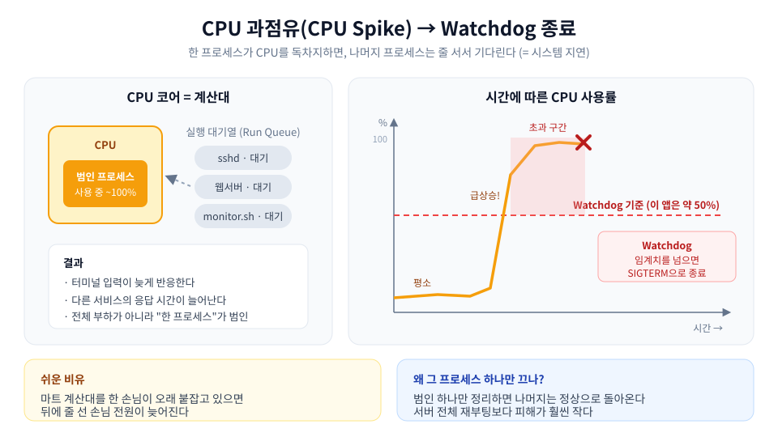

# B4-2 · 컴퓨터가 갑자기 느려지거나 멈췄을 때 원인 찾아 고치기

> 일부러 고장 나게 만든 프로그램을 실행해서 **3가지 장애를 직접 일으키고**,
> 관제 데이터와 로그를 증거로 원인을 밝혀 **GitHub Issue 형식의 리포트 3건**으로 남겼습니다.

**환경** UTM · Ubuntu Server 22.04.5 (x86_64) · CPU 2코어 · RAM 4GB
**범위** 필수 요구사항만 (보너스 제외)

 

## 📌 결과 한눈에

| | 🔴 [OOM](reports/01-oom.md) | 🟠 [CPU Spike](reports/02-cpu.md) | 🟣 [Deadlock](reports/03-deadlock.md) |
|:--|:--|:--|:--|
| **증상** | 17초 만에 꺼짐 | 46초 만에 꺼짐 | 꺼지지 않고 **멈춤** |
| **원인** | 메모리를 빌리고 반납 안 함 | 부하 상한이 종료 기준보다 높음 | 두 스레드가 서로를 기다림 |
| **누가 껐나** | MemoryGuard (SIGKILL) | Watchdog (SIGTERM) | 아무도 안 끔 → 사람이 Ctrl+C |
| **조치** | `MEMORY_LIMIT` 128 → **512** | `CPU_MAX_OCCUPY` 100 → **40** | `MULTI_THREAD_ENABLE` → **false** |
| **After** | ✅ 8분 이상 생존 | ✅ 8분 이상 생존 | ✅ 로그가 계속 쌓임 |

> 표의 장애 이름을 누르면 리포트(현상 → 증거 → 원인 → 조치)로 이동합니다.

 

## 📖 읽는 순서

| 순서 | 문서 | 내용 | 걸리는 시간 |
|:--:|:--|:--|:--:|
| 1 | **이 README** | 결과, 그래프, 핵심 개념 | 3분 |
| 2 | [수행과정.md](수행과정.md) | 제공 앱 분석 → VM 준비 → monitor.sh → 실험 4번 (명령 + 📸) | 10분 |
| 3 | [reports/](reports/) | 장애별 리포트 3건 | 각 5분 |
| 4 | [evaluation.md](evaluation.md) | 평가표 질문 원문 순서대로 답변 | 평가 때 |

 

## 🔄 전체 흐름

재부팅부터 하지 않고, **증거를 먼저 남기고 → 원인을 찾고 → 값 하나만 바꿔 → 전후를 비교**했습니다.

 

## 📊 실측 그래프

모든 그래프는 [monitor.sh](bin/monitor.sh)가 1초 간격으로 남긴 [로그 원본](logs/)으로 그렸습니다.

### 🔴 OOM - 메모리가 3초마다 25MB씩 일직선으로 증가

- **Before** (한도 128MB): 150MB가 되자 앱이 스스로를 강제 종료 (`exit=137`)
- **After** (한도 512MB): 525MB에 닿을 때마다 스스로 정리하며 8분 동안 동작

### 🟠 CPU Spike - 앱이 보고한 부하가 50%를 넘는 순간 종료

- **Before** (상한 100%): 부하가 51.22%가 되자 Watchdog이 종료 (`exit=143`)
- **After** (상한 40%): 40%에서 식혔다가 다시 오르기를 반복하며 8분 동안 동작
- 앱이 보고한 부하(파랑)와 OS가 잰 실제 CPU(주황)가 **다릅니다.** → [리포트 §2](reports/02-cpu.md#2-evidence--logs-증거-자료)

### 🟣 Deadlock - 살아 있지만 아무것도 안 하는 상태

- **Before** (멀티스레드 켬): Thread-1은 A를 쥐고 B를, Thread-2는 B를 쥐고 A를 기다려 **12분 29초 동안 로그 0줄**
- **After** (멀티스레드 끔): 서로 기다릴 상대가 없어 로그가 계속 쌓임

 

## 💡 핵심 개념

| 용어 | 쉬운 말 |
|:--|:--|
| **프로세스 / PID** | 실행 중인 프로그램 하나 / 그 번호. "살아 있다" = PID가 있다 |
| **스레드** | 한 프로세스 안의 일꾼 여러 명 |
| **RSS** | 프로세스가 **실제로 차지한** 메모리 |
| **메모리 누수** | 빌린 메모리를 반납하지 않아 계속 쌓이는 것 |
| **MemoryGuard / Watchdog** | 앱 안의 감시 장치. 기준을 넘으면 **자기 자신을** 끈다 |
| **SIGTERM / SIGKILL** | "정리하고 꺼져"(15) / "지금 당장 꺼져"(9). 종료 코드 = 128 + 번호 → 143 / 137 |
| **락 (Lock)** | 공용 자원의 열쇠. 쥔 스레드만 쓸 수 있다 |
| **데드락** | 서로가 서로의 열쇠를 기다리며 영원히 멈추는 것 |

<b>그림으로 보기 (메모리 누수 · CPU 과점유 · 데드락)</b>

 

 

## ⚠️ 과제 문서와 다른 점

직접 실행해 보니 문서와 다른 부분이 있어서 **실제 앱 동작을 기준**으로 했습니다.

| 과제 문서 | 실제 앱 |
|:--|:--|
| 실행 파일 `agent-app-leak-x86` | `agent-leak-app-x86` |
| 부팅 검사 단계 수 언급 없음 | 6단계 (실험용 환경변수 3개도 검사) |
| `CPU_MAX_OCCUPY`로 종료 기준 조정 | 이 값은 부하의 **상한**. 종료 기준은 약 50%로 고정 |
| top/ps로 CPU 급상승 확인 | 앱이 보고한 부하(51%)와 실제 CPU(0~10%)가 다름 → 둘 다 기록 |

 

## 📁 폴더 구조

| 위치 | 내용 |
|:--|:--|
| `README.md` | 지금 보는 문서 - 결과 · 그래프 · 개념 |
| [`수행과정.md`](수행과정.md) | 무엇을 어떤 순서로 했나 - 명령 + 📸 |
| [`evaluation.md`](evaluation.md) | 평가표 항목 1~4 답변 |
| [`reports/`](reports/) | 🔴 `01-oom.md` · 🟠 `02-cpu.md` · 🟣 `03-deadlock.md` |
| [`bin/monitor.sh`](bin/monitor.sh) | 관제 스크립트 |
| [`logs/`](logs/) | 실험 4번의 로그 원본 8개 |
| [`images/`](images/) | 개념 그림(`00`~`05`) · 실측 그래프(`chart_*`) · [VM 스크린샷 16장](images/evidence/) |
