# B4-2 · 컴퓨터가 갑자기 느려지거나 멈췄을 때 원인 찾아 고치기

> 일부러 고장 나게 만든 프로그램(`agent-leak-app`)을 실행해서 **3가지 장애(OOM · CPU Spike · Deadlock)를 직접 일으키고**, 관제 데이터와 로그를 증거로 원인을 밝혀 **GitHub Issue 형식의 리포트 3건**으로 남긴 과제입니다.

**환경:** iMac(Intel) + UTM, Ubuntu Server 22.04.5 LTS (x86_64), CPU 2코어 · RAM 4GB, VM `192.168.64.5`, 계정 `arang` · **범위:** 필수 요구사항만 (보너스 제외)


| 순서 | 내용 | 언제 보나 |
|---|---|---|
| 1 | [제공 앱은 무엇인가](#1-제공-앱은-무엇인가) | 과제가 준 프로그램이 하는 일 |
| 2 | [결과 요약](#2-결과-요약) | 다 됐는지 1분 안에 확인 |
| 3 | [핵심 개념](#3-핵심-개념) | 용어가 낯설 때 |
| 4 | [단계별 수행](#4-단계별-수행) | 무엇을 어떤 순서로 했는지 (명령 + 📸) |
| 5 | [부록](#5-부록) | 파일 구성, 과제 문서와 다른 점 |

| 문서 | 내용 |
|---|---|
| **README.md** (이 문서) | 무엇을 왜 어떻게 했나: 개념, 단계별 명령과 설명 |
| **[reports/01-oom.md](reports/01-oom.md)** | 🔴 OOM 리포트 (현상 → 증거 → 원인 → 조치) |
| **[reports/02-cpu.md](reports/02-cpu.md)** | 🟠 CPU Spike 리포트 |
| **[reports/03-deadlock.md](reports/03-deadlock.md)** | 🟣 Deadlock 리포트 |
| **[evaluation.md](evaluation.md)** | 평가표 항목 1~4 질문 원문 순서대로 답변 |

---

## 1. 제공 앱은 무엇인가

과제는 `agent-app-leak.zip`을 줍니다. 압축을 풀면 `agent-leak-app-x86`(Intel · AMD용)과 `agent-leak-app-arm64`(M칩용)가 나옵니다. 문서에는 조건만 있어서 **직접 실행해 보고 화면과 로그로 확인했습니다.** 한 줄로 요약하면 이렇습니다.

> **켤 때는 내 세팅을 검사하고, 켜진 뒤에는 환경변수 3개의 값에 따라 "어떤 장애를 일으킬지" 고르는 앱**

**역할 ① 채점기: 켤 때 6가지를 검사합니다** (📸 [0-1](images/evidence/0-1_boot_ok.png))

| 부팅 검사 | 검사하는 것 | 이번 결과 |
|---|---|---|
| [1/6] | root가 아닌 일반 계정인가 | `Running as service user 'arang' (uid=1000)` |
| [2/6] | 필수 환경변수 5개 (`AGENT_HOME` 등) | `All required Envs correct` |
| [3/6] | `api_keys/secret.key` 내용이 `agent_api_key_test`인가 | `Verified 'secret.key'` |
| [4/6] | 15034 포트가 비어 있나 | `Port 15034 is available.` |
| [5/6] | 로그 폴더에 쓸 수 있나 | `Log directory is writable` |
| [6/6] | **실험용 환경변수 3개**의 값이 범위 안인가 | `MEMORY_LIMIT=512MB, CPU_MAX_OCCUPY=100%, ...` |

**역할 ② 장애 발생기: 환경변수 값을 보고 시나리오를 고릅니다**

| 설정 | 부팅 직후 경고 | 일어나는 일 |
|---|---|---|
| 512 / 40 / false (전부 안전) | 없음 · `Scenario Selected: [Healthy System Monitoring]` | 메모리·CPU가 오르다가 **스스로 정리**하며 계속 동작 |
| `MEMORY_LIMIT=128` | `Recommend Over 256MB` | 메모리가 계속 늘다가 **MemoryGuard가 강제 종료** |
| `CPU_MAX_OCCUPY=100` | `Recommend Under 50%` | 부하가 50%를 넘는 순간 **Watchdog이 종료** |
| `MULTI_THREAD_ENABLE=true` | `POTENTIAL DEADLOCK IN CONCURRENT MODE.` | 스레드 둘이 서로 기다리며 **멈춤** |

**그 밖에 확인한 것**

| 관찰 | 의미 |
|---|---|
| 프로세스가 **2개** 뜸 (📸 [0-2](images/evidence/0-2_parent_child_ps.png)) | PyInstaller 실행 파일이라 부모가 압축을 풀고 **자식이 실제로 일함** → 관제는 **자식**을 재야 함 |
| 자식만 `NI 10` (📸 [0-3](images/evidence/0-3_parent_child_top.png)) | 앱이 스스로 우선순위를 낮춤 (`[SafetyGuard] Process priority lowered (nice=10)`) |
| 로그를 `~/agent-app/logs/agent_app.log`에 씀 | 단, `SELF-TERMINATED`, `WATCHDOG ... SIGTERM` 같은 마지막 경고는 **화면에만** 나옴 → 화면 캡처가 필요 |

---

## 2. 결과 요약

| 과제 요구사항 | 결과 | 근거 |
|---|---|---|
| [OOM] 메모리가 선형으로 늘다가 강제 종료되는 패턴 | ✅ RSS 17 → 143MB, 3초마다 25MB · 17초 만에 SIGKILL | [리포트 §2](reports/01-oom.md#2-evidence--logs-증거-자료) |
| [OOM] `MEMORY_LIMIT` 조정 Before & After (2회 이상) | ✅ 128 → 17초 종료 / 512 → 8분 이상 생존 | [리포트 §4](reports/01-oom.md#4-workaround--verification-조치-및-검증) |
| [CPU] 임계치 초과로 종료되는 패턴 | ✅ 51.22%에서 `WATCHDOG ... SIGTERM` (6번 중 6번) | [리포트 §2](reports/02-cpu.md#2-evidence--logs-증거-자료) |
| [CPU] `CPU_MAX_OCCUPY` 조정 Before & After | ✅ 100 → 46초 종료 / 40 → 8분 이상 생존 | [리포트 §4](reports/02-cpu.md#4-workaround--verification-조치-및-검증) |
| [Deadlock] PID는 있는데 CPU·메모리·로그가 멈춘 상태 식별 | ✅ PID 2916 · 스레드 3개 CPU 0% · 로그 12분 29초 정지 | [리포트 §2](reports/03-deadlock.md#2-evidence--logs-증거-자료) |
| [Deadlock] `MULTI_THREAD_ENABLE` 조정 재현/회피 | ✅ true → 재현 / false → 회피 | [리포트 §4](reports/03-deadlock.md#4-workaround--verification-조치-및-검증) |
| [Format] 3건 모두 현상 → 증거 → 원인 → 조치 | ✅ 3건 같은 4칸 구조 | [reports/](reports/) |
| [Evidence] PID · 타임스탬프 · 핵심 로그 첨부 | ✅ 스크린샷 16장 + 로그 원본 8개 | [images/evidence/](images/evidence/) · [logs/](logs/) |

### 3가지 장애 한눈에

| | 🔴 OOM | 🟠 CPU Spike | 🟣 Deadlock |
|---|---|---|---|
| 겉으로 보인 것 | 17초 만에 꺼짐 | 46초 만에 꺼짐 | **꺼지지 않고** 멈춤 |
| 핵심 로그 | `[MemoryGuard] Self-terminating process 2363` | `CPU Threshold Violated!` → `WATCHDOG ... (SIGTERM)` | `WAITING for [...] (Status: BLOCKED)` ×2 |
| 종료 코드 | 137 = SIGKILL | 143 = SIGTERM | 없음 (사람이 Ctrl+C) |
| 진짜 원인 | 메모리를 빌리고 반납하지 않음 (누수) | 부하 상한이 Watchdog 기준(약 50%)보다 높음 | 두 스레드가 서로 상대의 잠금을 기다림 |
| 임시 조치 | `MEMORY_LIMIT` 128 → **512** | `CPU_MAX_OCCUPY` 100 → **40** | `MULTI_THREAD_ENABLE` true → **false** |
| After | 8분 이상 생존 | 8분 이상 생존 | 로그가 계속 쌓임 |

| OOM | CPU Spike | Deadlock |
|---|---|---|
|  | 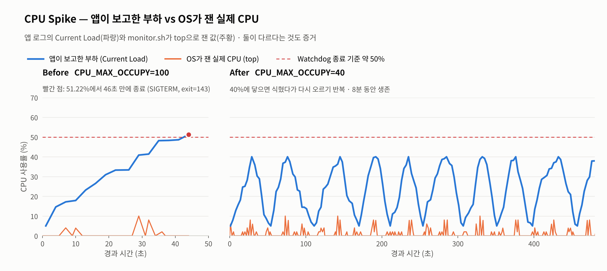 | 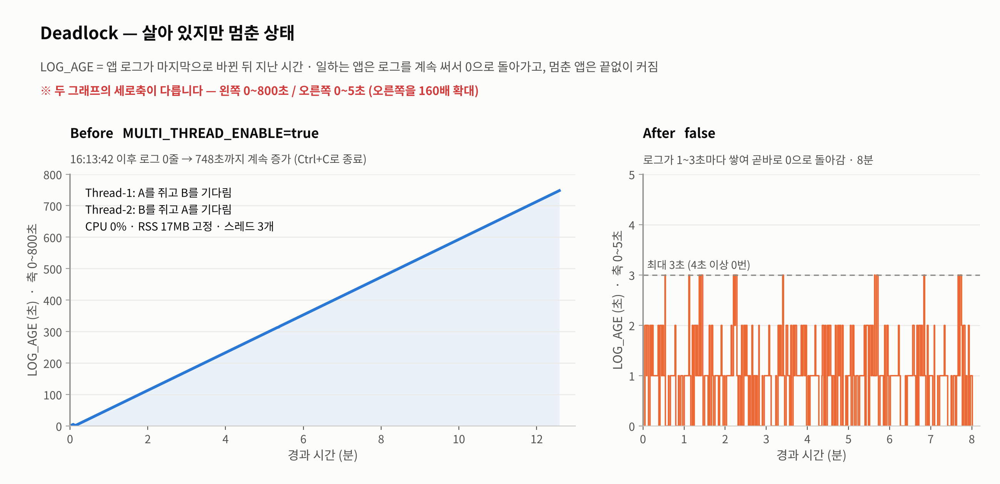 |

> **과제 문서와 다른 점 4가지** → [부록 B](#b-과제-문서와-다른-점)
> 실행 파일 이름, 부팅 검사 6단계, CPU 종료 기준이 설정과 상관없이 약 50%로 고정, 앱이 보고하는 CPU 부하와 실제 CPU가 다름

---

## 3. 핵심 개념

| 용어 | 쉬운 말 | 이 과제에서 |
|---|---|---|
| 프로세스 / PID | 실행 중인 프로그램 하나 / 그 번호 | "살아 있다" = PID가 있다 |
| 부모 · 자식 프로세스 | 프로그램이 다른 프로세스를 띄움 | 이 앱은 부모(껍데기) + **자식(진짜 일꾼)** |
| 스레드 | 한 프로세스 안의 일꾼 여러 명 (메모리를 같이 씀) | 데드락의 주인공. 메인 1 + 일꾼 2 = 3개 |
| 프로세스 상태 (STAT) | `R` 일하는 중 · `S` 기다리는 중 · `N` 우선순위 낮춤 · `l` 멀티스레드 | 데드락 = `SNl+`, CPU 0% |
| Heap | 실행 중에 필요할 때 빌려 쓰는 메모리 칸 | 누수가 생기는 곳 |
| 메모리 누수 | 빌리고 반납하지 않아 계속 쌓임 | RSS가 일직선으로 증가 |
| RSS | 프로세스가 **실제로 차지한** 물리 메모리 | monitor.sh가 잰 값 |
| OOM | Out Of Memory, 메모리 부족 | 한도를 넘어 강제 종료 |
| MemoryGuard / Watchdog | 앱 안의 감시 장치 (메모리 / CPU) | 기준을 넘으면 **자기 자신을** 종료 |
| 시그널 | 프로세스에 보내는 신호. TERM(15) = 정리하고 꺼져, KILL(9) = 즉시 강제 종료 | 종료 코드 = 128 + 신호 번호 → 143, 137 |
| 스케줄러 | CPU 시간을 프로세스들에 나눠 주는 OS의 관리자 | 한 프로세스가 독차지하면 나머지가 대기 |
| 락 (Lock) | 공용 자원의 열쇠. 쥔 스레드만 사용 | `Shared_Memory_A`, `Socket_Pool_B` |
| 데드락 | 서로가 서로의 열쇠를 기다리며 영원히 멈춤 | 상호 배제 + 점유 대기 + 비선점 + **순환 대기** |

| 메모리 누수 → OOM | CPU 과점유 → Watchdog | 데드락 |
|---|---|---|
|  |  |  |

---

## 4. 단계별 수행

내 VM에서 **실제로 실행한 명령**과 **📸 증거**입니다.

| 표시 | 어디서 | 프롬프트 |
|---|---|---|
| `[MAC]` | Mac 터미널 (VM에 접속하기 전) | `… ~ %` |
| `[SSH 탭 1]` | Mac에서 `ssh arang@192.168.64.5`로 접속한 VM · **앱 실행 전용** | `arang@b4-2:~$` |
| `[SSH 탭 2]` | 같은 VM, 새 탭 · **monitor.sh 전용** | `arang@b4-2:~$` |
| `[SSH 탭 3]` | 같은 VM, 새 탭 · **확인 명령** (`ps`, `top`) | `arang@b4-2:~$` |

> ⚠️ **명령은 한 줄(한 명령)씩 붙여넣으세요.** `cat`부터 `EOF`까지처럼 여러 줄이 한 명령인 곳은 따로 표시했습니다.

### 0단계. VM 준비

B4-1과 다른 Mac이라 **새 VM**을 만들었습니다. B4-2는 SSH 잠그기, 방화벽, 계정·권한 설정이 요구사항이 아니라서 **하지 않았습니다.**

| 순서 | 할 일 |
|---|---|
| 1 | UTM 설치, Ubuntu Server **22.04.5 amd64** iso 받기 (아래 명령) |
| 2 | UTM → `+` → 가상화 → Linux → iso 선택 · 메모리 **4096MB** · CPU 코어 **2** |
| 3 | 설치: 계정 `arang`, 서버 이름 **`b4-2`**, **Install OpenSSH server 체크** |
| 4 | 설치 후 CD 꺼내기 → 재부팅 → `ip -4 addr show`로 주소 확인 (`192.168.64.5`) |

```bash
# [MAC] UTM 받기 → 홈 폴더 Applications에 설치 (관리자 권한 없어도 됨)
curl -L -o ~/Downloads/UTM.dmg https://github.com/utmapp/UTM/releases/latest/download/UTM.dmg
hdiutil attach ~/Downloads/UTM.dmg
mkdir -p ~/Applications
cp -R /Volumes/UTM/UTM.app ~/Applications/
hdiutil detach /Volumes/UTM

# [MAC] Ubuntu Server iso + 체크섬 확인 → 결과: ...amd64.iso: OK
cd ~/Downloads
curl -L -O https://releases.ubuntu.com/22.04.5/ubuntu-22.04.5-live-server-amd64.iso
curl -L -O https://releases.ubuntu.com/22.04.5/SHA256SUMS
grep "live-server-amd64.iso" SHA256SUMS | shasum -a 256 -c -
```

**CPU를 2코어로 정한 이유:** UTM은 따로 정하지 않으면 Mac의 코어를 전부(이번엔 16개) 줍니다. CPU 사용률을 서버 전체 기준으로 재면 코어가 많을수록 값이 작게 나와서 실험이 흐려질 수 있고, 2코어면 실험 중에도 SSH 창이 버벅이지 않습니다.

```bash
# [MAC] VM 접속 (처음엔 yes 입력 후 비밀번호)
ssh arang@192.168.64.5

# [SSH] 시간대를 한국 시간으로 (로그 타임스탬프가 증거라서 꼭 맞춤)
sudo timedatectl set-timezone Asia/Seoul
sudo apt update
sudo apt install -y unzip

# [SSH] ✔ 확인 → 결과: 2 / Mem total 3.8Gi
nproc
free -h
```

### 1단계. 앱 파일 · 폴더 · 키 · 환경변수

```bash
# [MAC] (새 탭) zip을 VM 홈으로 복사
scp ~/Downloads/agent-app-leak.zip arang@192.168.64.5:~/

# [SSH] 풀기 (Mac이 끼워 넣은 __MACOSX 폴더는 지움)
mkdir -p ~/agent-app
unzip ~/agent-app-leak.zip -d ~/agent-app
rm -rf ~/agent-app/__MACOSX

# [SSH] 앱이 요구하는 폴더 3개 + 키 파일
mkdir -p ~/agent-app/upload_files ~/agent-app/api_keys ~/agent-app/logs
echo "agent_api_key_test" > ~/agent-app/api_keys/secret.key
```

환경변수 8개를 `~/.bashrc`에 넣습니다. 실험용 3개는 **정상(안전한) 값**을 기본으로 두고, 실험할 때만 명령 앞에 붙여서 바꿉니다 (예: `MEMORY_LIMIT=128 ./앱` → 그 실행에만 적용).

```bash
# [SSH] cat 줄부터 EOF 줄까지 10줄이 한 명령
cat >> ~/.bashrc << 'EOF'
export AGENT_HOME=/home/arang/agent-app
export AGENT_PORT=15034
export AGENT_UPLOAD_DIR=$AGENT_HOME/upload_files
export AGENT_KEY_PATH=$AGENT_HOME/api_keys
export AGENT_LOG_DIR=$AGENT_HOME/logs
export MEMORY_LIMIT=512
export CPU_MAX_OCCUPY=40
export MULTI_THREAD_ENABLE=false
EOF
```

```bash
# [SSH] 지금 창에 적용 → ✔ 결과: 8줄
source ~/.bashrc
env | grep -E "AGENT_|MEMORY_LIMIT|CPU_MAX_OCCUPY|MULTI_THREAD" | sort
```

| 정상 기본값 | 이유 |
|---|---|
| `MEMORY_LIMIT=512` | 범위(50~512)의 최대값. 앱 권장 "256 이상" |
| `CPU_MAX_OCCUPY=40` | 앱 권장 "50 미만" |
| `MULTI_THREAD_ENABLE=false` | 켜면 앱이 데드락 경고 |

### 2단계. 앱 실행 확인

```bash
# [SSH 탭 1] ✔ 결과: [1/6]~[6/6] [OK] → All Boot Checks Passed! → Agent READY  (📸 0-1)
cd ~/agent-app
./agent-leak-app-x86

# [SSH 탭 2] ✔ 프로세스 구조 → 결과: 2줄, 두 번째의 부모(PPID)가 첫 번째  (📸 0-2)
ps -ef | grep [a]gent-leak

# [SSH 탭 2] ✔ 결과: 부모 RES 약 1MB · NI 0 / 자식 RES 약 18MB · NI 10  (📸 0-3, q로 나옴)
top -p $(pgrep -d, -f agent-leak-app-x86)
```

| 📸 0-1 부팅 6단계 OK | 📸 0-2 부모·자식 | 📸 0-3 자식이 일꾼 |
|---|---|---|
| 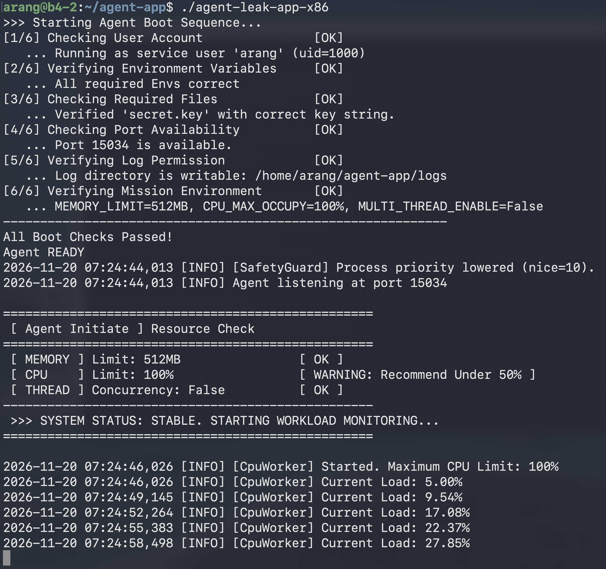 | 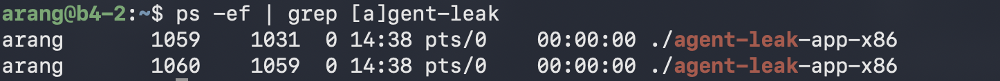 | 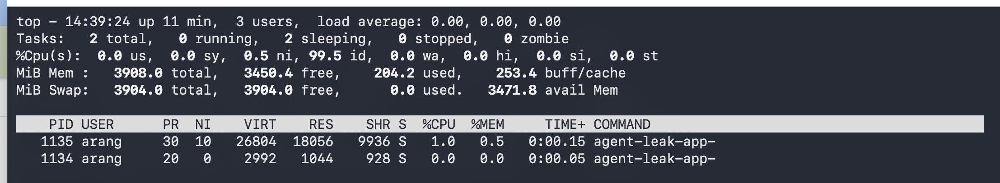 |

`[grep 요령]` `grep [a]gent-leak`의 `[a]`는 grep 명령 자기 자신이 결과에 섞이지 않게 하는 방법입니다.

### 3단계. monitor.sh

B4-1의 monitor.sh 구조(맨 위 설정값, 단계 주석, 한 줄 로그 포맷, `>>` 누적)를 가져오고, B4-2에 맞게 두 가지를 바꿨습니다.

| | B4-1 monitor.sh | B4-2 [bin/monitor.sh](bin/monitor.sh) |
|---|---|---|
| 무엇을 재나 | 서버 **전체** CPU·메모리 (`/proc/stat`, `free`) | **앱의 자식 프로세스 하나** (`ps -p`, `top -p`) |
| 언제 재나 | cron으로 **1분에 한 번** | 앱이 살아 있는 동안 **1초 간격 반복** (17초 만에 죽는 OOM도 6점 이상 기록) |
| 추가 항목 | - | `RSS`(MB), `THREADS`(스레드 수), `STAT`(상태), **`LOG_AGE`**(앱 로그가 멈춘 지 몇 초) |

```bash
# [SSH 탭 1] 레포 받기 (monitor.sh가 들어 있음)
git clone https://github.com/codewhite7777/codyssey_B4-2.git ~/codyssey_B4-2
mkdir -p ~/results
```

기록 한 줄:

```
[2026-11-20 16:13:42] PROCESS:agent-leak-app PID:2916 CPU:0.0% MEM:0.4% RSS:17MB THREADS:3 STAT:SNl+ LOG_AGE:2s
```

| 순서 | 명령 | 하는 일 |
|---|---|---|
| ① | `pgrep -o -f "^[^ ]*agent-leak-app"` | 앱이 뜰 때까지 기다렸다가 **부모** PID를 찾음 |
| ② | `pgrep -P $PARENT` | 부모의 **자식** PID (실제로 메모리가 늘어나는 쪽) |
| ③ | `ps -p $PID -o %mem=,rss=,nlwp=,stat=` | 메모리 %, RSS(KB), 스레드 수, 상태 |
| ④ | `top -b -n 2 -d 0.5 -p $PID` | **지금 이 순간**의 CPU (`ps`의 %cpu는 시작부터의 평균이라 늦게 보임) |
| ⑤ | `stat -c %Y agent_app.log` | 앱 로그의 마지막 수정 시각 → 지금과의 차이 = `LOG_AGE` |
| ⑥ | `kill -0 $PID` 실패 시 | `PROCESS NOT FOUND - PID:… terminated` 남기고 `exit 1` |

### 4단계. 실험 방법 (4번 모두 같은 순서)

**정상 설정에서 값 하나만 바꿔** Before를 만들고, 정상 실행 1번을 세 실험 공통의 After로 썼습니다 (설정이 같기 때문).

```bash
# ① [SSH 탭 1] 로그 2개 비우기 (이번 실행 기록만 남도록)
: > ~/agent-app/logs/agent_app.log; : > ~/agent-app/logs/monitor.log

# ② [SSH 탭 2] 감시 시작 → "Waiting for 'agent-leak-app'..." 상태로 대기
~/codyssey_B4-2/bin/monitor.sh 1

# ③ [SSH 탭 1] 앱 실행 → 아래 표의 명령 (끝나면 종료 코드가 바로 찍힘)

# ④ [SSH 탭 1] 로그 2개 보관 (이름은 실험마다 바꿈)
cp ~/agent-app/logs/agent_app.log ~/results/1_oom_app.log; cp ~/agent-app/logs/monitor.log ~/results/1_oom_monitor.log
```

| 실험 | ③ 실행 명령 | 끝내는 법 | 결과 | 리포트 |
|---|---|---|---|---|
| 1 OOM | `cd ~/agent-app; MEMORY_LIMIT=128 ./agent-leak-app-x86; echo "exit=$?"` | 스스로 꺼짐 | 17초, exit=137 | [🔴](reports/01-oom.md) |
| 2 CPU | `cd ~/agent-app; CPU_MAX_OCCUPY=100 ./agent-leak-app-x86; echo "exit=$?"` | 스스로 꺼짐 | 46초, exit=143 | [🟠](reports/02-cpu.md) |
| 3 Deadlock | `cd ~/agent-app; MULTI_THREAD_ENABLE=true ./agent-leak-app-x86; echo "exit=$?"` | 확인 후 Ctrl+C | 12분 29초 정지 | [🟣](reports/03-deadlock.md) |
| 4 정상 (After) | `cd ~/agent-app; ./agent-leak-app-x86; echo "exit=$?"` | 5분 넘게 두고 Ctrl+C | 8분 생존 | 세 리포트 §4 |

```bash
# [MAC] 끝나면 결과 8개를 Mac으로 가져오기 → 레포 logs/에 올림
scp -r arang@192.168.64.5:~/results ~/Downloads/
```

### 5단계. 실험 1 - OOM

| 📸 1-1 앱: `SELF-TERMINATED` · `Killed` · `exit=137` | 📸 1-2 monitor: RSS 17 → 143MB |
|---|---|
|  |  |

- 앱 Heap과 monitor.sh의 RSS가 **같은 속도(3초마다 25MB)**로 늘었습니다. 앱이 죽인 PID(`process 2363`)와 monitor.sh가 잰 PID(`PID:2363`)가 같습니다.
- 자세히 → **[reports/01-oom.md](reports/01-oom.md)**

### 6단계. 실험 2 - CPU Spike

| 📸 2-1 앱: 51.22% → `WATCHDOG ... SIGTERM` · `exit=143` | 📸 2-2 monitor: 실제 CPU 0~10% |
|---|---|
|  |  |

- 앱이 보고한 부하는 51%까지 올랐지만 OS가 잰 실제 CPU는 0~10%였습니다. **앱 내부 수치로 Watchdog이 동작**했다는 뜻이라, 관제 도구와 앱 로그를 함께 봐야 원인을 정확히 짚을 수 있습니다.
- 자세히 → **[reports/02-cpu.md](reports/02-cpu.md)**

### 7단계. 실험 3 - Deadlock

로그가 멈추고 1분 지난 뒤 **탭 3**에서 확인했습니다.

```bash
# [SSH 탭 3] 살아 있다 (📸 3-3)
ps -ef | grep [a]gent-leak

# [SSH 탭 3] 스레드별 상태: 모두 S, CPU 0  (-L 스레드마다 한 줄, lwp = 스레드 번호) (📸 3-4)
ps -L -o pid,lwp,stat,pcpu,rss,etime -p $(pgrep -n -f agent-leak-app-x86)

# [SSH 탭 3] 스레드별 CPU 실시간 → q로 나옴 (📸 3-5)
top -H -p $(pgrep -n -f agent-leak-app-x86)
```

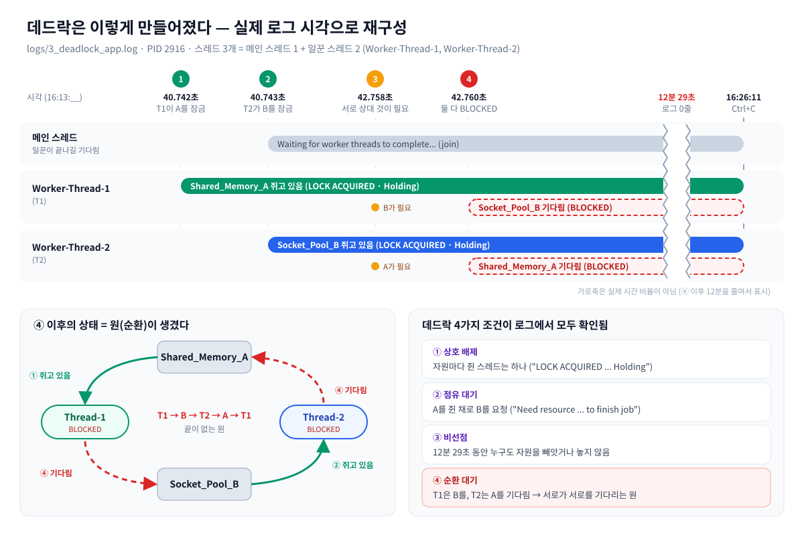

| 📸 3-1 앱: 마지막 `BLOCKED` 두 줄 | 📸 3-2 monitor: `LOG_AGE`만 계속 증가 |
|---|---|
| 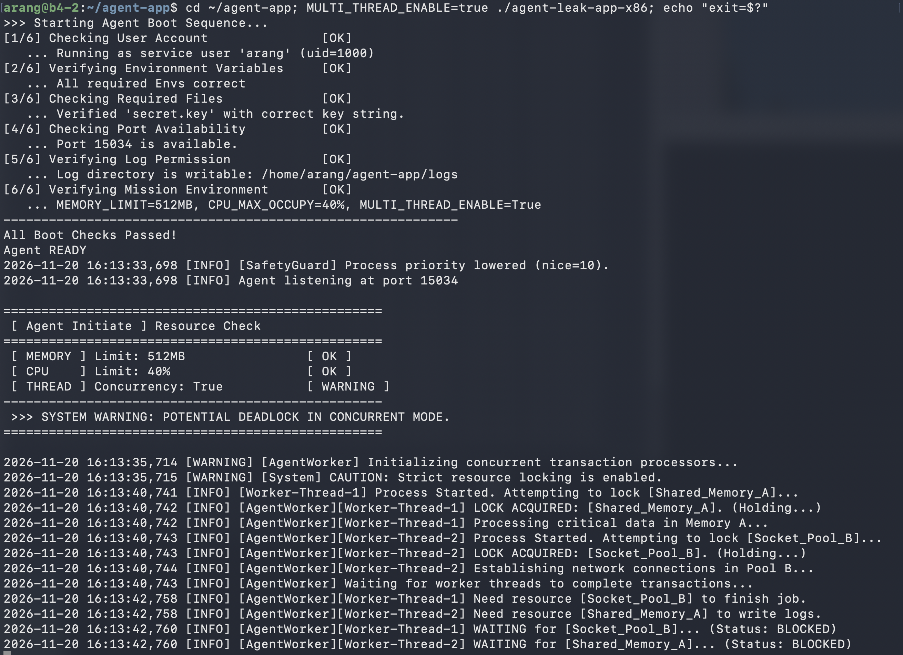 | 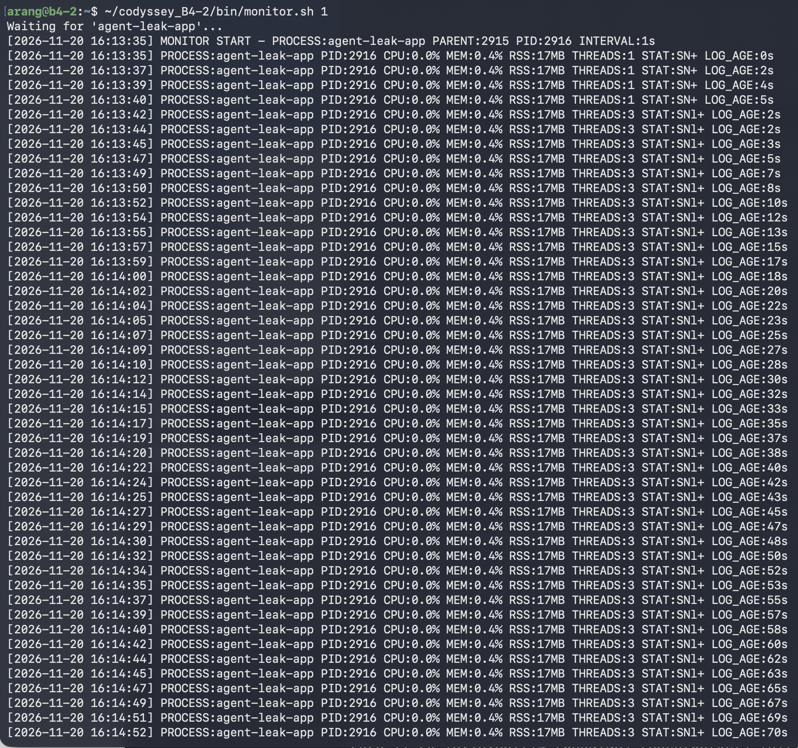 |

| 📸 3-3 `ps -ef` | 📸 3-4 `ps -L` | 📸 3-5 `top -H` | 📸 3-6 Ctrl+C |
|---|---|---|---|
| 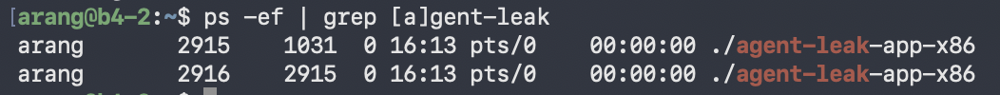 | 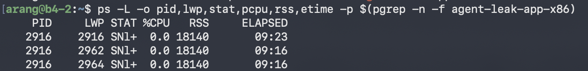 | 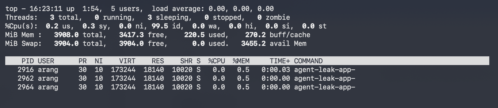 | 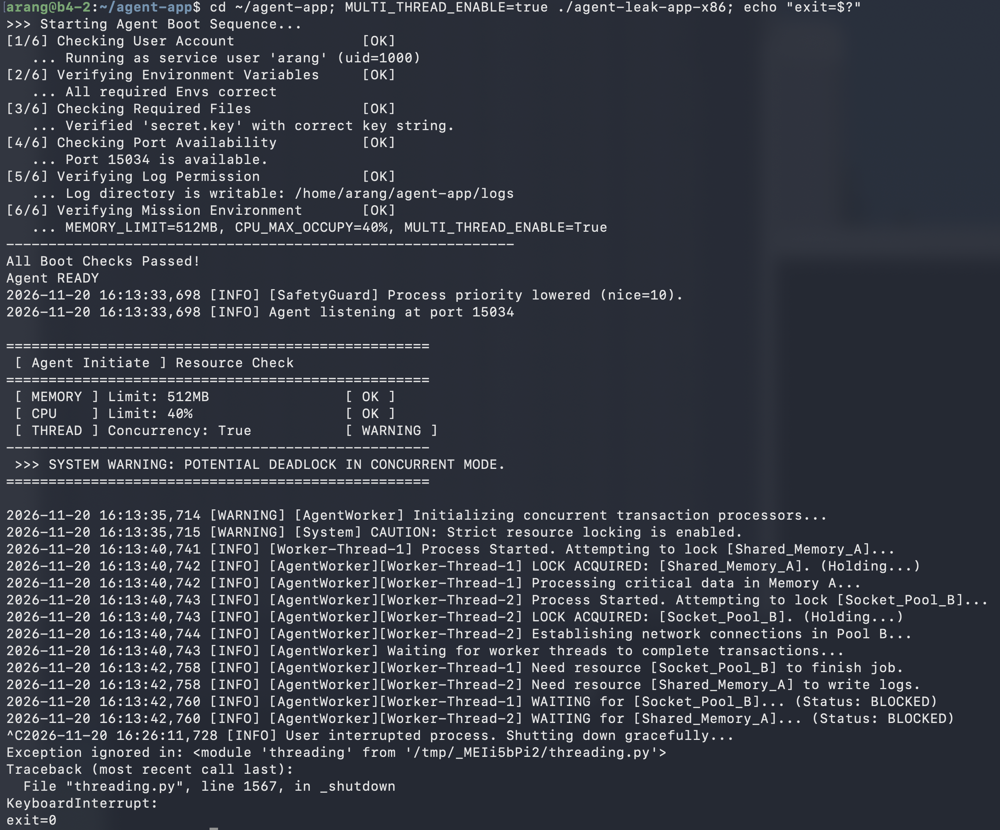 |

- 자세히 → **[reports/03-deadlock.md](reports/03-deadlock.md)**

### 8단계. 실험 4 - 정상 (세 실험의 After)

| 📸 4-1 앱: 525MB → `MEMORY RECOVERED` | 📸 4-2 monitor: RSS 517MB → 67MB로 뚝 떨어짐 |
|---|---|
| 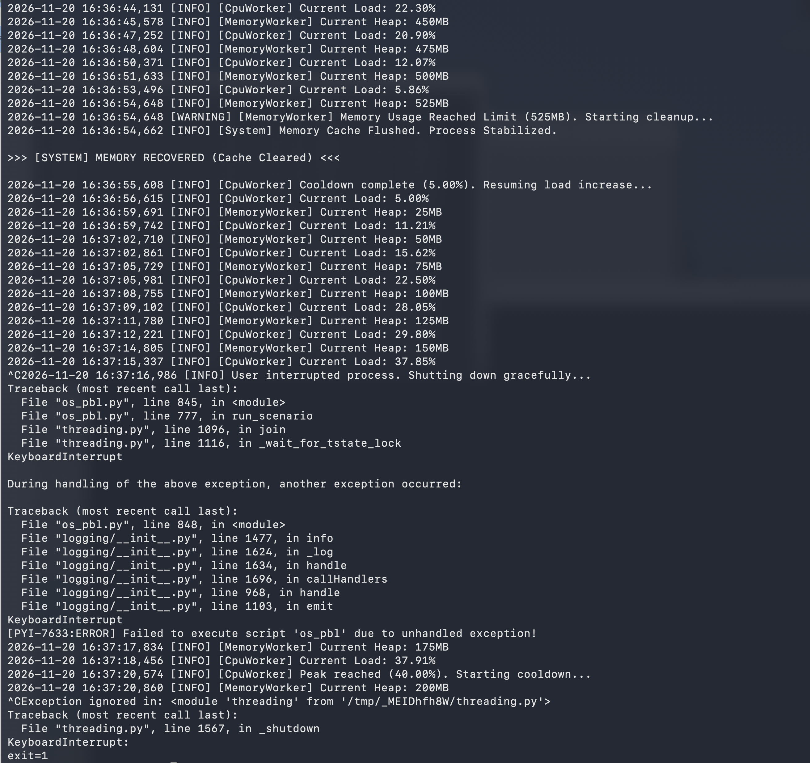 |  |

- 메모리는 525MB에 닿을 때마다 스스로 정리(7번), CPU는 40%에 닿을 때마다 식히기(10번), 로그는 8분 내내 쌓였습니다(`LOG_AGE` 0~3초).
- 끌 때는 Ctrl+C를 두 번 눌러야 했습니다(`exit=1`). 메인 스레드가 일꾼 스레드를 기다리다 끊긴 것으로, 실험 결과와는 관계없습니다.

---

## 5. 부록

### A. 파일 구성

| 파일 | 내용 |
|---|---|
| [bin/monitor.sh](bin/monitor.sh) | 관제 스크립트 (설정 15~20줄, 부모·자식 찾기 26~43줄, 기록 반복 45~69줄, 종료 기록 71~73줄) |
| [reports/](reports/) | 이슈 리포트 3건 |
| [evaluation.md](evaluation.md) | 평가 가이드 |
| [logs/](logs/) | 실험 4번의 앱 로그 · monitor 로그 원본 8개 (`1_oom` · `2_cpu` · `3_deadlock` · `4_healthy`) |
| [images/](images/) | 개념 그림 `00`~`05`, 실측 그래프 `chart_*.png`, [images/evidence/](images/evidence/)는 내 VM 스크린샷 16장 |

### B. 과제 문서와 다른 점

| 과제 문서 | 실제 앱 | 대응 |
|---|---|---|
| 실행 파일 `agent-app-leak-x86` | **`agent-leak-app-x86`** | 실제 이름으로 명령·monitor.sh 작성 |
| 부팅 검사 개수 언급 없음 (B4-1은 5단계) | **6단계** (`[6/6] Verifying Mission Environment`) | 실험용 환경변수 3개도 값이 있어야 부팅됨 |
| `CPU_MAX_OCCUPY`를 조정해 종료 여부 비교 | 이 값은 **부하를 어디까지 올릴지의 상한**이고, Watchdog 종료 기준은 **약 50%로 고정** (100으로 6번 실행 → 50.23~56.88%에서 모두 종료) | 50 미만(40)으로 낮춰 After 확보 |
| "top/ps로 CPU 급상승 구간 캡처" | 앱이 보고하는 부하(최대 51%)와 **실제 CPU(0~10%)가 다름** | 두 값을 함께 기록하고 리포트에 그대로 적음 (없는 급상승을 있다고 쓰지 않음) |

### C. 하지 않은 것

- **보너스 과제(스케줄링 알고리즘 추론)**: 정상 실행 로그 앞부분의 `Thread-A/B/C ... Preempted ... Resumed`가 그 재료이지만 범위에서 제외했습니다.
- **B4-1의 서버 보안 설정**(SSH 포트 변경, 방화벽, 계정 3개·권한, cron, logrotate): B4-2 요구사항이 아니라서 새 VM에 다시 하지 않았습니다.
