# 평가 가이드 (평가표 항목 1~4)

평가표 질문 **원문 순서대로** 답을 모았습니다. 무엇을 어떻게 했는지는 [README](README.md), 증거 전체는 [리포트 3건](reports/)에 있습니다.

- 제목 = 평가표 질문 원문 · 그 아래 = **어디에 증거가 있는지** 또는 **💬 답**
- 평가 때 바로 보여 줄 수 있는 명령은 `시연:`으로 표시했습니다 (VM에서 1분 안에 끝나는 것만).

## 한눈에 보는 답 (20문항)

> 번호를 누르면 자세한 답과 증거로 이동합니다.

### 항목 1. 결과물 - 증거가 있는가

| # | 질문 | 답 | 핵심 증거 |
|:--:|:--|:--:|:--|
| [1-1](#1-1-oom-메모리-사용량이-선형적으로-증가하다가-프로세스가-강제-종료되는-패턴이-로그에-기록되어-있는가) | OOM 선형 증가 → 강제 종료 패턴 | ✅ | RSS 17 → 143MB (3초마다 25MB) → `MemoryGuard Self-terminating process 2363` |
| [1-2](#1-2-oom-환경변수memory_limit-조정-후-프로세스-생존-시간이-늘어난-before--after-비교-결과가-있는가) | `MEMORY_LIMIT` Before & After | ✅ | 128 → **17초** 종료 / 512 → **8분 이상** 생존 |
| [1-3](#1-3-cpu-cpu-사용률이-임계치를-초과하여-프로세스가-종료되는-패턴이-로그에-기록되어-있는가) | CPU 임계치 초과 → 종료 패턴 | ✅ | Load 51.22% → `CPU Threshold Violated!` → `WATCHDOG (SIGTERM)` · exit=143 |
| [1-4](#1-4-cpu-환경변수cpu_max_occupy-조정-후-프로세스-종료-여부생존-시간이-변화한-before--after-비교-결과가-있는가) | `CPU_MAX_OCCUPY` Before & After | ✅ | 100 → **46초** 종료 / 40 → **8분 이상** 생존 |
| [1-5](#1-5-deadlock-프로세스가-살아있으나pid-존재-cpu메모리-변화-없이-로그가-멈춘-상태를-식별했는가) | 살아 있지만 멈춘 상태 식별 | ✅ | PID 2916 존재 · 스레드 3개 CPU 0% · LOG_AGE 0 → 748초 |
| [1-6](#1-6-deadlock-환경변수multi_thread_enable-조정-후-데드락-재현회피-비교-결과가-있는가) | `MULTI_THREAD_ENABLE` 재현/회피 | ✅ | true → 12분 29초 멈춤 / false → 로그 계속 쌓임 |
| [1-7](#1-7-format-3건의-리포트-모두-github-issue-구조현상--증거--원인--조치를-갖추고-있는가) | 리포트 4칸 구조 | ✅ | 3건 모두 현상 → 증거 → 원인 → 조치 |
| [1-8](#1-8-evidence-리포트에-pid-로그-타임스탬프-핵심-로그-메시지가-포함된-증거스크린샷-또는-로그-발췌가-첨부되어-있는가) | PID · 시각 · 로그 증거 | ✅ | 스크린샷 16장 + 로그 원본 8개 |

### 항목 2. 도구와 명령 - 어떻게 쟀는가

| # | 질문 | 한 줄 답 |
|:--:|:--|:--|
| [2-1](#2-1-monitorsh에서-메모리-증가-패턴을-추적하기-위해-사용한-명령어와-데이터-추출-방법을-구체적으로-답변할-수-있는가) | 메모리 추적 명령 | `pgrep -P`로 **자식 PID**를 찾고 `ps -p PID -o rss=`로 **RSS**를 1초마다 시각과 함께 기록 |
| [2-2](#2-2-프로세스의-cpu-사용률을-확인하기-위해-선택한-도구와-적용한-옵션의-의미를-구분하여-서술할-수-있는가) | CPU 도구와 옵션 | `top -b -n 2 -d 0.5 -p PID` · ps의 %cpu는 **평균**이라 **순간값**인 top을 선택 |
| [2-3](#2-3-프로세스가-살아있지만-멈춰있는-상태를-진단하기-위해-어떤-도구를-어떤-순서로-사용했는지-본인의-판단-흐름을-논리적으로-제시할-수-있는가) | 멈춘 상태 진단 순서 | ① `ps -ef` 살아 있나 → ② `top -H`·`ps -L` 일하나 → ③ LOG_AGE 언제 멈췄나 → ④ `tail` 무엇을 기다리나 |

### 항목 3. 원리 - 왜 그런가

| # | 질문 | 한 줄 답 |
|:--:|:--|:--|
| [3-1](#3-1-메모리-누수가-발생했을-때-애플리케이션의-메모리-보호-정책이-해당-프로세스를-강제-종료하는-이유를-설명할-수-있는가) | 메모리 보호 정책이 끄는 이유 | 놔두면 스왑 → OS OOM Killer가 **엉뚱한 서비스까지** 죽임 → 범인 하나만 먼저 끊음 |
| [3-2](#3-2-cpu-과점유-시-단일-프로세스를-종료하는-것이-시스템-보호에-왜-필요한지-근거를-제시할-수-있는가) | 프로세스 하나만 끄는 이유 | CPU를 독차지하면 sshd·웹 서버까지 **대기열에서 지연** → 범인만 끄면 나머지는 정상 |
| [3-3](#3-3-교착-상태deadlock가-발생하는-원리를-상호-배제와-순환-대기-개념으로-설명할-수-있는가) | 상호 배제 · 순환 대기 | 열쇠는 한 명만 쥠(상호 배제) + T1 → B → T2 → A → T1 원(순환 대기) |
| [3-4](#3-4-로그에서-스레드-간-순환-의존-관계a→b-b→a를-어떻게-파악했는지-추적-과정을-설명할-수-있는가) | A→B, B→A 추적 | 마지막 로그를 **스레드별로 나눠** "쥔 것 / 기다리는 것" 표로 정리 |

### 항목 4. 응용과 회고 - 나라면 어떻게 하나

| # | 질문 | 한 줄 답 |
|:--:|:--|:--|
| [4-1](#4-1-만약-이번-미션의-agent-leak-app이-실제-운영-서버에서-동작하고-있었다면-메모리-누수를-장애-발생-전에-탐지하기-위해-현재의-monitorsh를-어떻게-개선하겠는가) | 사전 탐지 개선 | RSS **계속 증가 추세** 경고 + 한도 **도달 시간 예측** + 알림 · 상시 실행 |
| [4-2](#4-2-이번-미션에서-겪은-3가지-장애oom-cpu-spike-deadlock-중-실제-서비스-환경에서-가장-치명적인-것은-무엇이라고-생각하는가-그-이유와-함께-해당-장애를-근본적으로-예방하는-방법을-제안할-수-있는가) | 가장 치명적인 장애 | **Deadlock** - 살아 있어서 발견이 어렵고 스스로 회복 못 함 · 잠금 순서 고정 + 타임아웃 |
| [4-3](#4-3-만약-동일한-서버에서-oom과-deadlock이-동시에-발생했다면-어떤-순서로-트러블슈팅을-진행하겠는가-우선순위-판단의-근거를-설명할-수-있는가) | 동시 발생 시 순서 | 데드락 증거 1분 저장 → **OOM 먼저**(서버 전체로 번짐) → 데드락 분석 |
| [4-4](#4-4-이번-미션의-환경변수-조정은-임시-조치였다-만약-소스-코드를-직접-수정할-수-있다면-각-장애-유형별로-어떤-코드-레벨의-개선을-하겠는가) | 코드 레벨 개선 | OOM: 다 쓴 데이터 지우기·캐시 크기 제한 / CPU: 쉬는 시간·작업 나누기 / Deadlock: 잠금 순서·타임아웃 |
| [4-5](#4-5-다시-이-미션을-처음부터-수행한다면-트러블슈팅-과정에서-어떤-점을-다르게-접근하겠는가) | 다르게 할 점 | 재는 대상(부모·자식) 먼저 확인 · 짧은 간격으로 계속 기록 · 앱 값과 OS 값 처음부터 비교 |

---

## 항목 1. 결과물

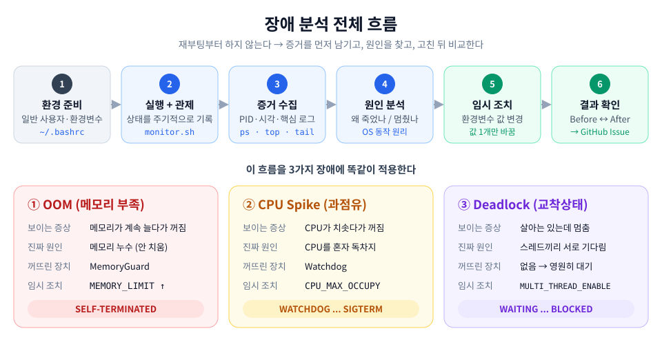

### 1-1. [OOM] 메모리 사용량이 선형적으로 증가하다가 프로세스가 강제 종료되는 패턴이 로그에 기록되어 있는가?

✅ **있음** → [reports/01-oom.md §2](reports/01-oom.md#2-evidence--logs-증거-자료)

- monitor.sh: RSS 17 → 42 → 68 → 93 → 118 → **143MB** (약 3초마다 25MB씩 일직선) → `PROCESS NOT FOUND - PID:2363`
- 앱 로그: `16:06:38,954 [CRITICAL] [MemoryGuard] Memory limit exceeded (150MB >= 128MB)` → `Self-terminating process 2363`

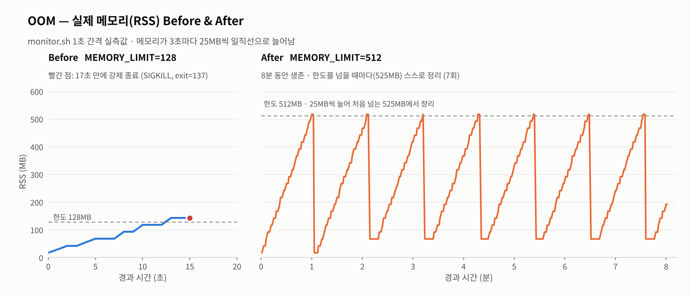

### 1-2. [OOM] 환경변수(MEMORY_LIMIT) 조정 후 프로세스 생존 시간이 늘어난 Before & After 비교 결과가 있는가?

✅ **있음** → [reports/01-oom.md §4](reports/01-oom.md#4-workaround--verification-조치-및-검증)

| | Before `MEMORY_LIMIT=128` | After `MEMORY_LIMIT=512` |
|---|---|---|
| 생존 시간 | **17초** (SIGKILL, exit=137) | **8분 이상** (사람이 Ctrl+C로 종료) |
| 메모리 | 150MB에서 강제 종료 | 525MB에서 스스로 정리, 7번 반복 |

### 1-3. [CPU] CPU 사용률이 임계치를 초과하여 프로세스가 종료되는 패턴이 로그에 기록되어 있는가?

✅ **있음** → [reports/02-cpu.md §2](reports/02-cpu.md#2-evidence--logs-증거-자료)

- 앱 로그: `Current Load` 5% → 51.22% → `16:09:48,939 [CRITICAL] [CpuWorker] CPU Threshold Violated! (51.22%)`
- 화면: `WATCHDOG: INITIATING EMERGENCY ABORT (SIGTERM)` → `Terminated` → `exit=143`
- 같은 설정으로 6번 실행해서 6번 모두 50%를 넘는 순간 종료

### 1-4. [CPU] 환경변수(CPU_MAX_OCCUPY) 조정 후 프로세스 종료 여부/생존 시간이 변화한 Before & After 비교 결과가 있는가?

✅ **있음** → [reports/02-cpu.md §4](reports/02-cpu.md#4-workaround--verification-조치-및-검증)

| | Before `CPU_MAX_OCCUPY=100` | After `CPU_MAX_OCCUPY=40` |
|---|---|---|
| 결과 | **46초 만에 종료** (SIGTERM, exit=143) | **8분 이상 생존**, 40%에서 식히기 10번 반복 |

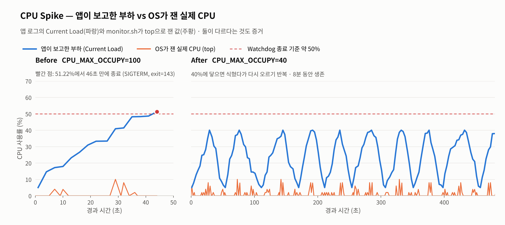

### 1-5. [Deadlock] 프로세스가 살아있으나(PID 존재) CPU/메모리 변화 없이 로그가 멈춘 상태를 식별했는가?

✅ **식별함** → [reports/03-deadlock.md §2](reports/03-deadlock.md#2-evidence--logs-증거-자료)

- `ps -ef`: PID 2915(부모), 2916(자식) 존재
- `ps -L`, `top -H`: 스레드 3개 모두 `S`, `%CPU 0.0`, `TIME+ 0:00.00`, RSS 18140KB 고정
- monitor.sh: `LOG_AGE` 0초 → **748초**까지 증가 (12분 넘게 로그 0줄)

### 1-6. [Deadlock] 환경변수(MULTI_THREAD_ENABLE) 조정 후 데드락 재현/회피 비교 결과가 있는가?

✅ **있음** → [reports/03-deadlock.md §4](reports/03-deadlock.md#4-workaround--verification-조치-및-검증)

| | Before `true` | After `false` |
|---|---|---|
| 결과 | **데드락 재현** (12분 29초 무응답) | **회피** (8분 동안 로그 372줄, LOG_AGE 0~3초) |

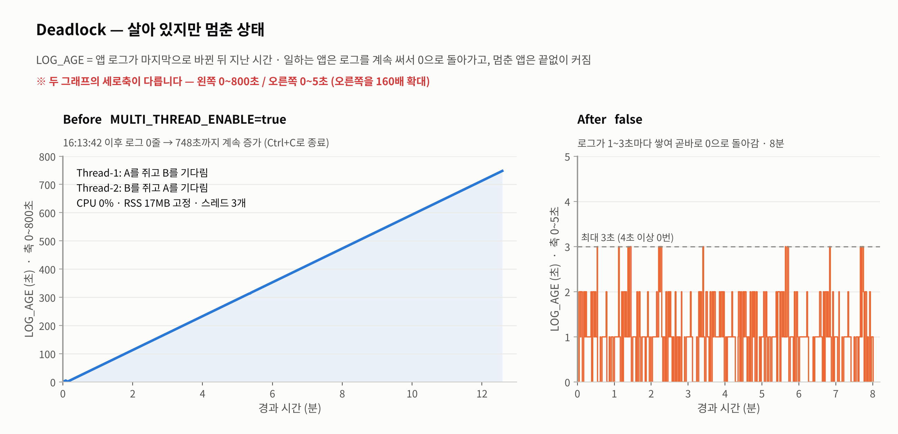

### 1-7. [Format] 3건의 리포트 모두 GitHub Issue 구조(현상 → 증거 → 원인 → 조치)를 갖추고 있는가?

✅ **갖춤** - 3건 모두 같은 4칸 구조입니다.

| 리포트 | 1. Description | 2. Evidence & Logs | 3. Root Cause | 4. Workaround & Verification |
|---|---|---|---|---|
| [01-oom.md](reports/01-oom.md) | ✅ | ✅ | ✅ | ✅ |
| [02-cpu.md](reports/02-cpu.md) | ✅ | ✅ | ✅ | ✅ |
| [03-deadlock.md](reports/03-deadlock.md) | ✅ | ✅ | ✅ | ✅ |

### 1-8. [Evidence] 리포트에 PID, 로그 타임스탬프, 핵심 로그 메시지가 포함된 증거(스크린샷 또는 로그 발췌)가 첨부되어 있는가?

✅ **포함** - 스크린샷 16장([README 📸 증거 스크린샷](README.md#-증거-스크린샷)) + 로그 원본 8개([logs/](logs/))

| 리포트 | PID | 핵심 로그 (타임스탬프) | 스크린샷 |
|---|---|---|---|
| OOM | 2363 | `16:06:38,955 Self-terminating process 2363` | 1-1, 1-2 |
| CPU | 2606 | `16:09:48,939 CPU Threshold Violated!` | 2-1, 2-2, 2-3 |
| Deadlock | 2916 | `16:13:42,760 WAITING ... (Status: BLOCKED)` | 3-1 ~ 3-6 |

---

## 항목 2. 도구와 명령

### 2-1. monitor.sh에서 메모리 증가 패턴을 추적하기 위해 사용한 명령어와 데이터 추출 방법을 구체적으로 답변할 수 있는가?

`시연:` `~/codyssey_B4-2/bin/monitor.sh 1` (앱을 켜 둔 상태에서)

| 단계 | 명령 ([bin/monitor.sh](bin/monitor.sh)) | 하는 일 |
|---|---|---|
| ① 앱 찾기 | `pgrep -o -f "^[^ ]*agent-leak-app"` (31줄) | 명령줄 **첫 단어**가 앱인 프로세스 중 가장 먼저 뜬 것(부모) |
| ② 진짜 일꾼 찾기 | `pgrep -P $PARENT` (41줄) | 부모의 **자식** PID |
| ③ 메모리 뽑기 | `ps -p $PID -o %mem=,rss=,nlwp=,stat=` (50줄) | `rss`(실제 메모리 KB), `%mem`, 스레드 수, 상태를 한 줄로 |
| ④ 단위 바꾸기 | `$((RSS_KB / 1024))` (67줄) | KB → MB |
| ⑤ 시간과 함께 쌓기 | `echo "[$(date ...)] ..." \| tee -a monitor.log` | 1초 간격 + 타임스탬프 → **추세**가 보임 |

💬 "메모리는 `ps`의 **RSS**로 쟀습니다. VSZ는 예약만 한 공간까지 포함해서 실제 사용량보다 크게 나오고, 과제는 '물리 메모리'를 보라고 했기 때문입니다. 핵심은 **자식 PID를 잰 것**입니다. 이 앱은 PyInstaller 실행 파일이라 프로세스가 2개 뜨는데, 부모는 1MB에서 변하지 않고 메모리가 늘어나는 건 자식(nice=10)입니다. 부모를 쟀다면 누수가 안 보였을 것입니다. `=`를 붙인 `-o rss=`는 머리글 없이 숫자만 뽑아서 `read`로 바로 변수에 넣기 위해서입니다."

| `ps`: 부모·자식 2개 | `top`: 부모 RES 1MB, 자식 RES 18MB + NI 10 |
|---|---|
| 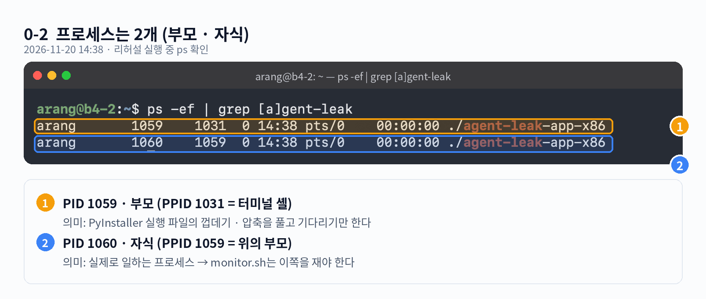 | 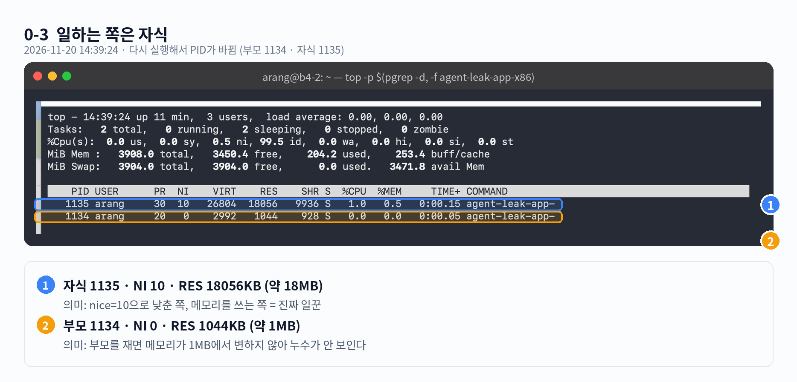 |

### 2-2. 프로세스의 CPU 사용률을 확인하기 위해 선택한 도구와 적용한 옵션의 의미를 구분하여 서술할 수 있는가?

**선택한 도구: `top`** - `top -b -n 2 -d 0.5 -p $PID` ([monitor.sh 57줄](bin/monitor.sh))

| 옵션 | 의미 | 넣은 이유 |
|---|---|---|
| `-b` | 배치 모드 (화면 갱신 없이 글자로 출력) | 스크립트에서 `awk`로 잘라 쓰고 파일에 저장하려고 |
| `-n 2` | 2번 측정하고 끝 | **첫 번째 값은 기준점이라 부정확** → 두 번째 값을 씀 (`END { print c }`) |
| `-d 0.5` | 측정 간격 0.5초 | 두 측정 사이의 차이로 "지금 이 순간" 사용률을 계산 |
| `-p PID` | 이 프로세스만 | 다른 프로세스 줄을 걸러 낼 필요 없음 |

💬 "`ps`의 `%cpu`를 쓰지 않은 이유는, `ps`는 **시작부터 지금까지의 평균**이라서 급상승이 늦게, 작게 보이기 때문입니다. `top`은 짧은 구간의 **순간값**이라 급상승을 잡을 수 있습니다. 데드락 진단 때는 `top -H`(스레드별로 보기)와 `ps -L`(스레드마다 한 줄)을 썼습니다. 그리고 이번 앱은 앱이 보고한 부하(51%)와 `top`이 잰 실제 CPU(0~10%)가 달랐습니다. 그래서 OS 도구만 믿지 않고 **앱 로그와 함께** 봐야 한다는 것을 확인했습니다."

### 2-3. 프로세스가 "살아있지만 멈춰있는 상태"를 진단하기 위해 어떤 도구를 어떤 순서로 사용했는지, 본인의 판단 흐름을 논리적으로 제시할 수 있는가?

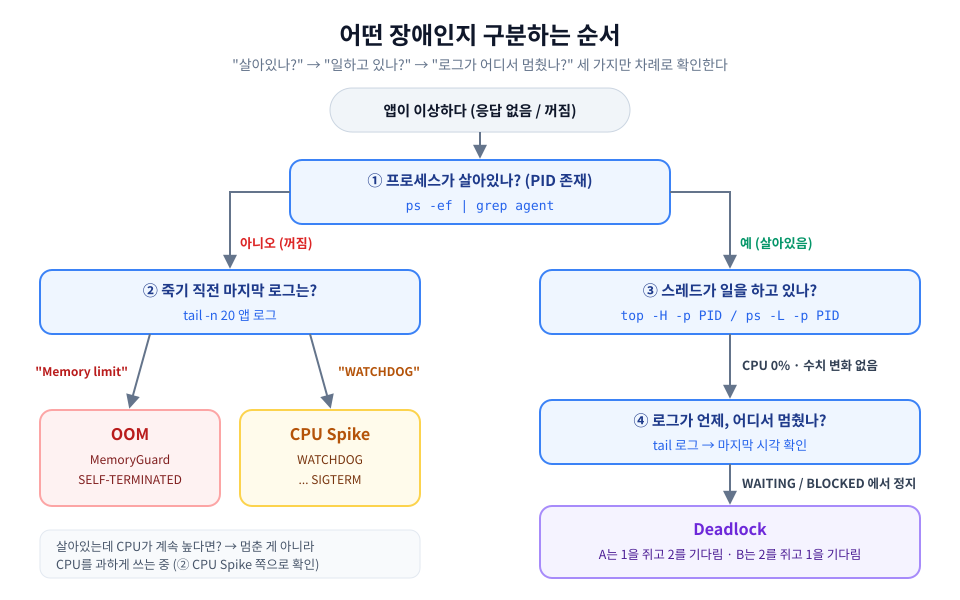

| 순서 | 질문 | 도구 | 이번 결과 | 판단 |
|---|---|---|---|---|
| 1 | 살아 있나? | `ps -ef \| grep [a]gent-leak` | PID 2915, 2916 있음 | 꺼진 게 아님 → OOM·CPU 아님 |
| 2 | 일하고 있나? | `top -H -p 2916`, `ps -L -p 2916` | 스레드 3개 모두 `S`, CPU 0.0, TIME+ 0:00.00 | 무한 루프(CPU 100%)도 아님 → **무언가를 기다리는 중** |
| 3 | 언제부터 멈췄나? | monitor.sh `LOG_AGE`, `tail` | 16:13:42 이후 로그 0줄, LOG_AGE 계속 증가 | 멈춘 시점 확정 |
| 4 | 무엇을 기다리나? | `tail -n 10 agent_app.log` | T1은 B를, T2는 A를 `WAITING ... BLOCKED` | 서로의 자원을 기다림 → **데드락** |

💬 "가장 먼저 '죽었나, 살았나'로 크게 나눴습니다. 살아 있으면 다음은 'CPU를 쓰고 있나'입니다. CPU가 높으면 바쁜 것이고, 0이면 기다리는 것입니다. 0이었기 때문에 '누구를 기다리나'를 마지막 로그에서 찾았습니다."

---

## 항목 3. 원리

### 3-1. 메모리 누수가 발생했을 때 애플리케이션의 메모리 보호 정책이 해당 프로세스를 강제 종료하는 이유를 설명할 수 있는가?

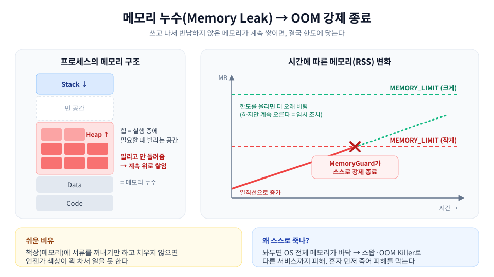

💬 "누수는 메모리를 빌리고 반납하지 않는 것이라 **저절로 줄어들지 않습니다.** 그대로 두면 서버 RAM이 바닥나고, OS는 디스크를 메모리처럼 쓰는 스왑을 시작해서 서버 전체가 느려집니다. 스왑까지 바닥나면 OS의 OOM Killer가 프로세스를 골라 죽이는데, 이때 **누수와 상관없는 DB나 sshd가 죽을 수도** 있습니다. MemoryGuard는 그 전에 **범인 하나만 스스로 끊어서** 피해가 다른 서비스로 번지지 않게 합니다. 이번에는 SIGKILL(exit=137)이라 정리할 틈 없이 즉시 종료됐습니다."

### 3-2. CPU 과점유 시 단일 프로세스를 종료하는 것이 시스템 보호에 왜 필요한지 근거를 제시할 수 있는가?

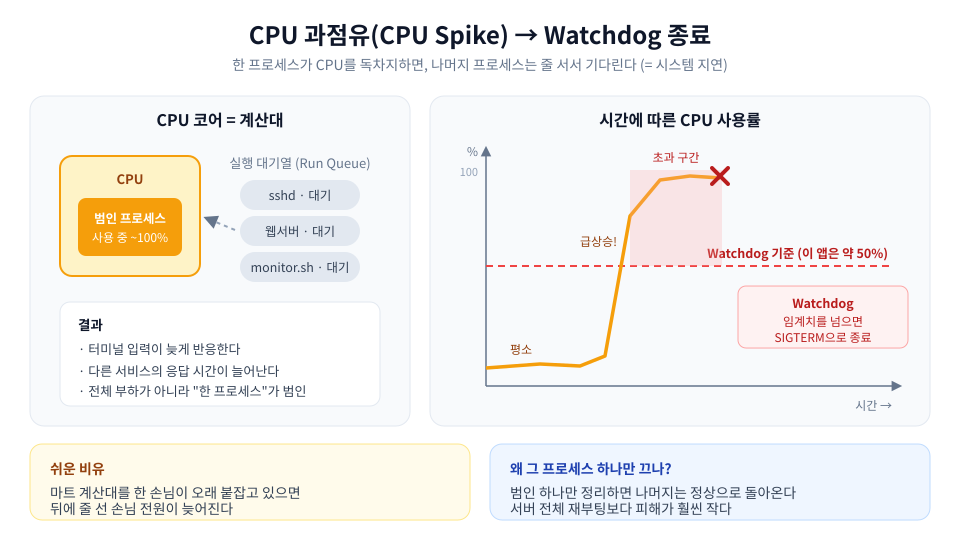

💬 "CPU 코어는 한 순간에 한 프로세스만 실행하고, 나머지는 실행 대기열에서 차례를 기다립니다. 한 프로세스가 CPU를 독차지하면 **sshd, 웹 서버, 관제 스크립트까지 모두 늦어집니다.** 원인이 프로세스 하나라면 그것만 끄는 게 서버 재부팅보다 피해가 훨씬 작습니다. 다른 서비스는 계속 돌기 때문입니다. 이 앱은 먼저 `nice=10`으로 자기 우선순위를 낮추고(SafetyGuard), 그래도 기준을 넘으면 SIGTERM으로 종료(Watchdog)하는 **2단계 보호**를 했습니다. SIGTERM(exit=143)은 마무리할 기회를 주는 부드러운 종료입니다."

### 3-3. 교착 상태(Deadlock)가 발생하는 원리를 "상호 배제"와 "순환 대기" 개념으로 설명할 수 있는가?

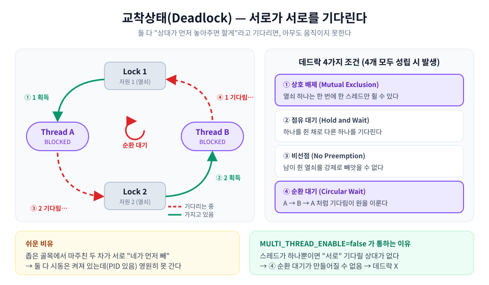

💬 "**상호 배제**는 자원 하나를 한 번에 한 스레드만 쥘 수 있다는 것입니다. 이번 로그의 `LOCK ACQUIRED ... (Holding...)`처럼 A는 Thread-1만, B는 Thread-2만 쥐고 있었습니다. **순환 대기**는 기다림이 원을 이루는 것입니다. Thread-1은 Thread-2가 쥔 B를, Thread-2는 Thread-1이 쥔 A를 기다려서 `T1 → B → T2 → A → T1`이 되었습니다. 둘 다 상대가 먼저 놓기를 기다리니 아무도 진행하지 못합니다. 점유 대기와 비선점까지 4가지가 모두 성립해야 데드락이 생기고, **하나만 깨도** 생기지 않습니다."

### 3-4. 로그에서 스레드 간 순환 의존 관계(A→B, B→A)를 어떻게 파악했는지 추적 과정을 설명할 수 있는가?

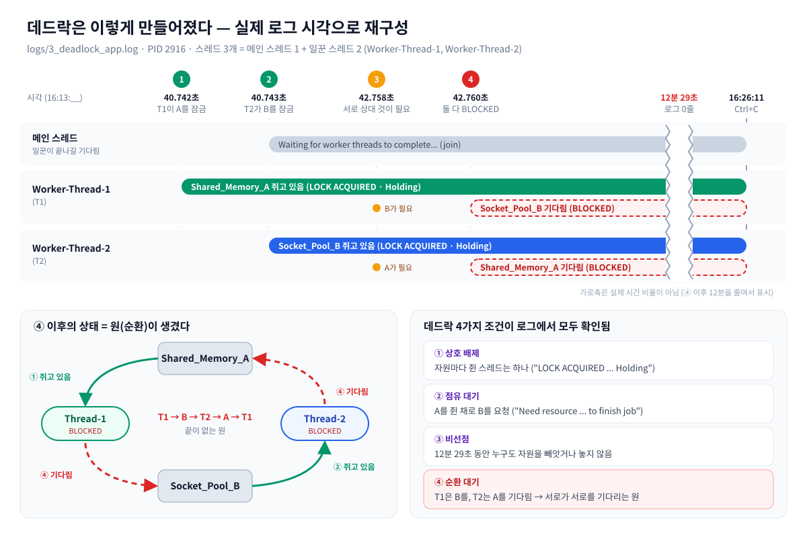

💬 "마지막 로그를 **스레드 이름별로 나눠서** 시간순으로 읽었습니다."

| 시각 | 로그 | 읽은 것 |
|---|---|---|
| 40.742 | `[Worker-Thread-1] LOCK ACQUIRED: [Shared_Memory_A]` | T1이 **A를 쥠** |
| 40.743 | `[Worker-Thread-2] LOCK ACQUIRED: [Socket_Pool_B]` | T2가 **B를 쥠** |
| 42.758 | `[Worker-Thread-1] Need resource [Socket_Pool_B]` / `[Worker-Thread-2] Need resource [Shared_Memory_A]` | 서로 **상대가 쥔 것**이 필요 |
| 42.760 | 두 스레드 모두 `WAITING for ... (Status: BLOCKED)` | 둘 다 멈춤 |
| 이후 | 12분 29초 동안 로그 0줄, CPU 0% | 아무도 놓지 않음 = 원이 풀리지 않음 |

💬 "'누가 무엇을 **쥐고** 있나'와 '누가 무엇을 **기다리나**'를 표로 정리하니 A→B, B→A 원이 바로 보였습니다. 로그가 거기서 끝났고 CPU가 0이었다는 사실이, 이 원이 실제로 풀리지 않았다는 증거입니다."

---

## 항목 4. 응용과 회고

### 4-1. 만약 이번 미션의 agent-leak-app이 실제 운영 서버에서 동작하고 있었다면, 메모리 누수를 장애 발생 전에 탐지하기 위해 현재의 monitor.sh를 어떻게 개선하겠는가?

💬 "지금 monitor.sh는 값을 **기록만** 합니다. 한도에 닿기 **전에** 알 수 있도록 세 가지를 더하겠습니다."

1. **추세 경고:** 최근 N분 동안 RSS가 **한 번도 줄지 않고 계속 올랐으면** 경고. 이번 데이터처럼 3초마다 25MB씩 오르면 1분이면 판단할 수 있습니다.
2. **도달 시간 예측:** 증가 속도로 "한도까지 몇 분 남았나"를 계산해서 예: 10분 이내면 경고. 이번 OOM은 `(128-17)MB ÷ 25MB/3초 ≈ 13초`라서 시작하자마자 경고가 떴을 것입니다.
3. **알림과 자동 실행:** 경고를 화면이 아니라 Slack·메일로 보내고, cron(B4-1)이나 systemd로 서버가 켜질 때부터 항상 돌게 합니다.

### 4-2. 이번 미션에서 겪은 3가지 장애(OOM, CPU Spike, Deadlock) 중 실제 서비스 환경에서 가장 치명적인 것은 무엇이라고 생각하는가? 그 이유와 함께, 해당 장애를 근본적으로 예방하는 방법을 제안할 수 있는가?

💬 "**Deadlock**이 가장 치명적이라고 판단합니다."

| 기준 | OOM / CPU | Deadlock |
|---|---|---|
| 겉모습 | 프로세스가 **사라짐** | 프로세스가 **살아 있음** |
| 기존 관제로 발견 | `kill -0`, `ps`로 바로 발견 | "살아 있나"만 보면 **정상으로 보임** |
| 스스로 회복 | 보호 장치가 끊고, 재시작하면 됨 | **사람이 끄기 전까지 영원히** (이번 12분 29초) |
| 증상 | 한 번에 꺼짐 | 요청이 쌓이고 응답만 없음 → 원인 찾기 어려움 |

- **예방:** ① 잠금을 잡는 **순서를 하나로 고정**(항상 A → B) → 순환 대기가 생길 수 없음 ② `acquire(timeout=)`으로 기다림에 **시간 제한** ③ 관제에 "살아 있나"뿐 아니라 **"일하고 있나"**(LOG_AGE, 응답 확인)를 추가

### 4-3. 만약 동일한 서버에서 OOM과 Deadlock이 동시에 발생했다면, 어떤 순서로 트러블슈팅을 진행하겠는가? 우선순위 판단의 근거를 설명할 수 있는가?

💬 "**OOM 쪽 메모리 문제를 먼저**, 그다음 데드락을 보겠습니다. 단, 데드락의 증거는 맨 처음에 빠르게 남겨 둡니다."

| 순서 | 할 일 | 근거 |
|---|---|---|
| 0 | 데드락 프로세스의 `ps -L`, `top -H`, 마지막 로그를 **먼저 저장** (1분) | 재시작하면 "누가 무엇을 기다렸나"가 사라짐 |
| 1 | **OOM 대응**: 메모리를 계속 먹는 프로세스 확인·격리 | 메모리 부족은 **서버 전체로 번짐**(스왑 → OS OOM Killer가 엉뚱한 프로세스까지 죽임). 시간이 지날수록 피해가 커짐 |
| 2 | **Deadlock 대응**: 저장한 증거로 원인 분석 → 프로세스 재시작 | 데드락은 해당 프로세스만 멈춤. 더 퍼지지 않음 |
| 3 | 둘의 관계 확인 | 데드락으로 요청이 쌓이며 메모리가 늘었을 수도 있음 → 같은 원인인지 확인 |

판단 기준은 **"피해가 번지는 속도"**와 **"사라지는 증거"** 두 가지입니다.

### 4-4. 이번 미션의 환경변수 조정은 임시 조치였다. 만약 소스 코드를 직접 수정할 수 있다면, 각 장애 유형별로 어떤 코드 레벨의 개선을 하겠는가?

| 장애 | 임시 조치 (이번) | 코드 개선 |
|---|---|---|
| **OOM** | `MEMORY_LIMIT` 128 → 512 | 다 쓴 데이터를 리스트·딕셔너리에서 **지우기**(`del`, `pop`), 캐시에 **최대 크기** 두기(오래된 것부터 버림), 큰 데이터는 한 번에 다 올리지 말고 나눠 처리 |
| **CPU** | `CPU_MAX_OCCUPY` 100 → 40 | 무거운 반복문 중간에 **쉬는 시간**(`sleep`) 넣기, 일을 작업 큐로 나눠 처리, 상한을 앱 내부 기준(50%)과 **같은 값으로 검증**해서 시작 시 막기 |
| **Deadlock** | `MULTI_THREAD_ENABLE` true → false | **잠금 순서 고정**(모든 스레드가 A → B), `lock.acquire(timeout=5)` 실패 시 쥔 것을 놓고 재시도, A·B를 항상 같이 쓰면 잠금 하나로 합치기 |

### 4-5. 다시 이 미션을 처음부터 수행한다면, 트러블슈팅 과정에서 어떤 점을 다르게 접근하겠는가?

💬 이번에 실제로 겪은 일을 기준으로 세 가지입니다.

1. **"어떤 프로세스를 재는지"부터 확인하겠습니다.** 처음 만든 monitor.sh는 부모 PID를 잡을 수 있었습니다. 부모를 쟀다면 메모리가 1MB에서 그대로라 "누수 없음"으로 잘못 판단했을 것입니다. `ps -ef`로 부모·자식을 먼저 보고 나서 관제를 설계하겠습니다.
2. **띄엄띄엄 찍은 값으로 결론 내리지 않겠습니다.** 리허설 때 `ps`를 세 번 찍은 값(18 → 68 → 142MB)만 보고 "메모리가 정리 없이 계속 는다"고 잘못 판단했다가, 1초 간격 기록을 보고 톱니 모양이라는 것을 알았습니다. **처음부터 짧은 간격으로 계속 기록**하겠습니다.
3. **앱이 말하는 값과 OS가 잰 값을 처음부터 나란히 보겠습니다.** CPU 장애는 앱 로그로는 51%였지만 `top`으로는 0~10%였습니다. 한쪽만 봤다면 원인을 잘못 짚었을 것입니다.
