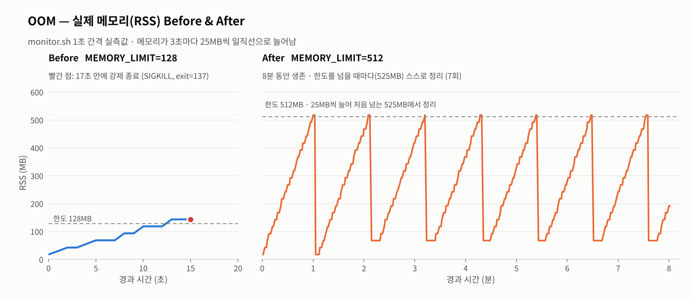
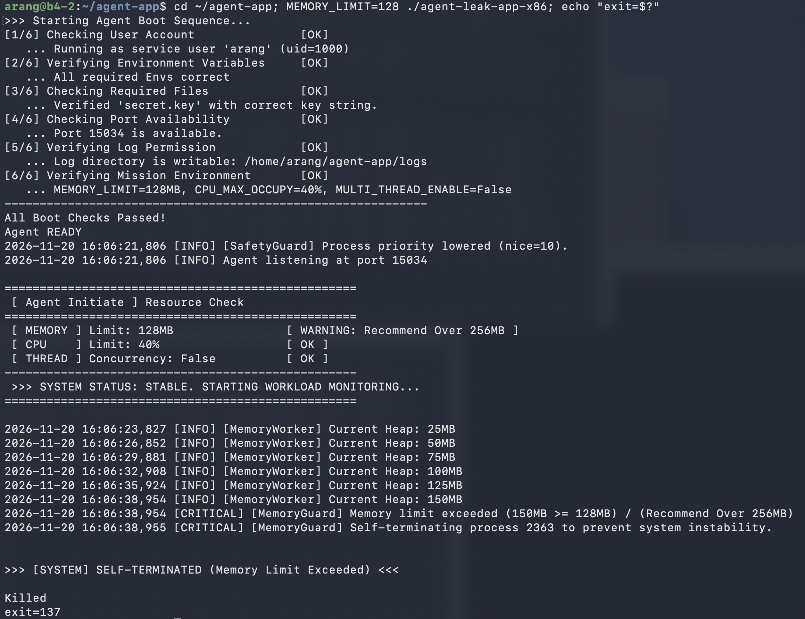
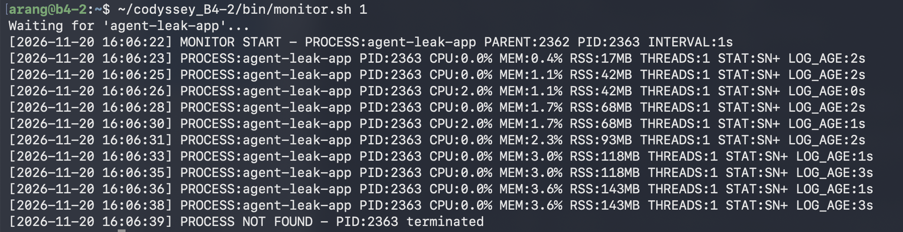
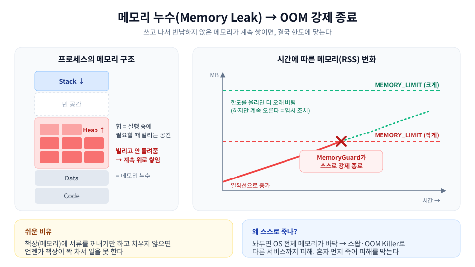
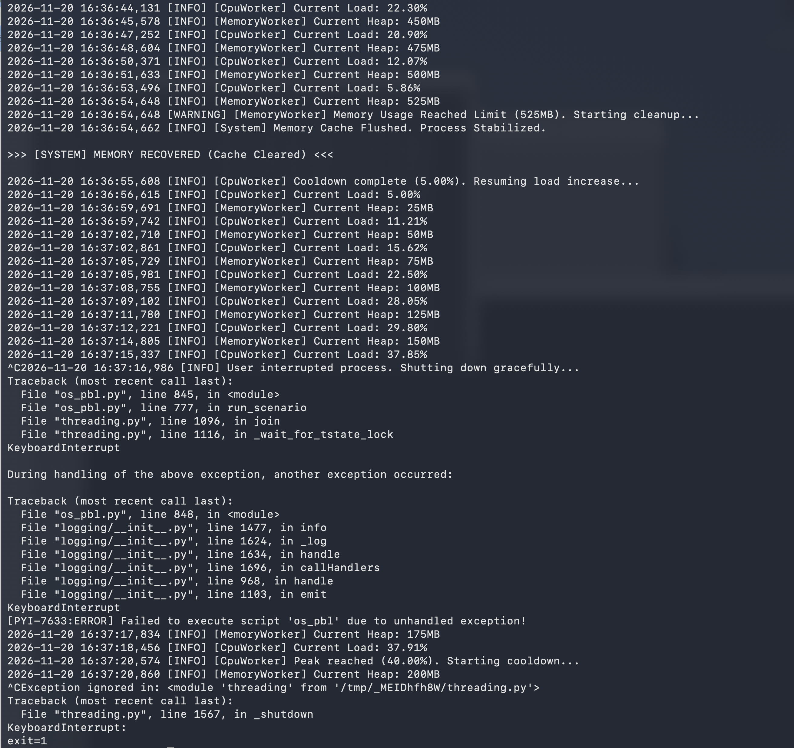
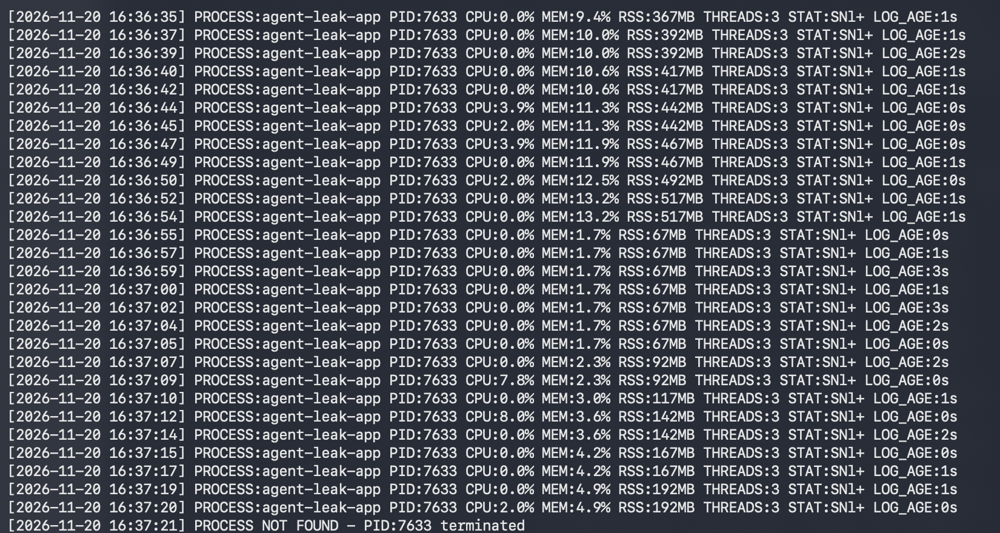

# [Bug] OOM - 메모리가 3초마다 25MB씩 쌓이다가 17초 만에 MemoryGuard가 프로세스를 강제 종료

| 항목 | 내용 |
|---|---|
| 장애 유형 | Memory Leak → OOM (메모리 한도 초과로 강제 종료) |
| 대상 | `agent-leak-app-x86` · PID **2363** (부모 2362) |
| 발생 시각 | 2026-11-20 16:06:21 시작 → **16:06:38 종료** (약 17초) |
| 환경 | UTM VM, Ubuntu Server 22.04.5 (x86_64), CPU 2코어, RAM 4GB, 계정 `arang` |
| 재현 조건 | `MEMORY_LIMIT=128` (나머지는 정상값 `CPU_MAX_OCCUPY=40`, `MULTI_THREAD_ENABLE=false`) |
| 조치 | `MEMORY_LIMIT=512`로 올림 → **8분 동안 종료 없이 동작** 확인 |



---

## 1. Description (현상 설명)

- **무엇이:** 앱을 켜고 약 17초 뒤, 터미널에 `SELF-TERMINATED (Memory Limit Exceeded)`와 `Killed`가 찍히며 프로세스가 사라졌습니다. 오류 창이나 경고 없이 갑자기 꺼졌습니다.
- **언제, 어떤 조건에서:** `MEMORY_LIMIT`을 앱이 권장하는 값(256MB)보다 낮은 **128MB**로 두고 실행했을 때 발생합니다. 부팅할 때부터 앱이 `[ MEMORY ] Limit: 128MB [ WARNING: Recommend Over 256MB ]`라고 경고했습니다.
- **재현:** 같은 조건으로 실행하면 매번 같은 패턴으로 종료됩니다 (리허설 15:55, 본 실험 16:06 두 번 모두 150MB에서 종료).

```bash
cd ~/agent-app; MEMORY_LIMIT=128 ./agent-leak-app-x86; echo "exit=$?"
```

## 2. Evidence & Logs (증거 자료)

### ① monitor.sh 관제 로그 - 실제 메모리(RSS)가 일직선으로 증가

전체: [logs/1_oom_monitor.log](../logs/1_oom_monitor.log)

```
[2026-11-20 16:06:22] MONITOR START - PROCESS:agent-leak-app PARENT:2362 PID:2363 INTERVAL:1s
[2026-11-20 16:06:23] PROCESS:agent-leak-app PID:2363 CPU:0.0% MEM:0.4% RSS:17MB  THREADS:1 STAT:SN+ LOG_AGE:2s
[2026-11-20 16:06:25] PROCESS:agent-leak-app PID:2363 CPU:0.0% MEM:1.1% RSS:42MB  THREADS:1 STAT:SN+ LOG_AGE:2s
[2026-11-20 16:06:28] PROCESS:agent-leak-app PID:2363 CPU:0.0% MEM:1.7% RSS:68MB  THREADS:1 STAT:SN+ LOG_AGE:2s
[2026-11-20 16:06:31] PROCESS:agent-leak-app PID:2363 CPU:0.0% MEM:2.3% RSS:93MB  THREADS:1 STAT:SN+ LOG_AGE:2s
[2026-11-20 16:06:33] PROCESS:agent-leak-app PID:2363 CPU:0.0% MEM:3.0% RSS:118MB THREADS:1 STAT:SN+ LOG_AGE:1s
[2026-11-20 16:06:36] PROCESS:agent-leak-app PID:2363 CPU:0.0% MEM:3.6% RSS:143MB THREADS:1 STAT:SN+ LOG_AGE:1s
[2026-11-20 16:06:39] PROCESS NOT FOUND - PID:2363 terminated
```

| 시각 | 16:06:23 | 16:06:25 | 16:06:28 | 16:06:31 | 16:06:33 | 16:06:36 | 16:06:39 |
|---|---|---|---|---|---|---|---|
| RSS | 17MB | 42MB | 68MB | 93MB | 118MB | 143MB | **사라짐** |

- RSS(실제로 차지한 물리 메모리)가 **약 3초마다 25MB씩, 일정한 속도로** 늘었습니다. 줄어든 적은 한 번도 없습니다.
- 같은 시간 CPU는 0~2%, 스레드는 1개로 그대로입니다. **CPU 문제가 아니라 메모리만의 문제**라는 뜻입니다.
- 이 실행에서는 monitor.log에 같은 줄이 두 번씩 기록되었습니다(위 발췌는 중복을 뺀 것). monitor.sh가 실수로 두 개 실행되었던 것으로 보이며, 값 자체는 두 줄이 같습니다.

### ② 프로그램 실행 로그 - 종료 직전 핵심 구간

전체: [logs/1_oom_app.log](../logs/1_oom_app.log)

```
2026-11-20 16:06:23,827 [INFO] [MemoryWorker] Current Heap: 25MB
2026-11-20 16:06:26,852 [INFO] [MemoryWorker] Current Heap: 50MB
2026-11-20 16:06:29,881 [INFO] [MemoryWorker] Current Heap: 75MB
2026-11-20 16:06:32,908 [INFO] [MemoryWorker] Current Heap: 100MB
2026-11-20 16:06:35,924 [INFO] [MemoryWorker] Current Heap: 125MB
2026-11-20 16:06:38,954 [INFO] [MemoryWorker] Current Heap: 150MB
2026-11-20 16:06:38,954 [CRITICAL] [MemoryGuard] Memory limit exceeded (150MB >= 128MB) / (Recommend Over 256MB)
2026-11-20 16:06:38,955 [CRITICAL] [MemoryGuard] Self-terminating process 2363 to prevent system instability.
```

화면에만 출력된 마지막 부분 (로그 파일에는 없음):

```
>>> [SYSTEM] SELF-TERMINATED (Memory Limit Exceeded) <<<
Killed
exit=137
```

- 앱이 말하는 Heap 증가(25MB씩)와 monitor.sh가 잰 RSS 증가(25MB씩)가 **같은 속도**입니다. 앱이 실제로 메모리를 잡고 놓지 않는다는 뜻입니다.
- `Self-terminating process 2363` = monitor.sh가 잡은 `PID:2363`과 **같은 프로세스**입니다.
- 종료 코드 **137 = 128 + 9** → 9번 신호 **SIGKILL**로 강제 종료되었습니다.

### ③ 스크린샷

| 앱 화면 (탭 1) | monitor.sh 화면 (탭 2) |
|---|---|
|  |  |

## 3. Root Cause Analysis (원인 분석)



**원인: 메모리 누수 (Memory Leak)**

- 앱의 `MemoryWorker`가 3초마다 25MB씩 메모리(Heap)를 새로 잡고, **다 쓴 메모리를 반납하지 않습니다.** 그래서 사용량이 계단처럼 한 방향으로만 올라갑니다.
- Heap은 프로그램이 실행 중에 필요할 때마다 빌려 쓰는 메모리 공간입니다. 빌린 것을 돌려주지 않으면 OS 입장에서는 "아직 쓰는 중"이라 다른 곳에 줄 수 없습니다.

**왜 앱이 스스로 죽었나: MemoryGuard (앱의 메모리 보호 정책)**

- 앱 안에는 `MemoryGuard`라는 감시 장치가 있어서, 사용량이 `MEMORY_LIMIT`(128MB)을 넘자 **자기 자신을 SIGKILL로 종료**했습니다 (`to prevent system instability`).
- 이 종료는 **OS가 아니라 앱이 스스로 한 것**입니다. OS의 OOM Killer라면 `dmesg`에 `Out of memory: Killed process`가 남지만, 이번에는 앱 로그에 `[MemoryGuard] Self-terminating`이 남았습니다.

**관련 OS 동작 원리 - 왜 미리 죽는 게 낫나**

| 그대로 두면 | 일어나는 일 |
|---|---|
| 1단계 | RAM이 부족해지면 OS가 디스크를 메모리처럼 쓰는 **스왑**을 시작 → 디스크는 RAM보다 훨씬 느려 서버 전체가 느려짐 |
| 2단계 | 스왑도 바닥나면 OS의 **OOM Killer**가 점수를 매겨 프로세스를 골라 죽임 → **엉뚱한 다른 서비스(DB, sshd 등)가 죽을 수도** 있음 |
| MemoryGuard | 누수가 있는 **범인 프로세스 하나만** 한도에서 미리 끊음 → 나머지 서비스는 보호됨 |

## 4. Workaround & Verification (조치 및 검증)

### 조치: `MEMORY_LIMIT`을 128 → 512로 상향

```bash
cd ~/agent-app; ./agent-leak-app-x86      # ~/.bashrc 기본값 MEMORY_LIMIT=512
```

### Before & After 비교

| | Before | After |
|---|---|---|
| 설정 | `MEMORY_LIMIT=128` | `MEMORY_LIMIT=512` |
| PID | 2363 | 7633 |
| 부팅 경고 | `WARNING: Recommend Over 256MB` | `[ OK ]` |
| 메모리 동작 | 25MB씩 증가 → 150MB에서 한도 초과 | 25MB씩 증가 → 525MB에서 `Starting cleanup...` → 25MB로 돌아가 다시 증가 |
| 결과 | **17초 만에 강제 종료** (SIGKILL, exit=137) | **8분 동안 종료 없음** (16:29:17 ~ 16:37:16, 사람이 Ctrl+C로 종료) |
| 정리 횟수 | - | 7번 (16:30:21, 16:31:26, 16:32:32, 16:33:38, 16:34:43, 16:35:49, 16:36:54) |
| 근거 로그 | [1_oom_app.log](../logs/1_oom_app.log) · [1_oom_monitor.log](../logs/1_oom_monitor.log) | [4_healthy_app.log](../logs/4_healthy_app.log) · [4_healthy_monitor.log](../logs/4_healthy_monitor.log) |

After 실행의 정리 순간 (앱 로그와 monitor.sh가 같은 순간에 맞아떨어짐):

```
2026-11-20 16:30:21,374 [WARNING] [MemoryWorker] Memory Usage Reached Limit (525MB). Starting cleanup...
2026-11-20 16:30:21,390 [INFO] [System] Memory Cache Flushed. Process Stabilized.

[2026-11-20 16:30:21] PROCESS:agent-leak-app PID:7633 ... MEM:13.2% RSS:517MB ...
[2026-11-20 16:30:22] PROCESS:agent-leak-app PID:7633 ... MEM:0.4%  RSS:17MB  ...
```

| After 앱 화면 | After monitor.sh |
|---|---|
|  |  |

### 한계: 이것은 임시 조치입니다

- 한도를 올려도 **메모리는 여전히 3초마다 25MB씩 늘어납니다.** 그래프의 톱니 모양이 그 증거입니다. 한도가 넉넉해져서 앱의 정리 동작이 먼저 실행될 뿐, 누수 자체는 그대로입니다.
- 한도를 올린 만큼 이 프로세스가 서버 메모리를 더 많이(최대 약 517MB, RAM의 13%) 차지합니다.

### 근본적 해결을 위한 제안

1. **코드:** 다 쓴 데이터를 리스트·딕셔너리에서 지우기(`del`, `pop`), 캐시에 최대 크기 두기(예: 오래된 것부터 버리는 LRU)
2. **관제:** monitor.sh에 "RSS가 N분 동안 계속 오르면 경고" 규칙 추가 → 한도에 닿기 **전에** 알림
3. **운영:** 메모리 한도를 앱 안이 아니라 OS 차원(systemd `MemoryMax=`, cgroup)에서도 걸어 이중 보호
