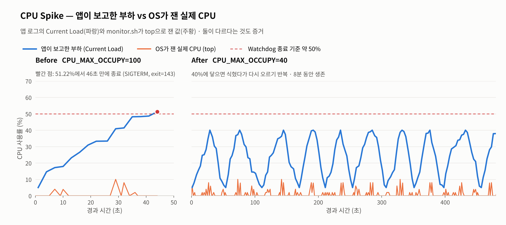
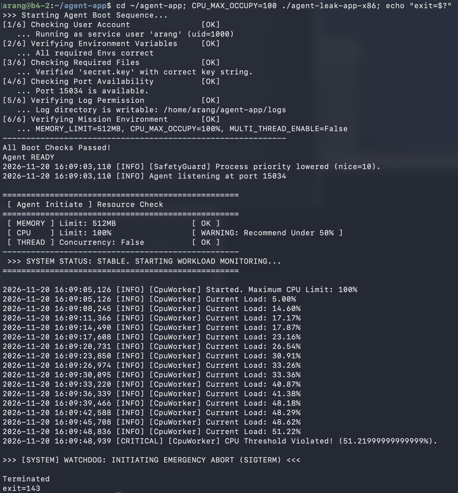
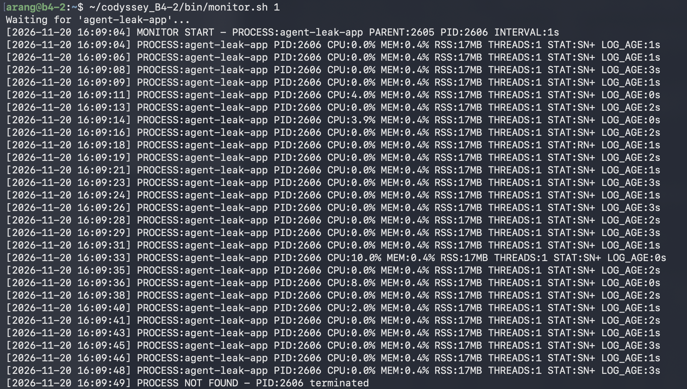
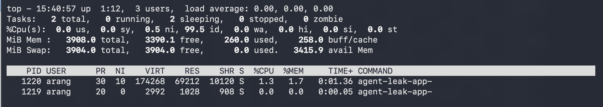
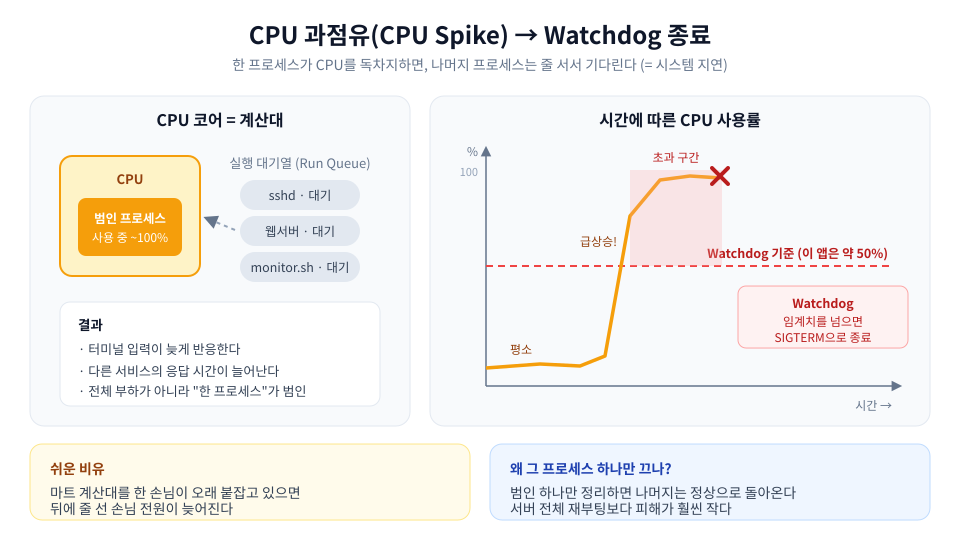

# [Bug] CPU Spike - 앱이 보고한 CPU 부하가 50%를 넘는 순간 Watchdog이 SIGTERM으로 종료

> **요약**
> - 앱의 `CpuWorker`가 부하를 3초마다 올렸고, **50%를 넘는 순간 Watchdog이 SIGTERM으로 종료**했다 (46초, exit=143).
> - 같은 시간 OS가 잰 실제 CPU는 0~10%였다. 종료는 **앱이 보고한 내부 수치** 기준이다.
> - 상한을 40%로 낮추자 부하가 40%에서 멈췄다 내려가기를 반복하며 **8분 이상 살아남았다.**

| 항목 | 내용 |
|---|---|
| 장애 유형 | CPU 과점유 → Watchdog 보호 종료 |
| 대상 | `agent-leak-app-x86` · PID **2606** (부모 2605) |
| 발생 시각 | 2026-11-20 16:09:03 시작 → **16:09:48 종료** (약 46초) |
| 환경 | UTM VM, Ubuntu Server 22.04.5 (x86_64), CPU 2코어, RAM 4GB, 계정 `arang` |
| 재현 조건 | `CPU_MAX_OCCUPY=100` (나머지는 정상값 `MEMORY_LIMIT=512`, `MULTI_THREAD_ENABLE=false`) |
| 조치 | `CPU_MAX_OCCUPY=40`으로 낮춤 → **8분 동안 종료 없이 동작** 확인 |



---

## 1. Description (현상 설명)

- **무엇이:** 앱을 켜면 `[CpuWorker] Current Load`가 3초마다 오르다가, 약 46초 뒤 `CPU Threshold Violated!` → `WATCHDOG: INITIATING EMERGENCY ABORT (SIGTERM)` → `Terminated`와 함께 꺼졌습니다.
- **언제, 어떤 조건에서:** `CPU_MAX_OCCUPY`를 50보다 크게 두었을 때 발생합니다. 부팅할 때 앱이 `[ CPU ] Limit: 100% [ WARNING: Recommend Under 50% ]`라고 경고했습니다.
- **재현:** `CPU_MAX_OCCUPY=100`으로 **6번 실행해서 6번 모두** 부하가 50%를 넘는 순간 종료되었습니다 (50.42%, 56.64%, 56.88%, 54.78%, 50.23%, 본 실험 51.22%).

```bash
cd ~/agent-app; CPU_MAX_OCCUPY=100 ./agent-leak-app-x86; echo "exit=$?"
```

## 2. Evidence & Logs (증거 자료)

### ① 프로그램 실행 로그 - 부하 상승과 Watchdog 종료

전체: [logs/2_cpu_app.log](../logs/2_cpu_app.log)

```
2026-11-20 16:09:05,126 [INFO] [CpuWorker] Started. Maximum CPU Limit: 100%
2026-11-20 16:09:05,126 [INFO] [CpuWorker] Current Load: 5.00%
2026-11-20 16:09:17,608 [INFO] [CpuWorker] Current Load: 23.16%
2026-11-20 16:09:33,220 [INFO] [CpuWorker] Current Load: 40.87%
2026-11-20 16:09:45,708 [INFO] [CpuWorker] Current Load: 48.62%
2026-11-20 16:09:48,836 [INFO] [CpuWorker] Current Load: 51.22%
2026-11-20 16:09:48,939 [CRITICAL] [CpuWorker] CPU Threshold Violated! (51.21999999999999%).
```

화면에만 출력된 마지막 부분 (로그 파일에는 없음):

```
>>> [SYSTEM] WATCHDOG: INITIATING EMERGENCY ABORT (SIGTERM) <<<
Terminated
exit=143
```

- 종료 코드 **143 = 128 + 15** → 15번 신호 **SIGTERM**으로 종료되었습니다. 앱이 "오류로 죽은 것"이 아니라 **Watchdog이 보낸 종료 신호**로 꺼졌다는 증거입니다.
- OOM(SIGKILL, 137)과 신호가 다릅니다. SIGTERM은 "정리하고 꺼져"라는 부드러운 신호라서 프로세스가 마무리할 기회가 있습니다.

### ② monitor.sh 관제 로그 - 같은 시간의 실제 CPU

전체: [logs/2_cpu_monitor.log](../logs/2_cpu_monitor.log)

```
[2026-11-20 16:09:04] MONITOR START - PROCESS:agent-leak-app PARENT:2605 PID:2606 INTERVAL:1s
[2026-11-20 16:09:11] PROCESS:agent-leak-app PID:2606 CPU:4.0%  MEM:0.4% RSS:17MB THREADS:1 STAT:SN+ LOG_AGE:0s
[2026-11-20 16:09:33] PROCESS:agent-leak-app PID:2606 CPU:10.0% MEM:0.4% RSS:17MB THREADS:1 STAT:SN+ LOG_AGE:0s
[2026-11-20 16:09:36] PROCESS:agent-leak-app PID:2606 CPU:8.0%  MEM:0.4% RSS:17MB THREADS:1 STAT:SN+ LOG_AGE:0s
[2026-11-20 16:09:48] PROCESS:agent-leak-app PID:2606 CPU:0.0%  MEM:0.4% RSS:17MB THREADS:1 STAT:SN+ LOG_AGE:3s
[2026-11-20 16:09:49] PROCESS NOT FOUND - PID:2606 terminated
```

| | 앱이 보고한 부하 (Current Load) | OS가 잰 실제 CPU (top) |
|---|---|---|
| 범위 | 5% → **51.22%** (계속 상승) | **0 ~ 10%** (대부분 0%) |
| 메모리 | - | 17MB로 변화 없음 |

- **두 값이 다릅니다.** 앱의 `Current Load`는 실제로 CPU를 그만큼 쓴 값이 아니라, 앱 안에서 계산해 올리는 **시뮬레이션 수치**로 판단됩니다. Watchdog은 이 앱 내부 수치를 보고 종료를 결정했습니다.
- 그래서 이 장애는 `top`으로는 "급상승"이 보이지 않고, **앱 로그로만 확인**됩니다. 관제 도구 값과 앱 로그를 **함께** 봐야 하는 이유입니다.
- `STAT:SN+`의 `N`은 우선순위를 낮춘 상태(nice)입니다. 앱 로그의 `[SafetyGuard] Process priority lowered (nice=10).`와 일치합니다.

### ③ 스크린샷

**앱 화면** - Current Load 5% → 51.22% → `WATCHDOG ... SIGTERM` → `exit=143`



**monitor.sh 화면** - 같은 시간 실제 CPU 0~10%



**`top`으로 직접 본 실제 CPU** (리허설 실행, `CPU_MAX_OCCUPY=40`, PID 1220, 15:40:57)



- 같은 순간 앱 로그는 `15:40:57,774 [CpuWorker] Current Load: 25.34%`였지만, `top`의 자식 프로세스(NI 10) `%CPU`는 **1.3**, 서버 전체는 `99.5 id`(99.5% 놀고 있음)였습니다.

## 3. Root Cause Analysis (원인 분석)



**원인: 부하 상한(`CPU_MAX_OCCUPY`)이 Watchdog 기준(약 50%)보다 높게 설정됨**

- `CpuWorker`는 부하를 3초마다 조금씩 올리며, **`CPU_MAX_OCCUPY`까지** 올라갑니다 (`Maximum CPU Limit: 100%`).
- 앱 안의 **Watchdog은 부하가 약 50%를 넘으면** 종료합니다. 이 기준은 `CPU_MAX_OCCUPY` 값과 상관없이 고정되어 있었습니다 (100으로 설정해도 50.23~56.88%에서 종료).
- 그래서 상한이 50보다 크면 → 부하가 50%를 뚫고 올라감 → Watchdog이 SIGTERM.

**관련 OS 동작 원리 - 왜 프로세스 하나를 끄나**

- CPU 코어는 한 순간에 한 프로세스만 실행합니다. OS의 **스케줄러**가 차례를 정해 시간을 나눠 주는데, 한 프로세스가 계속 CPU를 차지하면 나머지는 **실행 대기열(Run Queue)에서 기다려야** 합니다.
- 그 결과 sshd(원격 접속), 웹 서버, 관제 스크립트까지 **응답이 느려집니다**. 서버 전체를 재부팅하면 모든 서비스가 멈추지만, **범인 하나만 끄면** 나머지는 바로 정상으로 돌아옵니다.
- 이 앱은 스스로 `nice=10`으로 우선순위를 낮추는 `SafetyGuard`도 가지고 있습니다. 우선순위를 낮춰도 위험하다고 판단되면 Watchdog이 마지막 수단으로 종료합니다.

## 4. Workaround & Verification (조치 및 검증)

### 조치: `CPU_MAX_OCCUPY`를 100 → 40으로 하향 (앱 권장값 50 미만)

```bash
cd ~/agent-app; ./agent-leak-app-x86      # ~/.bashrc 기본값 CPU_MAX_OCCUPY=40
```

### Before & After 비교

| | Before | After |
|---|---|---|
| 설정 | `CPU_MAX_OCCUPY=100` | `CPU_MAX_OCCUPY=40` |
| PID | 2606 | 7633 |
| 부팅 경고 | `WARNING: Recommend Under 50%` | `[ OK ]` |
| 부하 동작 | 5% → 51.22%까지 계속 상승 | 40%에 닿으면 `Peak reached (40.00%). Starting cooldown...` → 5%까지 내렸다가 다시 상승 |
| 결과 | **46초 만에 종료** (SIGTERM, exit=143) | **8분 동안 종료 없음** (16:29:17 ~ 16:37:16, 사람이 Ctrl+C로 종료) |
| 최고 부하 | 51.22% | 40.00% (10번 도달, 한 번도 넘지 않음) |
| 근거 로그 | [2_cpu_app.log](../logs/2_cpu_app.log) · [2_cpu_monitor.log](../logs/2_cpu_monitor.log) | [4_healthy_app.log](../logs/4_healthy_app.log) · [4_healthy_monitor.log](../logs/4_healthy_monitor.log) |

After 실행의 핵심 구간:

```
2026-11-20 16:29:47,927 [INFO] [CpuWorker] Peak reached (40.00%). Starting cooldown...
2026-11-20 16:30:12,895 [INFO] [CpuWorker] Cooldown complete (5.00%). Resuming load increase...
```

### 한계와 근본적 해결 제안

- 이 조치는 **부하를 Watchdog 기준 아래로 묶어 두는 것**입니다. 실제 서비스라면 "처리량을 일부러 줄인 것"이기도 해서, 일이 많아지면 처리가 밀릴 수 있습니다.
- 제안:
  1. **코드:** 무거운 계산을 잘게 나눠 중간중간 쉬게 하기(`sleep`, 작업 큐), 바쁜 반복문(busy loop) 제거
  2. **운영:** OS 차원에서 CPU 상한 걸기 (systemd `CPUQuota=`, cgroup) → 앱이 실수해도 다른 서비스 보호
  3. **관제:** 앱 내부 수치(Current Load)와 OS 수치(top)를 **둘 다** 기록 → 이번처럼 두 값이 다를 때 바로 발견
