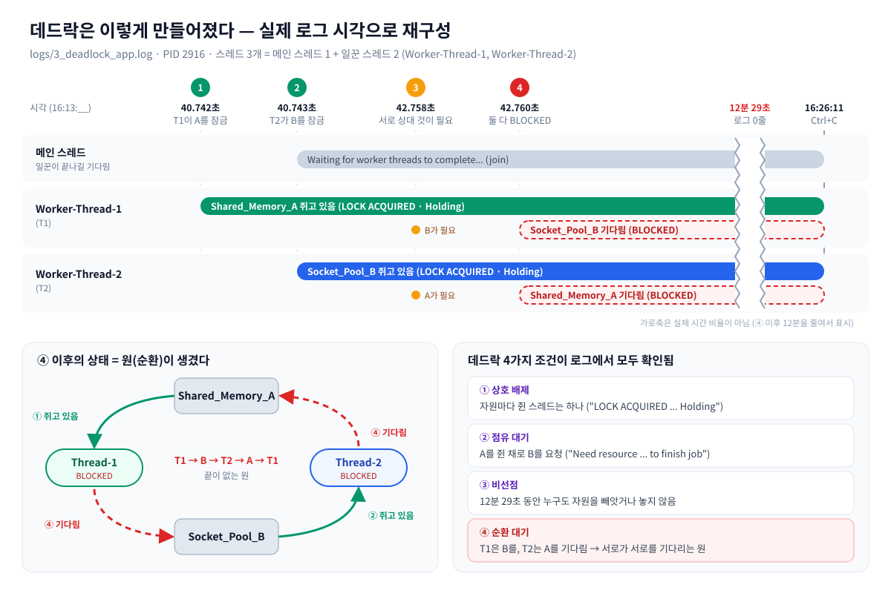
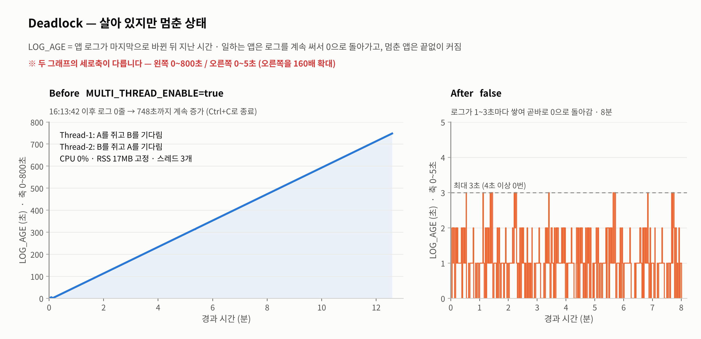
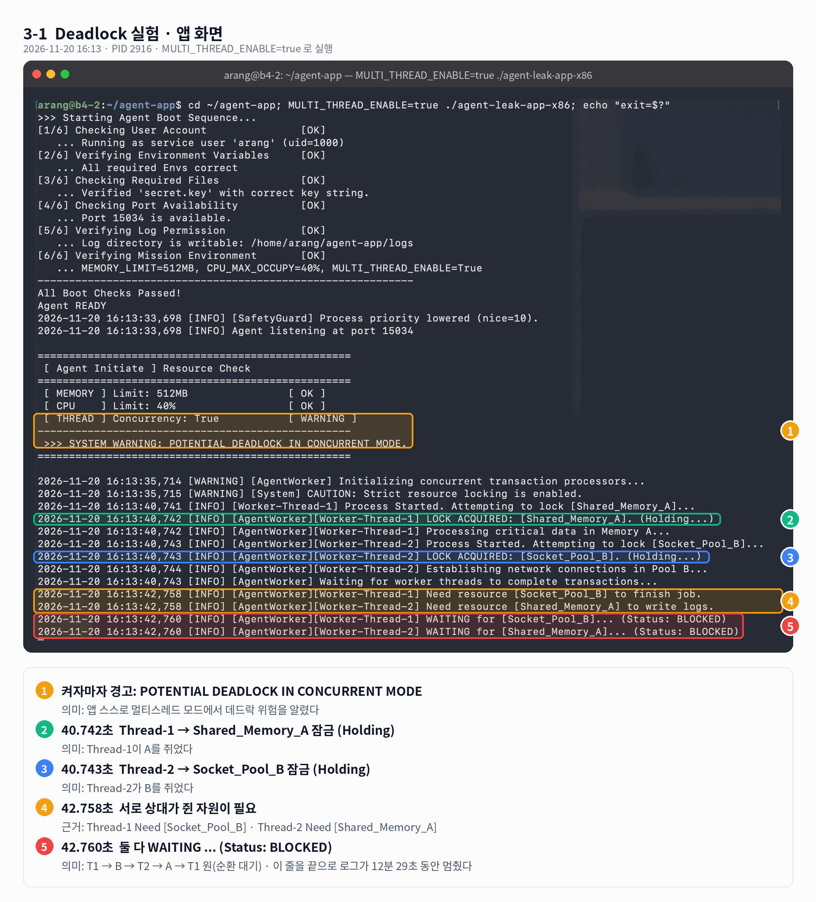
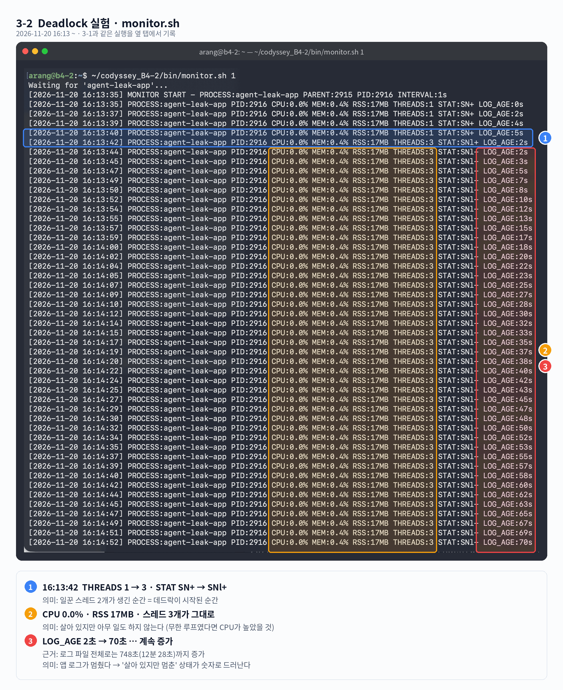
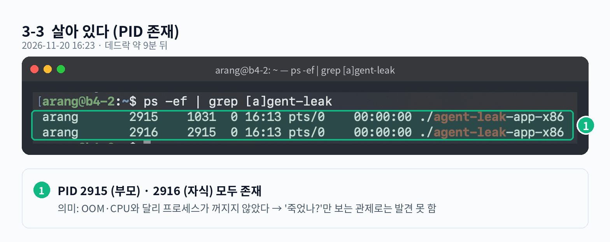
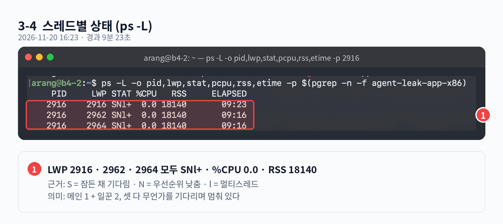
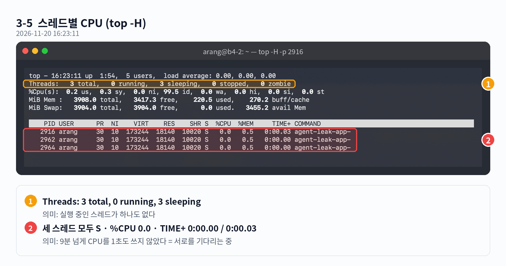
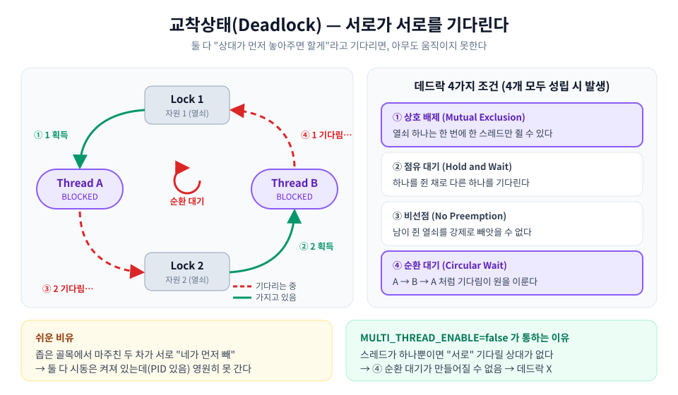
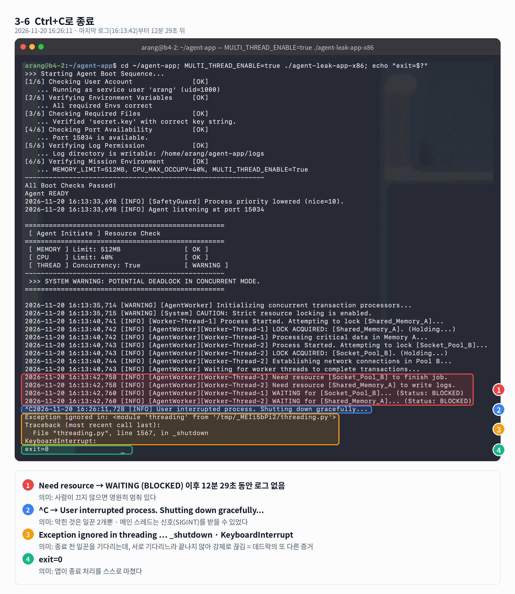

# [Bug] Deadlock - 멀티스레드 모드에서 두 스레드가 서로의 자원을 기다리며 12분 넘게 무응답

> **요약**
> - Thread-1은 A를 쥐고 B를, Thread-2는 B를 쥐고 A를 기다려 **서로가 서로를 기다리는 원**이 생겼다.
> - 프로세스는 살아 있었지만 CPU 0% · 메모리 고정 · **로그 0줄로 12분 29초** 동안 멈춰 있었다.
> - 멀티스레드를 끄자 기다릴 상대가 없어져 **데드락이 사라졌다.**

| 항목 | 내용 |
|---|---|
| 장애 유형 | 교착상태 (Deadlock) → 프로세스는 살아 있으나 무응답 |
| 대상 | `agent-leak-app-x86` · PID **2916** (부모 2915) · 스레드 3개 |
| 발생 시각 | 2026-11-20 16:13:33 시작 → **16:13:42 이후 로그 정지** → 16:26:11 Ctrl+C (약 12분 29초 정지) |
| 환경 | UTM VM, Ubuntu Server 22.04.5 (x86_64), CPU 2코어, RAM 4GB, 계정 `arang` |
| 재현 조건 | `MULTI_THREAD_ENABLE=true` (나머지는 정상값 `MEMORY_LIMIT=512`, `CPU_MAX_OCCUPY=40`) |
| 조치 | `MULTI_THREAD_ENABLE=false` → 데드락 없이 **8분 동안 로그가 계속 쌓임** 확인 |



---

## 1. Description (현상 설명)

- **무엇이:** 앱을 켜고 약 9초 뒤 `WAITING ... (Status: BLOCKED)` 두 줄을 끝으로 **로그가 완전히 멈췄습니다.** 프로세스는 꺼지지 않았고, 화면도 반응이 없었습니다.
- **OOM·CPU와 다른 점:** 앞의 두 장애는 프로세스가 **사라졌지만**, 이번에는 **살아 있는데 아무 일도 안 하는** 상태입니다. 그래서 "죽었나?"만 확인하는 관제로는 발견되지 않습니다.
- **언제, 어떤 조건에서:** `MULTI_THREAD_ENABLE=true`일 때 발생합니다. 부팅할 때 앱이 `[ THREAD ] Concurrency: True [ WARNING ]`, `SYSTEM WARNING: POTENTIAL DEADLOCK IN CONCURRENT MODE.`라고 경고했습니다.
- **재현:** 리허설(15:56)과 본 실험(16:13) 두 번 모두 같은 지점에서 멈췄습니다.

```bash
cd ~/agent-app; MULTI_THREAD_ENABLE=true ./agent-leak-app-x86; echo "exit=$?"
```

## 2. Evidence & Logs (증거 자료)

### ① 살아 있다 - PID 존재

```
$ ps -ef | grep [a]gent-leak
arang   2915   1031  0 16:13 pts/0  00:00:00 ./agent-leak-app-x86     ← 부모
arang   2916   2915  0 16:13 pts/0  00:00:00 ./agent-leak-app-x86     ← 자식 (실제 일꾼)
```

### ② 아무 일도 안 한다 - 스레드별 CPU·메모리 변화 없음

```
$ ps -L -o pid,lwp,stat,pcpu,rss,etime -p 2916
    PID     LWP STAT %CPU   RSS   ELAPSED
   2916    2916 SNl+  0.0 18140     09:23      ← 메인 스레드
   2916    2962 SNl+  0.0 18140     09:16      ← 일꾼 스레드
   2916    2964 SNl+  0.0 18140     09:16      ← 일꾼 스레드
```

```
$ top -H -p 2916        (16:23:11)
Threads:   3 total,   0 running,   3 sleeping
  PID USER  PR NI   VIRT   RES   SHR S %CPU %MEM   TIME+ COMMAND
 2916 arang 30 10 173244 18140 10020 S  0.0  0.5 0:00.03 agent-leak-app-
 2962 arang 30 10 173244 18140 10020 S  0.0  0.5 0:00.00 agent-leak-app-
 2964 arang 30 10 173244 18140 10020 S  0.0  0.5 0:00.00 agent-leak-app-
```

- 3개 스레드 모두 `S`(잠든 채 기다림), `%CPU 0.0`, **`TIME+ 0:00.00`** → 9분 넘게 CPU를 단 1초도 쓰지 않았습니다.
- `STAT SNl+` = **S** 대기 · **N** 우선순위 낮춤(nice) · **l** 멀티스레드 · **+** 터미널 앞에서 실행 중
- 만약 무한 루프였다면 CPU가 100% 가까이 나왔을 것입니다. **CPU 0%로 멈춘 것은 "무언가를 기다리는 중"**이라는 뜻입니다.

### ③ monitor.sh 관제 로그 - 로그가 멈춘 시간(LOG_AGE)만 계속 증가

전체: [logs/3_deadlock_monitor.log](../logs/3_deadlock_monitor.log)

```
[2026-11-20 16:13:40] PROCESS:agent-leak-app PID:2916 CPU:0.0% MEM:0.4% RSS:17MB THREADS:1 STAT:SN+  LOG_AGE:5s
[2026-11-20 16:13:42] PROCESS:agent-leak-app PID:2916 CPU:0.0% MEM:0.4% RSS:17MB THREADS:3 STAT:SNl+ LOG_AGE:2s   ← 스레드 1→3
[2026-11-20 16:14:42] PROCESS:agent-leak-app PID:2916 CPU:0.0% MEM:0.4% RSS:17MB THREADS:3 STAT:SNl+ LOG_AGE:60s
[2026-11-20 16:20:02] PROCESS:agent-leak-app PID:2916 CPU:0.0% MEM:0.4% RSS:17MB THREADS:3 STAT:SNl+ LOG_AGE:380s
[2026-11-20 16:26:10] PROCESS:agent-leak-app PID:2916 CPU:0.0% MEM:0.4% RSS:17MB THREADS:3 STAT:SNl+ LOG_AGE:748s
```



- `LOG_AGE`는 monitor.sh가 앱 로그 파일의 마지막 수정 시각을 보고 계산한 값입니다. 정상이면 0~3초를 오가는데, 여기서는 **0초 → 748초(12분 28초)까지 쉬지 않고 증가**했습니다. (16:26:11에 0초로 돌아간 것은 Ctrl+C를 눌러 앱이 종료 로그를 썼기 때문입니다.)
- CPU 0%, RSS 17MB, 스레드 3개가 12분 동안 **한 번도 변하지 않았습니다.**

### ④ 프로그램 실행 로그 - 마지막 기록

전체: [logs/3_deadlock_app.log](../logs/3_deadlock_app.log)

```
16:13:40,741 [INFO] [Worker-Thread-1] Process Started. Attempting to lock [Shared_Memory_A]...
16:13:40,742 [INFO] [AgentWorker][Worker-Thread-1] LOCK ACQUIRED: [Shared_Memory_A]. (Holding...)
16:13:40,743 [INFO] [AgentWorker][Worker-Thread-2] Process Started. Attempting to lock [Socket_Pool_B]...
16:13:40,743 [INFO] [AgentWorker] Waiting for worker threads to complete transactions...
16:13:40,743 [INFO] [AgentWorker][Worker-Thread-2] LOCK ACQUIRED: [Socket_Pool_B]. (Holding...)
16:13:42,758 [INFO] [AgentWorker][Worker-Thread-1] Need resource [Socket_Pool_B] to finish job.
16:13:42,758 [INFO] [AgentWorker][Worker-Thread-2] Need resource [Shared_Memory_A] to write logs.
16:13:42,760 [INFO] [AgentWorker][Worker-Thread-1] WAITING for [Socket_Pool_B]... (Status: BLOCKED)
16:13:42,760 [INFO] [AgentWorker][Worker-Thread-2] WAITING for [Shared_Memory_A]... (Status: BLOCKED)
          ── 이후 12분 29초 동안 로그 0줄 ──
16:26:11,728 [INFO] User interrupted process. Shutting down gracefully...
```

### ⑤ 스크린샷

**앱 화면** - 마지막 로그 `WAITING ... (Status: BLOCKED)` 두 줄



**monitor.sh** - CPU 0% · RSS 17MB 고정, LOG_AGE만 증가



**`ps -ef`** - PID 2915, 2916 살아 있음



**`ps -L`** - 스레드 3개 모두 `SNl+`, `%CPU 0.0`



**`top -H`** - 스레드 3개 모두 `S`, `TIME+ 0:00.00`



## 3. Root Cause Analysis (원인 분석)

### 로그로 추적한 순환 의존 (A→B, B→A)

마지막 로그를 **스레드별로 나눠서** 시간순으로 읽으면 다음과 같습니다.

| 시각 (16:13:__) | Worker-Thread-1 | Worker-Thread-2 |
|---|---|---|
| 40.742 | ① `Shared_Memory_A` **잠금 성공** (쥐고 있음) | |
| 40.743 | | ② `Socket_Pool_B` **잠금 성공** (쥐고 있음) |
| 42.758 | ③ 일을 끝내려면 `Socket_Pool_B`가 필요 | ③ 로그를 쓰려면 `Shared_Memory_A`가 필요 |
| 42.760 | ④ **B를 기다림** (BLOCKED) | ④ **A를 기다림** (BLOCKED) |

- Thread-1이 기다리는 **B는 Thread-2가 쥐고 있고**, Thread-2가 기다리는 **A는 Thread-1이 쥐고 있습니다.**
- 둘 다 "상대가 먼저 놓아주면 진행하겠다"고 기다리기 때문에 **누구도 영원히 진행할 수 없습니다.** → `T1 → B → T2 → A → T1` 원(순환)
- 메인 스레드도 `Waiting for worker threads to complete transactions...`(join)로 두 일꾼이 끝나기를 기다리고 있어서 **프로세스 전체가 멈췄습니다.** 그래서 스레드 3개가 모두 `S` 상태입니다.

### 데드락 4가지 조건 (4개가 모두 성립해야 발생)



| 조건 | 쉬운 뜻 | 이번 로그에서 |
|---|---|---|
| **상호 배제** | 자원 하나는 한 번에 한 스레드만 쥘 수 있다 | `LOCK ACQUIRED ... (Holding...)` → A는 T1만, B는 T2만 |
| 점유 대기 | 하나를 쥔 채로 다른 하나를 기다린다 | T1은 A를 쥔 채 B 요청, T2는 B를 쥔 채 A 요청 |
| 비선점 | 남이 쥔 자원을 강제로 뺏을 수 없다 | 12분 29초 동안 누구도 놓거나 빼앗지 않음 |
| **순환 대기** | 기다림이 원을 이룬다 | T1 → B(T2 소유) → T2 → A(T1 소유) → T1 |

넷 중 **하나만 깨도** 데드락은 생기지 않습니다. 임시 조치(아래)는 스레드를 하나로 만들어 **순환 대기**를 깬 것입니다.

### 끄는 과정에서 나온 추가 증거

`Ctrl + C`를 누르자 메인 스레드는 신호(SIGINT)를 받아 `Shutting down gracefully...`를 찍었지만, 이어서 다음 오류가 나왔습니다.

```
Exception ignored in: <module 'threading' from '/tmp/_MEIi5bPi2/threading.py'>
  File "threading.py", line 1567, in _shutdown
KeyboardInterrupt:
exit=0
```

- 파이썬은 끝나기 전에 일꾼 스레드가 끝나기를 기다리는데(`_shutdown`), 두 스레드는 **서로를 기다리느라 영원히 끝나지 않으므로** 그 기다림이 강제로 끊긴 것입니다. 데드락 상태를 한 번 더 보여 주는 기록입니다.



## 4. Workaround & Verification (조치 및 검증)

### 조치: `MULTI_THREAD_ENABLE`을 true → false

```bash
cd ~/agent-app; ./agent-leak-app-x86      # ~/.bashrc 기본값 MULTI_THREAD_ENABLE=false
```

### Before & After 비교

| | Before | After |
|---|---|---|
| 설정 | `MULTI_THREAD_ENABLE=true` | `MULTI_THREAD_ENABLE=false` |
| PID | 2916 | 7633 |
| 부팅 화면 | `POTENTIAL DEADLOCK IN CONCURRENT MODE.` | `Scenario Selected: [Healthy System Monitoring]` |
| 잠금 동작 | T1·T2가 A·B를 하나씩 쥐고 서로 기다림 | 서로 기다리는 잠금 처리 자체가 실행되지 않음 |
| 로그 | 16:13:42 이후 **0줄** | 8분 동안 계속 기록 (372줄) |
| LOG_AGE (monitor.sh) | 0 → **748초**까지 증가 | 8분 내내 **0~3초** |
| 결과 | **데드락 재현** (12분 29초 무응답, Ctrl+C로 종료) | **데드락 회피** |
| 근거 로그 | [3_deadlock_app.log](../logs/3_deadlock_app.log) · [3_deadlock_monitor.log](../logs/3_deadlock_monitor.log) | [4_healthy_app.log](../logs/4_healthy_app.log) · [4_healthy_monitor.log](../logs/4_healthy_monitor.log) |

### 한계와 근본적 해결 제안

- 멀티스레드를 끄면 데드락은 사라지지만, **여러 일을 동시에 처리하는 능력도 함께 잃습니다.**
- 제안 (코드 수정이 가능하다면):
  1. **잠금 순서 고정:** 모든 스레드가 항상 `A → B` 순서로만 잠그게 하기 → 순환 대기가 생길 수 없음
  2. **기다림에 시간 제한:** `lock.acquire(timeout=5)`처럼 일정 시간 안에 못 얻으면 쥐고 있던 것을 놓고 다시 시도 → 비선점·점유 대기를 깸
  3. **잠금 하나로 합치기:** A와 B를 항상 같이 쓴다면 잠금 하나로 묶기
  4. **관제:** monitor.sh의 `LOG_AGE`가 일정 시간(예: 60초) 넘으면 경고 → "살아 있지만 멈춘" 상태를 자동 발견
