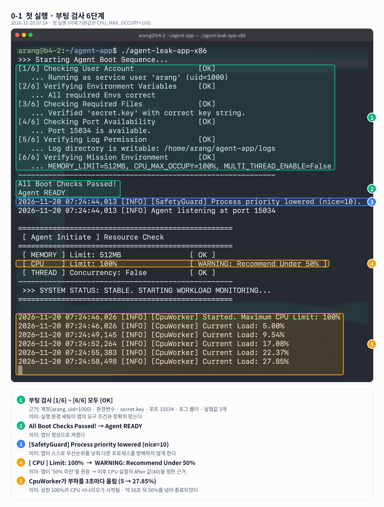
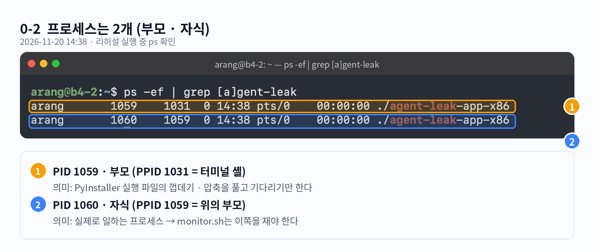
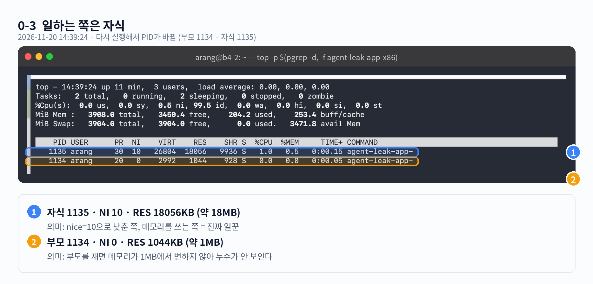

# 0. 실행 환경 · 앱 구조

> 앱이 정상으로 켜지는지, 프로세스가 어떻게 생겼는지 확인한 화면입니다.
> 자세한 분석 → [수행과정 §1](../../수행과정.md#1-제공-앱-분석)

**보는 법** · 창 제목 = 그 화면에서 실제로 친 명령 · 색 상자와 번호 = 봐야 할 줄 · 아래 패널 = 근거와 의미 · 원본은 [`original/`](original/)

| 사진 | 무엇을 증명하나 |
|:--|:--|
| [0-1](#0-1) | 첫 실행 · 부팅 검사 6단계 |
| [0-2](#0-2) | 프로세스는 2개 (부모 · 자식) |
| [0-3](#0-3) | 일하는 쪽은 자식 |

---

## 0-1  첫 실행 · 부팅 검사 6단계

2026-11-20 07:24 · 첫 실행 (이때 기본값은 CPU_MAX_OCCUPY=100)

원본: [`original/0-1_boot_ok.png`](original/0-1_boot_ok.png)

---

## 0-2  프로세스는 2개 (부모 · 자식)

2026-11-20 14:38 · 리허설 실행 중 ps 확인

원본: [`original/0-2_parent_child_ps.png`](original/0-2_parent_child_ps.png)

---

## 0-3  일하는 쪽은 자식

2026-11-20 14:39:24 · 다시 실행해서 PID가 바뀜 (부모 1134 · 자식 1135)

원본: [`original/0-3_parent_child_top.png`](original/0-3_parent_child_top.png)
