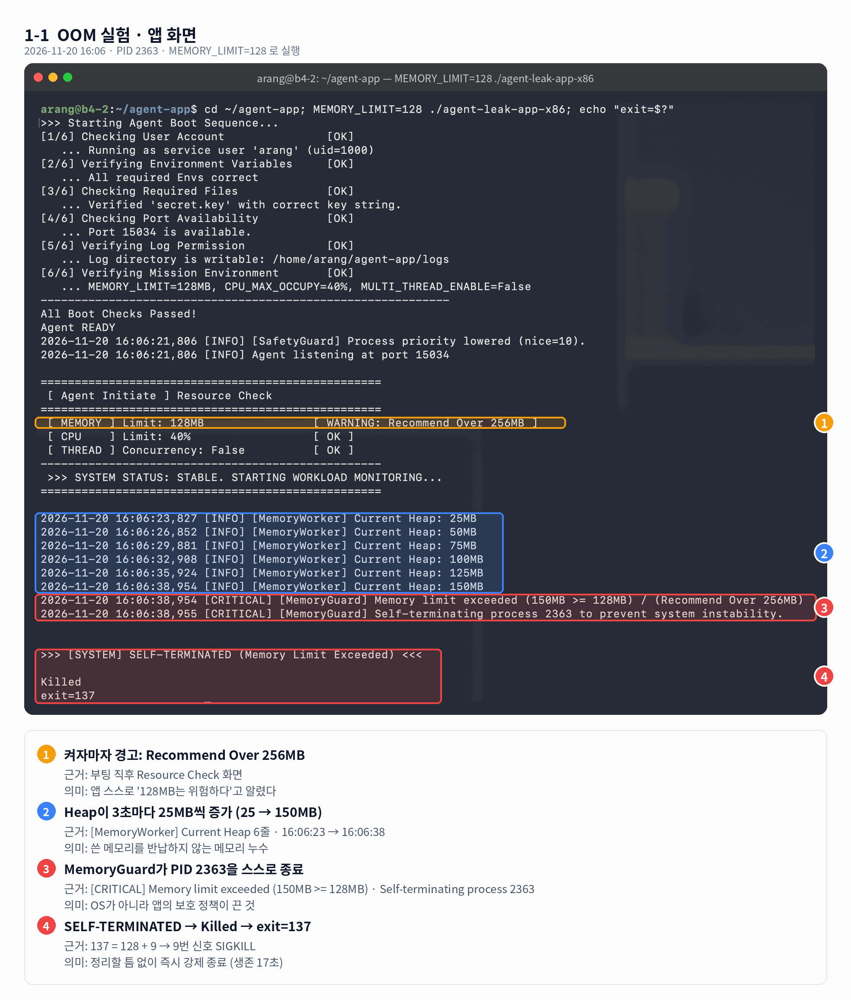
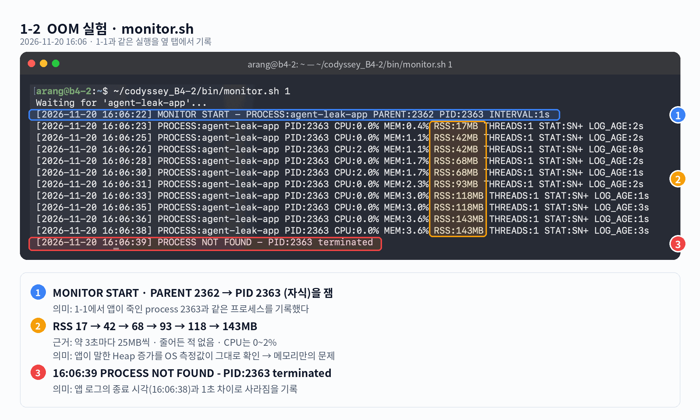

# 1. 🔴 OOM 실험

> `MEMORY_LIMIT=128`로 실행해서 메모리 누수 → MemoryGuard 강제 종료를 재현한 화면입니다.
> 자세한 분석 → [OOM 리포트](../../reports/01-oom.md)

**보는 법** · 창 제목 = 그 화면에서 실제로 친 명령 · 색 상자와 번호 = 봐야 할 줄 · 아래 패널 = 근거와 의미 · 원본은 [`original/`](original/)

| 사진 | 무엇을 증명하나 |
|:--|:--|
| [1-1](#1-1) | OOM 실험 · 앱 화면 |
| [1-2](#1-2) | OOM 실험 · monitor.sh |

---

## 1-1  OOM 실험 · 앱 화면

2026-11-20 16:06 · PID 2363 · MEMORY_LIMIT=128 로 실행

원본: [`original/1-1_oom_app.png`](original/1-1_oom_app.png)

---

## 1-2  OOM 실험 · monitor.sh

2026-11-20 16:06 · 1-1과 같은 실행을 옆 탭에서 기록

원본: [`original/1-2_oom_monitor.png`](original/1-2_oom_monitor.png)
