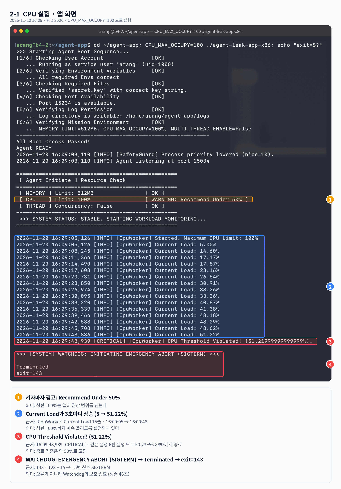
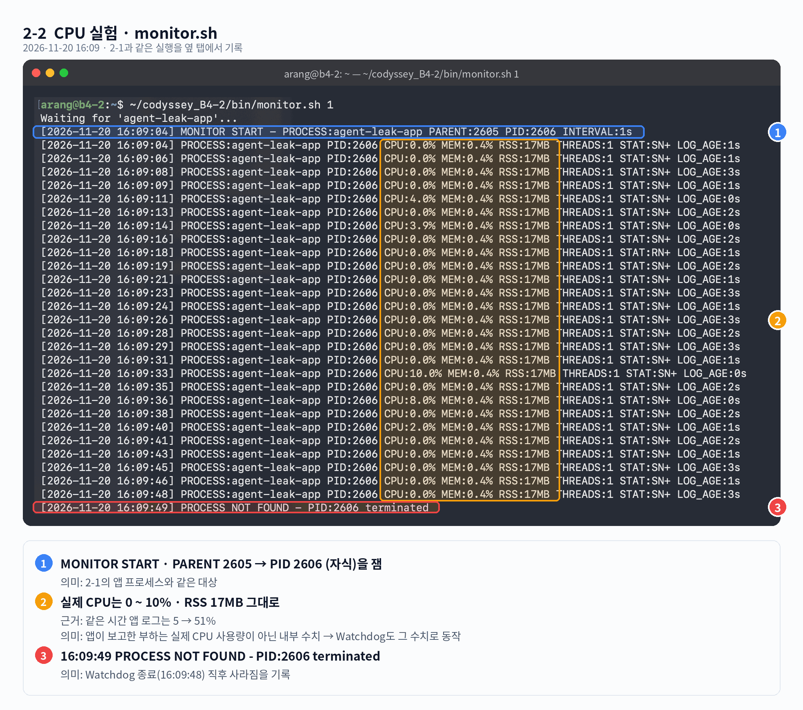
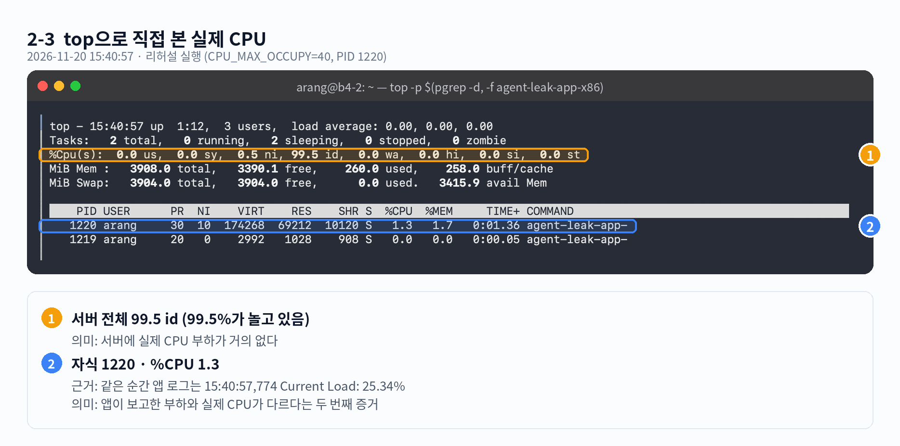

# 2. 🟠 CPU Spike 실험

> `CPU_MAX_OCCUPY=100`으로 실행해서 Watchdog 종료를 재현하고, 실제 CPU와 비교한 화면입니다.
> 자세한 분석 → [CPU 리포트](../../reports/02-cpu.md)

**보는 법** · 창 제목 = 그 화면에서 실제로 친 명령 · 색 상자와 번호 = 봐야 할 줄 · 아래 패널 = 근거와 의미 · 원본은 [`original/`](original/)

| 사진 | 무엇을 증명하나 |
|:--|:--|
| [2-1](#2-1) | CPU 실험 · 앱 화면 |
| [2-2](#2-2) | CPU 실험 · monitor.sh |
| [2-3](#2-3) | top으로 직접 본 실제 CPU |

---

## 2-1  CPU 실험 · 앱 화면

2026-11-20 16:09 · PID 2606 · CPU_MAX_OCCUPY=100 으로 실행

원본: [`original/2-1_cpu_app.png`](original/2-1_cpu_app.png)

---

## 2-2  CPU 실험 · monitor.sh

2026-11-20 16:09 · 2-1과 같은 실행을 옆 탭에서 기록

원본: [`original/2-2_cpu_monitor.png`](original/2-2_cpu_monitor.png)

---

## 2-3  top으로 직접 본 실제 CPU

2026-11-20 15:40:57 · 리허설 실행 (CPU_MAX_OCCUPY=40, PID 1220)

원본: [`original/2-3_cpu_top_actual.png`](original/2-3_cpu_top_actual.png)
