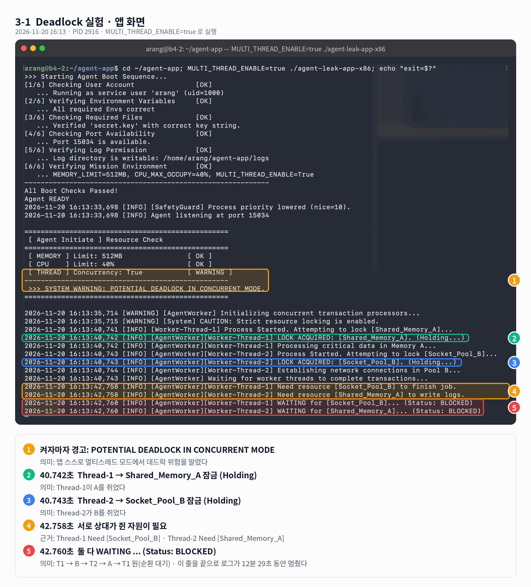
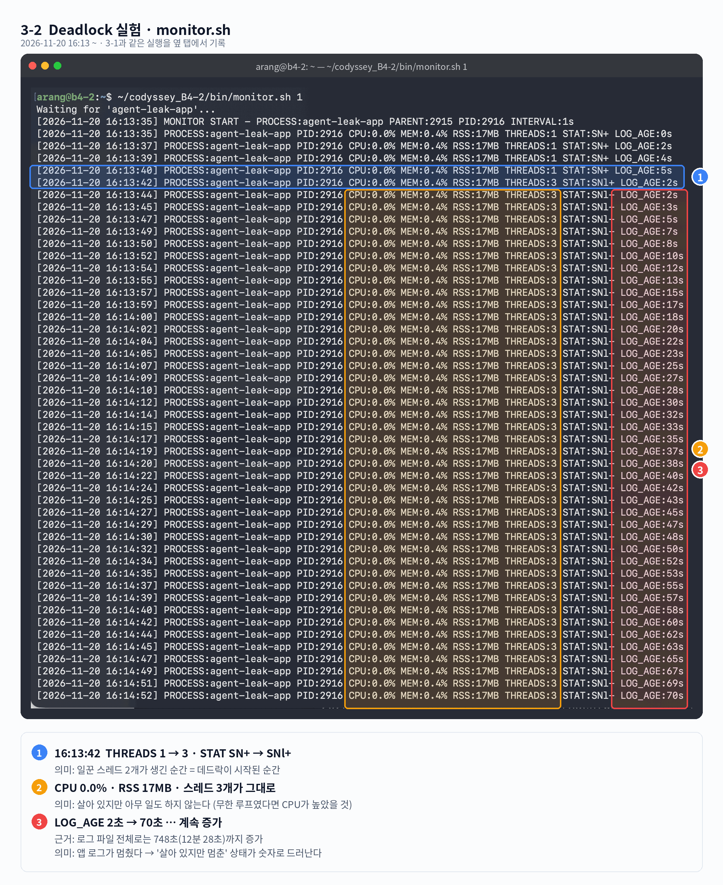
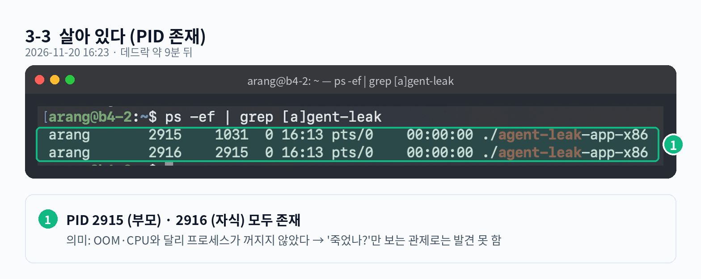
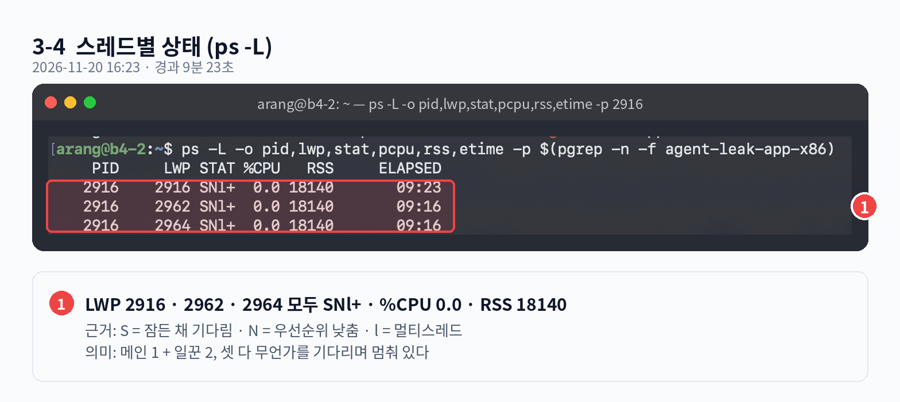
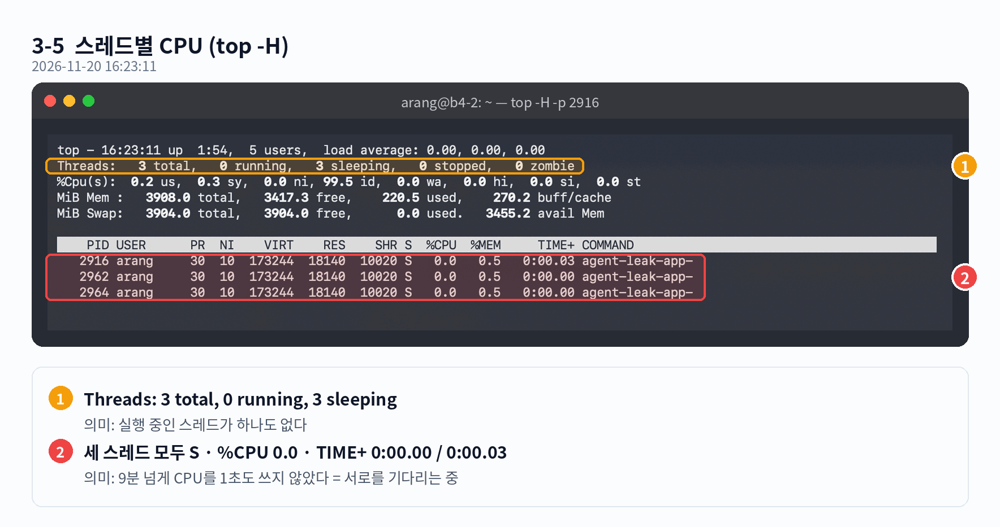
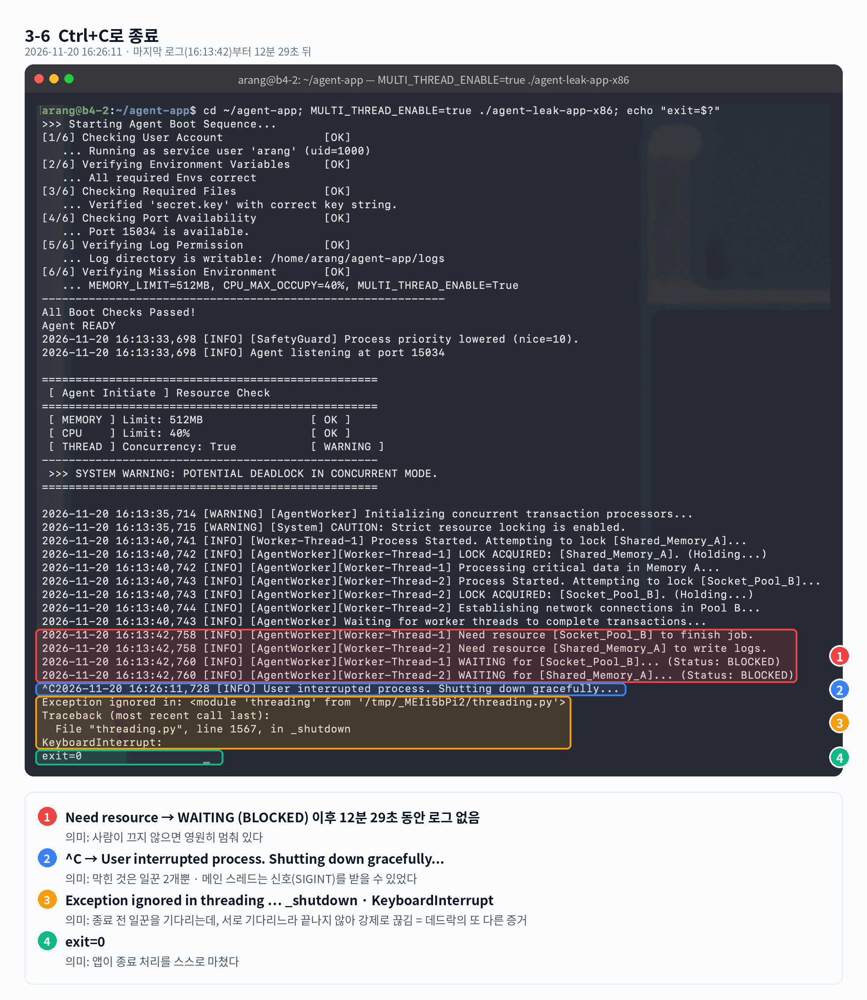

# 3. 🟣 Deadlock 실험

> `MULTI_THREAD_ENABLE=true`로 실행해서 '살아 있지만 멈춘' 상태를 재현하고 진단한 화면입니다.
> 자세한 분석 → [Deadlock 리포트](../../reports/03-deadlock.md)

**보는 법** · 창 제목 = 그 화면에서 실제로 친 명령 · 색 상자와 번호 = 봐야 할 줄 · 아래 패널 = 근거와 의미 · 원본은 [`original/`](original/)

| 사진 | 무엇을 증명하나 |
|:--|:--|
| [3-1](#3-1) | Deadlock 실험 · 앱 화면 |
| [3-2](#3-2) | Deadlock 실험 · monitor.sh |
| [3-3](#3-3) | 살아 있다 (PID 존재) |
| [3-4](#3-4) | 스레드별 상태 (ps -L) |
| [3-5](#3-5) | 스레드별 CPU (top -H) |
| [3-6](#3-6) | Ctrl+C로 종료 |

---

## 3-1  Deadlock 실험 · 앱 화면

2026-11-20 16:13 · PID 2916 · MULTI_THREAD_ENABLE=true 로 실행

원본: [`original/3-1_deadlock_app.png`](original/3-1_deadlock_app.png)

---

## 3-2  Deadlock 실험 · monitor.sh

2026-11-20 16:13 ~ · 3-1과 같은 실행을 옆 탭에서 기록

원본: [`original/3-2_deadlock_monitor.png`](original/3-2_deadlock_monitor.png)

---

## 3-3  살아 있다 (PID 존재)

2026-11-20 16:23 · 데드락 약 9분 뒤

원본: [`original/3-3_deadlock_ps_ef.png`](original/3-3_deadlock_ps_ef.png)

---

## 3-4  스레드별 상태 (ps -L)

2026-11-20 16:23 · 경과 9분 23초

원본: [`original/3-4_deadlock_ps_L.png`](original/3-4_deadlock_ps_L.png)

---

## 3-5  스레드별 CPU (top -H)

2026-11-20 16:23:11

원본: [`original/3-5_deadlock_top_H.png`](original/3-5_deadlock_top_H.png)

---

## 3-6  Ctrl+C로 종료

2026-11-20 16:26:11 · 마지막 로그(16:13:42)부터 12분 29초 뒤

원본: [`original/3-6_deadlock_ctrl_c.png`](original/3-6_deadlock_ctrl_c.png)
