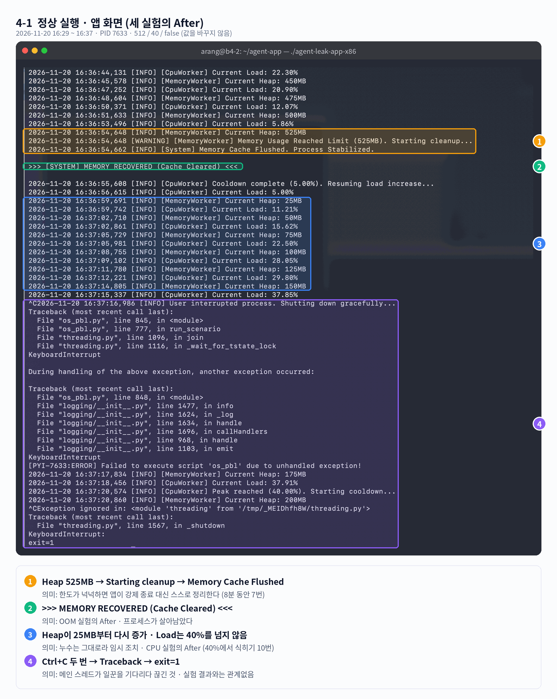
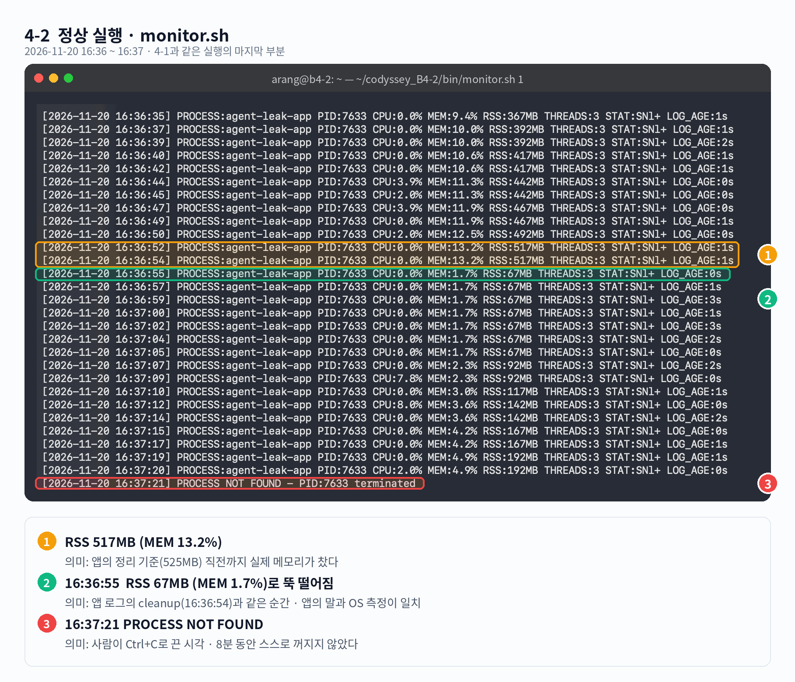

# 4. ✅ 정상 실행 (세 실험의 After)

> 값을 바꾸지 않은 정상 설정(512 / 40 / false)으로 8분 동안 실행한 화면입니다.
> 자세한 분석 → 리포트 3건의 §4

**보는 법** · 창 제목 = 그 화면에서 실제로 친 명령 · 색 상자와 번호 = 봐야 할 줄 · 아래 패널 = 근거와 의미 · 원본은 [`original/`](original/)

| 사진 | 무엇을 증명하나 |
|:--|:--|
| [4-1](#4-1) | 정상 실행 · 앱 화면 (세 실험의 After) |
| [4-2](#4-2) | 정상 실행 · monitor.sh |

---

## 4-1  정상 실행 · 앱 화면 (세 실험의 After)

2026-11-20 16:29 ~ 16:37 · PID 7633 · 512 / 40 / false (값을 바꾸지 않음)

원본: [`original/4-1_healthy_app.png`](original/4-1_healthy_app.png)

---

## 4-2  정상 실행 · monitor.sh

2026-11-20 16:36 ~ 16:37 · 4-1과 같은 실행의 마지막 부분

원본: [`original/4-2_healthy_monitor.png`](original/4-2_healthy_monitor.png)
