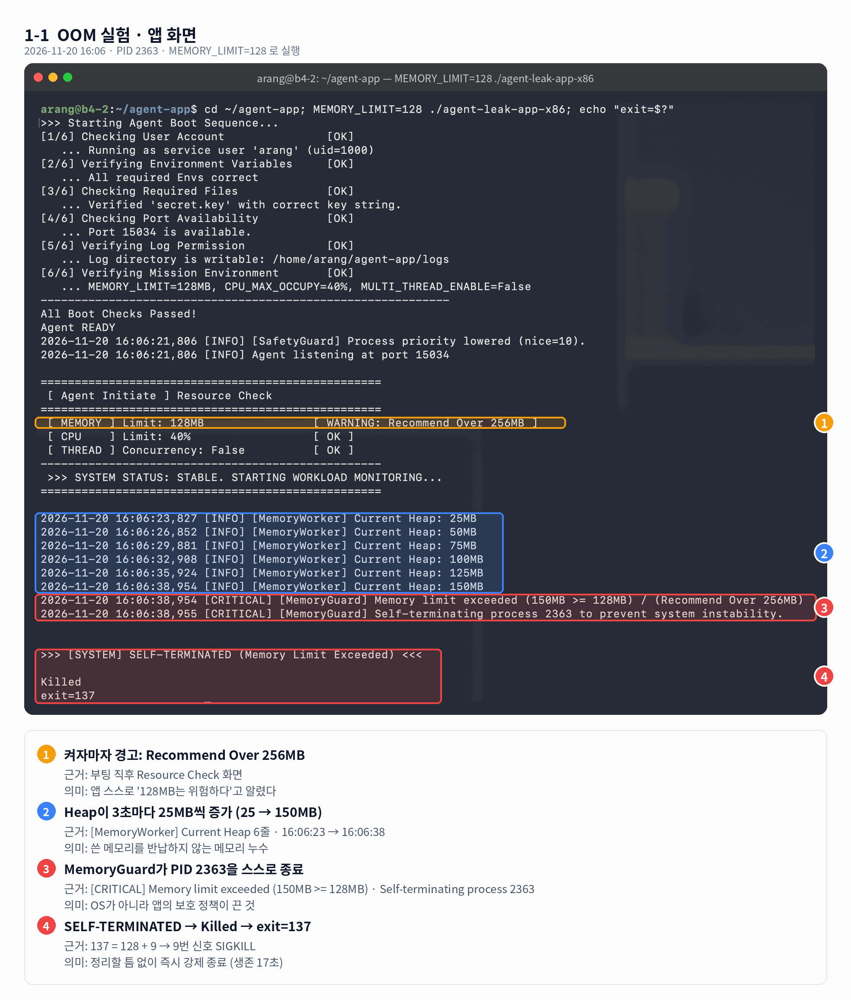

# 📸 스크린샷

> 모든 사진은 **내 VM(UTM · Ubuntu 22.04)에서 직접 찍은 화면**입니다.
> 각 사진에 **맥 터미널 창 틀**(제목 = 실제로 친 명령), **봐야 할 줄 강조**, **근거와 의미 설명**을 붙였고, 손대지 않은 원본은 폴더마다 `original/`에 그대로 있습니다.

| 폴더 | 내용 | 장수 |
|:--|:--|:--:|
| [`0_setup/`](0_setup/) | 0. 실행 환경 · 앱 구조 | 3 |
| [`1_oom/`](1_oom/) | 1. 🔴 OOM 실험 | 2 |
| [`2_cpu/`](2_cpu/) | 2. 🟠 CPU Spike 실험 | 3 |
| [`3_deadlock/`](3_deadlock/) | 3. 🟣 Deadlock 실험 | 6 |
| [`4_healthy/`](4_healthy/) | 4. ✅ 정상 실행 (세 실험의 After) | 2 |

## 전체 목록

| 번호 | 무엇을 증명하나 | 날짜 · 시각 |
|:--|:--|:--|
| [0-1](0_setup/README.md#0-1) | 첫 실행 · 부팅 검사 6단계 | 2026-11-20 07:24 |
| [0-2](0_setup/README.md#0-2) | 프로세스는 2개 (부모 · 자식) | 2026-11-20 14:38 |
| [0-3](0_setup/README.md#0-3) | 일하는 쪽은 자식 | 2026-11-20 14:39:24 |
| [1-1](1_oom/README.md#1-1) | OOM 실험 · 앱 화면 | 2026-11-20 16:06 |
| [1-2](1_oom/README.md#1-2) | OOM 실험 · monitor.sh | 2026-11-20 16:06 |
| [2-1](2_cpu/README.md#2-1) | CPU 실험 · 앱 화면 | 2026-11-20 16:09 |
| [2-2](2_cpu/README.md#2-2) | CPU 실험 · monitor.sh | 2026-11-20 16:09 |
| [2-3](2_cpu/README.md#2-3) | top으로 직접 본 실제 CPU | 2026-11-20 15:40:57 |
| [3-1](3_deadlock/README.md#3-1) | Deadlock 실험 · 앱 화면 | 2026-11-20 16:13 |
| [3-2](3_deadlock/README.md#3-2) | Deadlock 실험 · monitor.sh | 2026-11-20 16:13 ~ |
| [3-3](3_deadlock/README.md#3-3) | 살아 있다 (PID 존재) | 2026-11-20 16:23 |
| [3-4](3_deadlock/README.md#3-4) | 스레드별 상태 (ps -L) | 2026-11-20 16:23 |
| [3-5](3_deadlock/README.md#3-5) | 스레드별 CPU (top -H) | 2026-11-20 16:23:11 |
| [3-6](3_deadlock/README.md#3-6) | Ctrl+C로 종료 | 2026-11-20 16:26:11 |
| [4-1](4_healthy/README.md#4-1) | 정상 실행 · 앱 화면 (세 실험의 After) | 2026-11-20 16:29 ~ 16:37 |
| [4-2](4_healthy/README.md#4-2) | 정상 실행 · monitor.sh | 2026-11-20 16:36 ~ 16:37 |

## 예시

