# 수행 과정

> 무엇을 **어떤 순서로** 했는지, 실제로 친 명령과 📸 증거입니다.
> 결과와 평가표 답변, 리포트 3건은 모두 [README](README.md)에 있습니다.

| 단계 | 내용 |
|:--:|:--|
| [1](#1-제공-앱-분석) | 제공 앱 분석 - 무엇을 검사하고 어떤 장애를 일으키나 |
| [2](#2-vm-준비) | VM 준비 - UTM, Ubuntu, SSH |
| [3](#3-앱-설치와-환경변수) | 앱 설치와 환경변수 |
| [4](#4-monitorsh) | monitor.sh - 관제 스크립트 |
| [5](#5-실험-4번) | 실험 4번 - OOM · CPU · Deadlock · 정상 |

**명령 앞 표시**

| 표시 | 어디서 치나 |
|:--|:--|
| `[MAC]` | Mac 터미널 |
| `[탭 1]` | VM에 SSH로 접속한 창 - **앱 실행용** |
| `[탭 2]` | 같은 VM, 새 탭 - **monitor.sh용** |
| `[탭 3]` | 같은 VM, 새 탭 - **확인 명령용** (`ps`, `top`) |

> ⚠️ 명령은 **한 줄씩** 붙여넣으세요.

---

## 1. 제공 앱 분석

`agent-app-leak.zip`을 풀면 `agent-leak-app-x86`(Intel)과 `agent-leak-app-arm64`(M칩)가 나옵니다. 과제 문서에는 조건만 있어서 **직접 실행해 보고 확인**했습니다.

> **한 줄 요약:** 켤 때 내 세팅을 6가지로 검사하고, 켜진 뒤에는 환경변수 3개의 값을 보고 **어떤 장애를 일으킬지** 고르는 앱

### 켤 때 검사하는 6가지

| 단계 | 검사 내용 |
|:--:|:--|
| 1/6 | root가 아닌 일반 계정인가 |
| 2/6 | 필수 환경변수 5개가 있나 (`AGENT_HOME` 등) |
| 3/6 | `api_keys/secret.key` 내용이 `agent_api_key_test`인가 |
| 4/6 | 15034 포트가 비어 있나 |
| 5/6 | 로그 폴더에 쓸 수 있나 |
| 6/6 | 실험용 환경변수 3개가 범위 안인가 |

📸 **0-1** 6단계 모두 OK → `Agent READY`

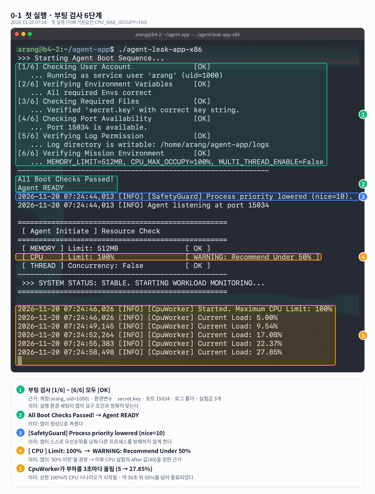

### 환경변수 값에 따라 고르는 시나리오

| 설정 | 일어나는 일 |
|:--|:--|
| 512 / 40 / false (전부 안전) | 정상 - 메모리·CPU가 오르다가 **스스로 정리**하며 계속 동작 |
| `MEMORY_LIMIT=128` | 🔴 메모리가 늘다가 **MemoryGuard가 강제 종료** |
| `CPU_MAX_OCCUPY=100` | 🟠 부하가 50%를 넘으면 **Watchdog이 종료** |
| `MULTI_THREAD_ENABLE=true` | 🟣 스레드 둘이 서로 기다리며 **멈춤** |

### 프로세스가 2개 뜬다

PyInstaller로 만든 실행 파일이라 **부모(껍데기)가 압축을 풀고, 자식이 실제로 일합니다.** 그래서 관제는 **자식**을 재야 합니다. 부모를 재면 메모리가 1MB에서 변하지 않아 누수가 안 보입니다.

📸 **0-2** `ps -ef` - 두 번째 줄의 부모(PPID)가 첫 번째 줄

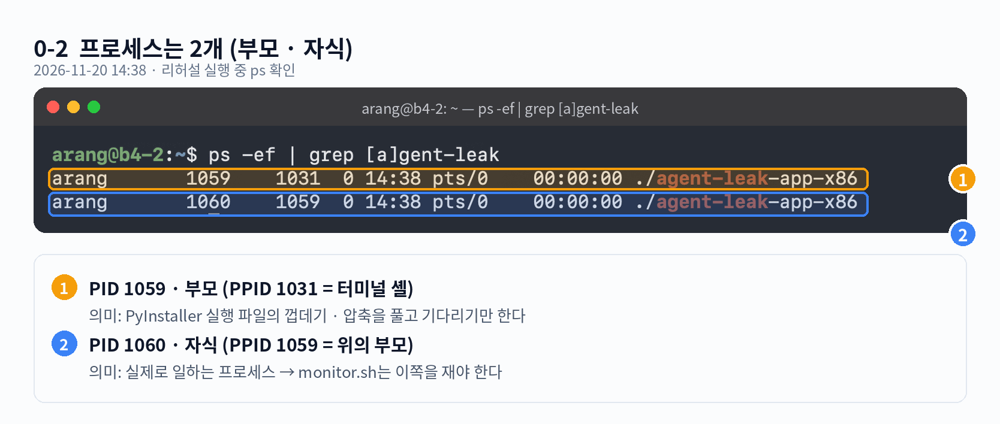

📸 **0-3** `top` - 부모는 RES 1MB · NI 0, 자식은 RES 18MB · **NI 10** (앱이 스스로 우선순위를 낮춤)

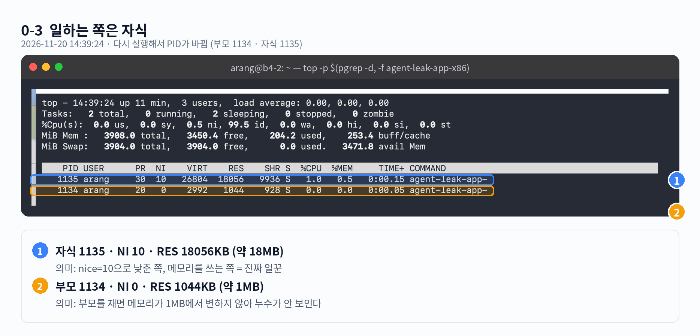

---

## 2. VM 준비

B4-1과 다른 Mac이라 **새 VM**을 만들었습니다. B4-1의 SSH 잠그기·방화벽·계정 권한은 B4-2 요구사항이 아니라서 **하지 않았습니다.**

| 순서 | 할 일 |
|:--:|:--|
| 1 | UTM 설치, Ubuntu Server **22.04.5 amd64** iso 받기 |
| 2 | UTM → `+` → 가상화 → Linux → iso 선택 · 메모리 **4096MB** · CPU 코어 **2** |
| 3 | 설치: 계정 `arang` · 서버 이름 `b4-2` · **Install OpenSSH server 체크** |
| 4 | 설치 후 CD 꺼내기 → 재부팅 → `ip -4 addr show`로 주소 확인 |

```bash
# [MAC] UTM 설치 (홈 폴더라 관리자 권한 없어도 됨)
curl -L -o ~/Downloads/UTM.dmg https://github.com/utmapp/UTM/releases/latest/download/UTM.dmg
hdiutil attach ~/Downloads/UTM.dmg
mkdir -p ~/Applications
cp -R /Volumes/UTM/UTM.app ~/Applications/
hdiutil detach /Volumes/UTM
```

```bash
# [MAC] Ubuntu iso 받고 체크섬 확인 → 결과: ...amd64.iso: OK
cd ~/Downloads
curl -L -O https://releases.ubuntu.com/22.04.5/ubuntu-22.04.5-live-server-amd64.iso
curl -L -O https://releases.ubuntu.com/22.04.5/SHA256SUMS
grep "live-server-amd64.iso" SHA256SUMS | shasum -a 256 -c -
```

```bash
# [MAC] VM 접속
ssh arang@192.168.64.5

# [탭 1] 한국 시간으로 (로그 타임스탬프가 증거라서 꼭 맞춤)
sudo timedatectl set-timezone Asia/Seoul
sudo apt update
sudo apt install -y unzip

# [탭 1] ✔ 결과: 2 / Mem total 3.8Gi
nproc
free -h
```

> **왜 CPU 2코어?** UTM은 따로 정하지 않으면 Mac의 코어를 전부(이번엔 16개) 줍니다. 코어가 많으면 CPU 사용률이 작게 나와 실험이 흐려질 수 있고, 2코어면 실험 중에도 SSH 창이 버벅이지 않습니다.

---

## 3. 앱 설치와 환경변수

```bash
# [MAC] zip을 VM으로 복사
scp ~/Downloads/agent-app-leak.zip arang@192.168.64.5:~/
```

```bash
# [탭 1] 풀기 (Mac이 끼워 넣은 __MACOSX 폴더는 지움)
mkdir -p ~/agent-app
unzip ~/agent-app-leak.zip -d ~/agent-app
rm -rf ~/agent-app/__MACOSX

# [탭 1] 앱이 요구하는 폴더 3개 + 키 파일
mkdir -p ~/agent-app/upload_files ~/agent-app/api_keys ~/agent-app/logs
echo "agent_api_key_test" > ~/agent-app/api_keys/secret.key
```

환경변수 8개를 `~/.bashrc`에 넣습니다. 실험용 3개는 **안전한 값을 기본**으로 두고, 실험할 때만 명령 앞에 붙여 바꿉니다.
예: `MEMORY_LIMIT=128 ./agent-leak-app-x86` → **그 실행에만** 128 적용

```bash
# [탭 1] cat 줄부터 EOF 줄까지 10줄이 한 명령
cat >> ~/.bashrc << 'EOF'
export AGENT_HOME=/home/arang/agent-app
export AGENT_PORT=15034
export AGENT_UPLOAD_DIR=$AGENT_HOME/upload_files
export AGENT_KEY_PATH=$AGENT_HOME/api_keys
export AGENT_LOG_DIR=$AGENT_HOME/logs
export MEMORY_LIMIT=512
export CPU_MAX_OCCUPY=40
export MULTI_THREAD_ENABLE=false
EOF
```

```bash
# [탭 1] 적용 → ✔ 결과: 8줄
source ~/.bashrc
env | grep -E "AGENT_|MEMORY_LIMIT|CPU_MAX_OCCUPY|MULTI_THREAD" | sort

# [탭 1] ✔ 첫 실행 → 결과: [1/6]~[6/6] [OK] → Agent READY (📸 0-1)
cd ~/agent-app
./agent-leak-app-x86
```

| 기본값 | 이유 |
|:--|:--|
| `MEMORY_LIMIT=512` | 범위(50~512)의 최대값, 앱 권장 "256 이상" |
| `CPU_MAX_OCCUPY=40` | 앱 권장 "50 미만" |
| `MULTI_THREAD_ENABLE=false` | 켜면 앱이 데드락 경고 |

---

## 4. monitor.sh

B4-1의 monitor.sh 틀(맨 위 설정값, 단계 주석, 한 줄 로그, `>>` 누적)을 가져오고 B4-2에 맞게 바꿨습니다. → [bin/monitor.sh](bin/monitor.sh)

| | B4-1 | B4-2 |
|:--|:--|:--|
| 무엇을 재나 | 서버 **전체** | 앱의 **자식 프로세스 하나** |
| 언제 재나 | cron으로 1분에 한 번 | 앱이 살아 있는 동안 **1초마다** |
| 추가 항목 | - | RSS · 스레드 수 · 상태 · **LOG_AGE** |

**기록 한 줄**

```
[2026-11-20 16:13:42] PROCESS:agent-leak-app PID:2916 CPU:0.0% MEM:0.4% RSS:17MB THREADS:3 STAT:SNl+ LOG_AGE:2s
```

**동작 순서**

| 순서 | 명령 | 하는 일 |
|:--:|:--|:--|
| ① | `pgrep -o -f "^[^ ]*agent-leak-app"` | 앱이 뜰 때까지 기다렸다가 **부모** PID 찾기 |
| ② | `pgrep -P $PARENT` | 부모의 **자식** PID 찾기 |
| ③ | `ps -p $PID -o %mem=,rss=,nlwp=,stat=` | 메모리 %, RSS, 스레드 수, 상태 |
| ④ | `top -b -n 2 -d 0.5 -p $PID` | **지금 이 순간**의 CPU |
| ⑤ | `stat -c %Y agent_app.log` | 앱 로그가 멈춘 지 몇 초 = **LOG_AGE** |
| ⑥ | `kill -0 $PID` 실패 시 | `PROCESS NOT FOUND` 남기고 `exit 1` |

> **LOG_AGE를 넣은 이유:** 데드락은 프로세스가 살아 있어서 "죽었나?"만 보면 정상으로 보입니다. 앱 로그가 몇 초째 멈춰 있는지를 같이 재면 **"살아 있지만 멈춘"** 상태가 숫자로 드러납니다.

```bash
# [탭 1] 레포 받기 (monitor.sh가 들어 있음) + 결과 모을 폴더
git clone https://github.com/codewhite7777/codyssey_B4-2.git ~/codyssey_B4-2
mkdir -p ~/results
```

---

## 5. 실험 4번

**정상 설정에서 값 하나만 바꿔** 장애(Before)를 만들고, 정상 실행 1번을 세 실험 공통의 After로 썼습니다.

| 실험 | 바꾼 값 | 결과 | 리포트 |
|:--|:--|:--|:--:|
| 1 OOM | `MEMORY_LIMIT=128` | 17초 만에 종료 (exit=137) | [🔴](README.md#1-1-oom-메모리-선형-증가--강제-종료-패턴) |
| 2 CPU | `CPU_MAX_OCCUPY=100` | 46초 만에 종료 (exit=143) | [🟠](README.md#1-3-cpu-임계치-초과--종료-패턴) |
| 3 Deadlock | `MULTI_THREAD_ENABLE=true` | 12분 29초 멈춤 → Ctrl+C | [🟣](README.md#1-5-deadlock-살아-있지만-멈춘-상태-식별) |
| 4 정상 | 없음 | 8분 동안 정상 → Ctrl+C | README 1-2 · 1-4 · 1-6 |

### 매번 같은 순서

```bash
# ① [탭 1] 로그 2개 비우기
: > ~/agent-app/logs/agent_app.log; : > ~/agent-app/logs/monitor.log

# ② [탭 2] 감시 시작 → "Waiting for 'agent-leak-app'..." 상태로 대기
~/codyssey_B4-2/bin/monitor.sh 1

# ③ [탭 1] 앱 실행 (실험마다 다름, 아래 참고) → 끝나면 종료 코드가 찍힘

# ④ [탭 1] 로그 보관 (이름은 실험마다 바꿈)
cp ~/agent-app/logs/agent_app.log ~/results/1_oom_app.log; cp ~/agent-app/logs/monitor.log ~/results/1_oom_monitor.log
```

### 🔴 실험 1. OOM

```bash
# [탭 1]
cd ~/agent-app; MEMORY_LIMIT=128 ./agent-leak-app-x86; echo "exit=$?"
```

📸 **1-1** 앱 화면 - Heap 25MB씩 증가 → `Memory limit exceeded` → `SELF-TERMINATED` → `Killed` → `exit=137`

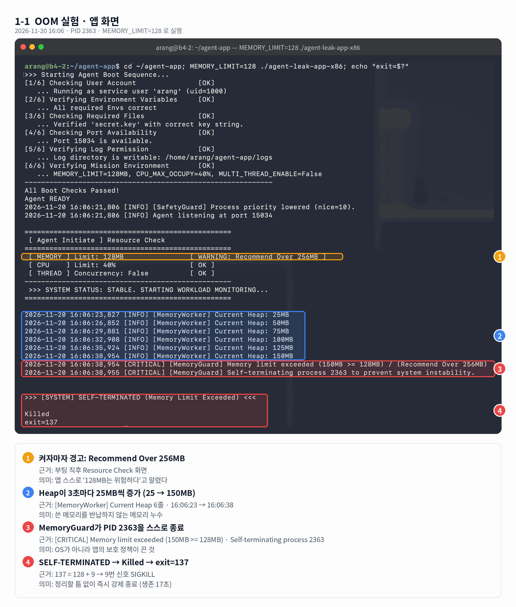

📸 **1-2** monitor.sh - RSS 17 → 42 → 68 → 93 → 118 → 143MB → `PROCESS NOT FOUND`

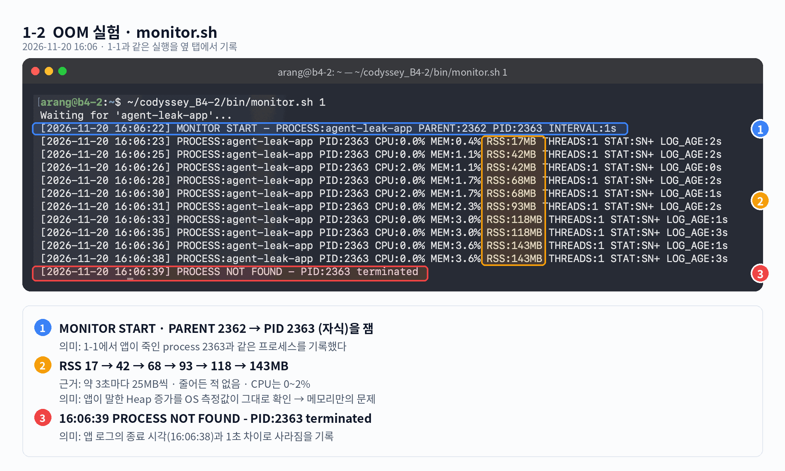

> 앱이 죽인 PID(`process 2363`)와 monitor.sh가 잰 PID(`PID:2363`)가 같습니다. → [리포트](README.md#1-1-oom-메모리-선형-증가--강제-종료-패턴)

### 🟠 실험 2. CPU Spike

```bash
# [탭 1]
cd ~/agent-app; CPU_MAX_OCCUPY=100 ./agent-leak-app-x86; echo "exit=$?"
```

📸 **2-1** 앱 화면 - Current Load 5% → 51.22% → `CPU Threshold Violated!` → `WATCHDOG ... SIGTERM` → `exit=143`

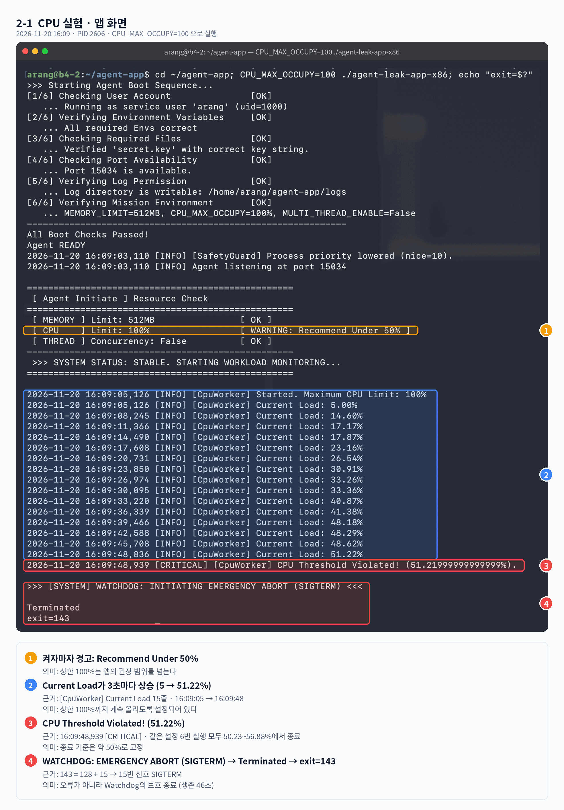

📸 **2-2** monitor.sh - 같은 시간 **실제 CPU는 0~10%**

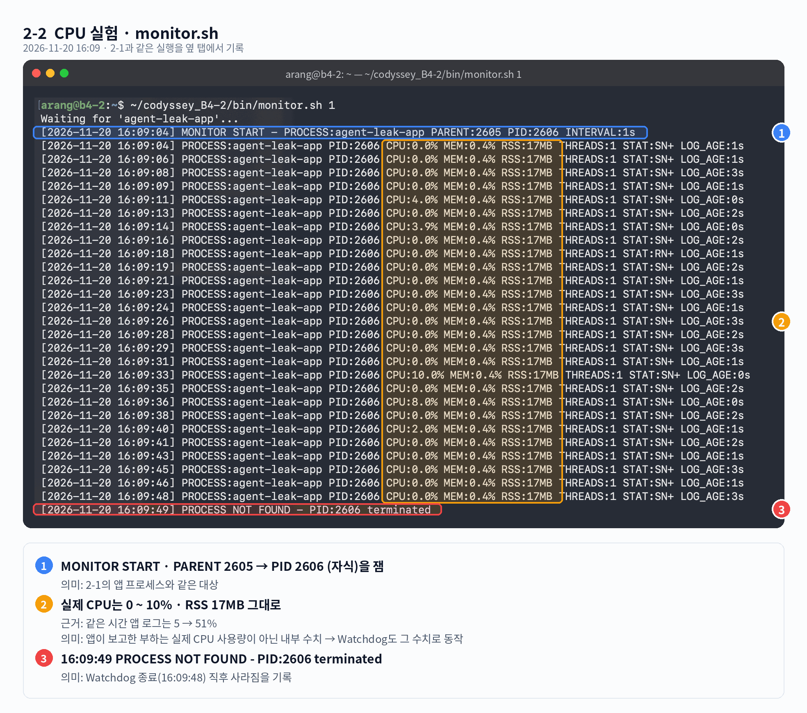

> 앱이 보고한 부하와 실제 CPU가 다릅니다. Watchdog은 **앱 내부 수치**를 보고 껐습니다. → [리포트](README.md#1-3-cpu-임계치-초과--종료-패턴)

### 🟣 실험 3. Deadlock

```bash
# [탭 1]
cd ~/agent-app; MULTI_THREAD_ENABLE=true ./agent-leak-app-x86; echo "exit=$?"
```

로그가 멈추고 1분 뒤 **탭 3**에서 확인합니다.

```bash
# [탭 3] 살아 있나 (📸 3-3)
ps -ef | grep [a]gent-leak

# [탭 3] 스레드별 상태 - 모두 S, CPU 0 (📸 3-4)
ps -L -o pid,lwp,stat,pcpu,rss,etime -p $(pgrep -n -f agent-leak-app-x86)

# [탭 3] 스레드별 CPU 실시간, q로 나옴 (📸 3-5)
top -H -p $(pgrep -n -f agent-leak-app-x86)
```

📸 **3-1** 앱 화면 - 마지막 로그 `WAITING for ... (Status: BLOCKED)` 두 줄

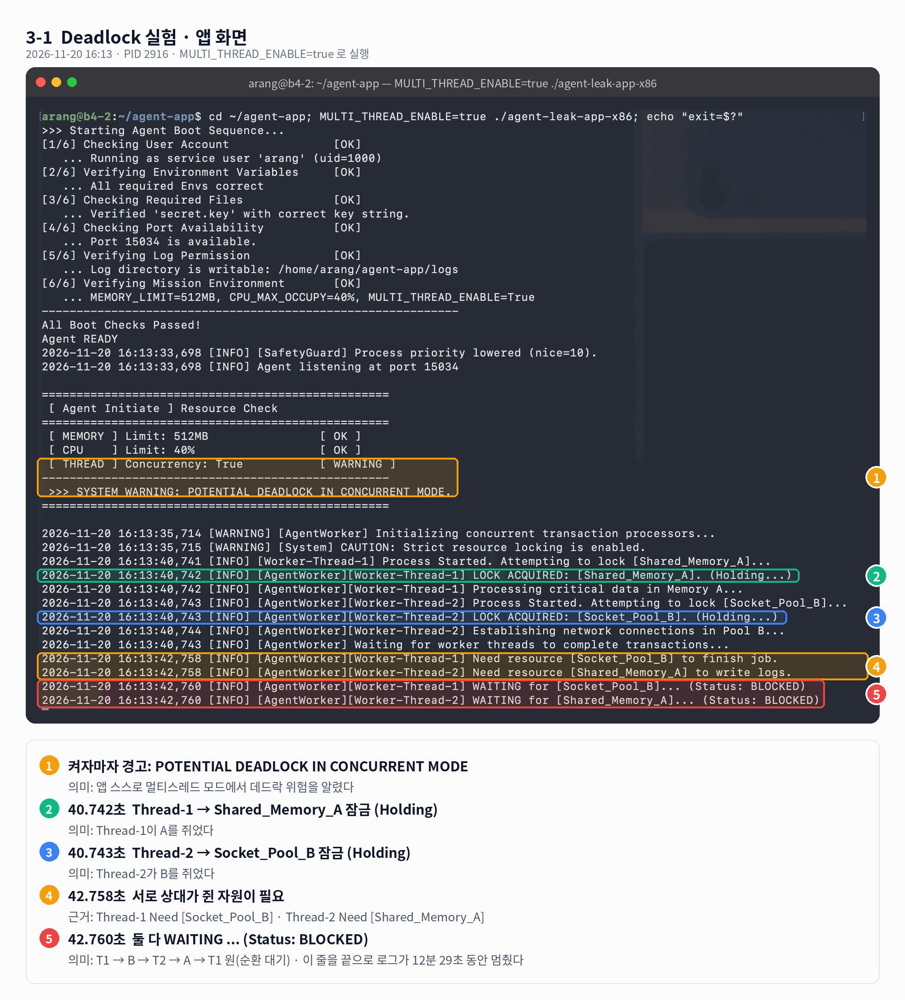

📸 **3-2** monitor.sh - CPU 0% · RSS 17MB 그대로, **LOG_AGE만 계속 증가**

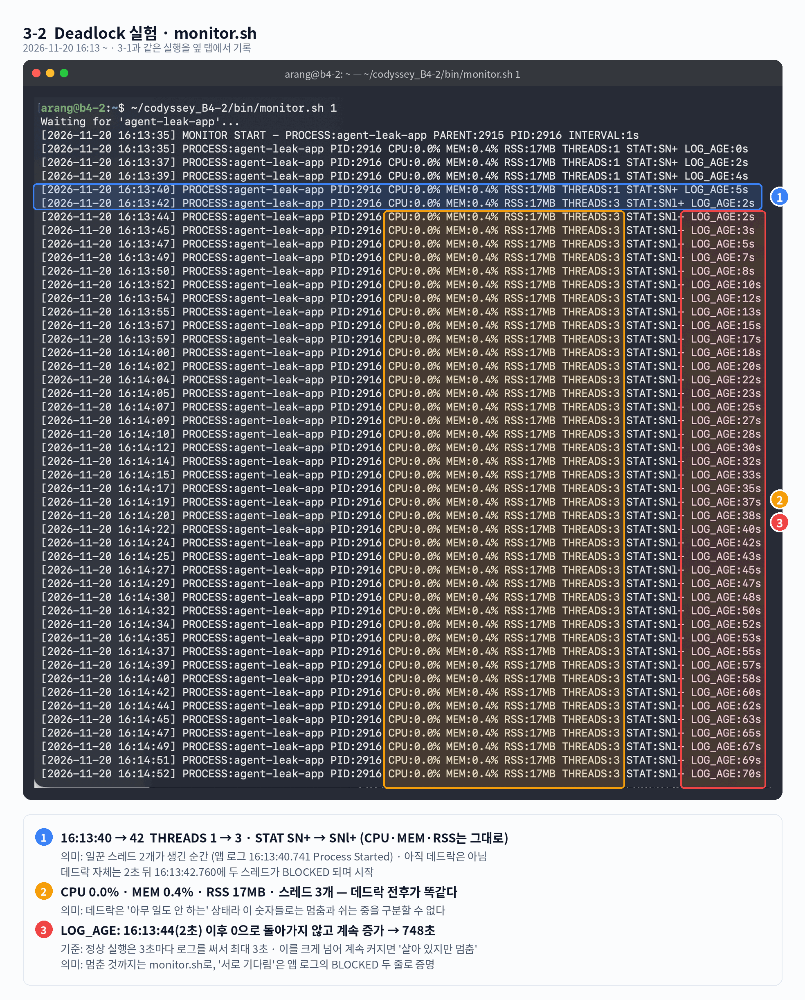

📸 **3-3** `ps -ef` - PID 2915, 2916 살아 있음

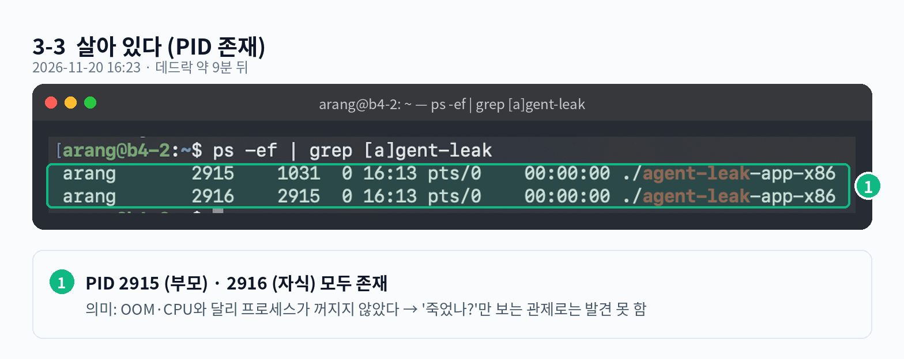

📸 **3-4** `ps -L` - 스레드 3개 모두 `SNl+`, `%CPU 0.0`

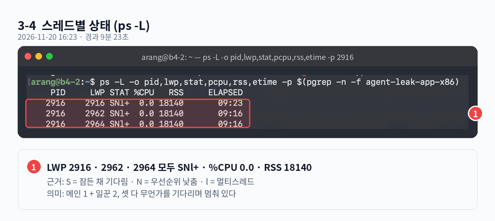

📸 **3-5** `top -H` - 스레드 3개 모두 `S`, `TIME+ 0:00.00` (CPU를 1초도 안 씀)

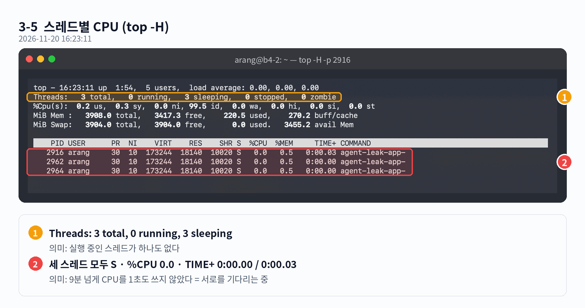

📸 **3-6** Ctrl+C - 메인 스레드가 일꾼 스레드를 기다리다 끊김 (`threading ... _shutdown`)

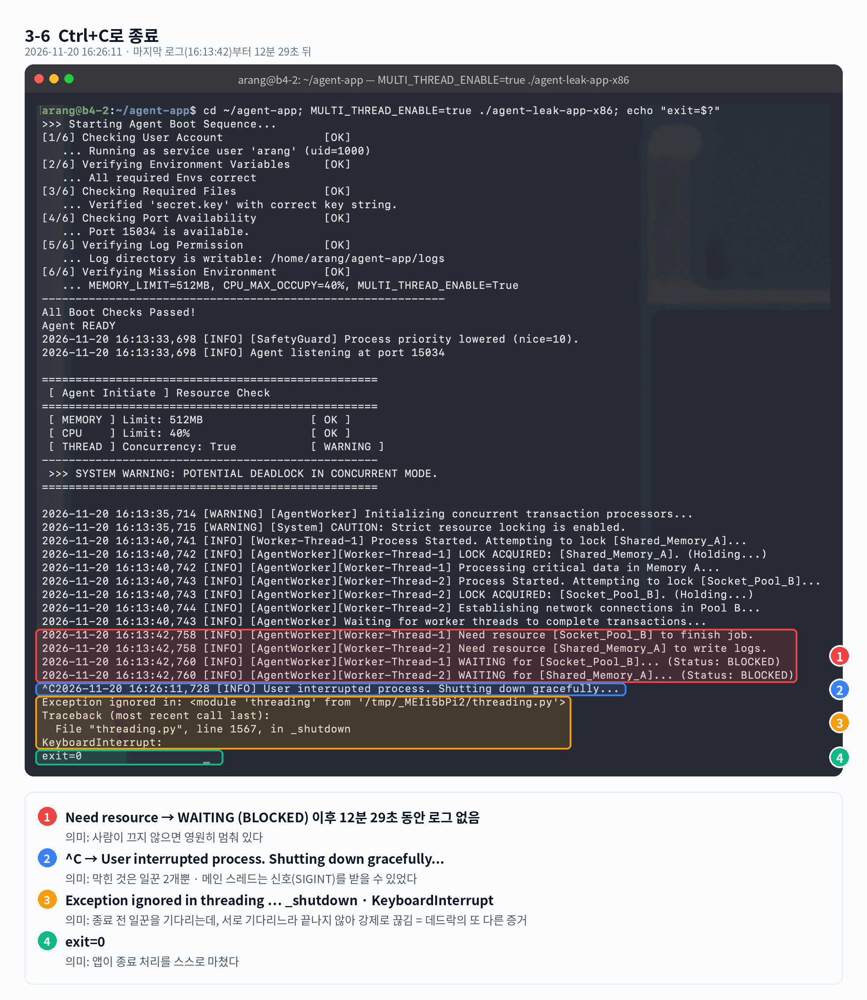

> → [리포트](README.md#1-5-deadlock-살아-있지만-멈춘-상태-식별)

### ✅ 실험 4. 정상 (세 실험의 After)

```bash
# [탭 1] 값을 바꾸지 않고 실행 → 5분 넘게 두고 Ctrl+C
cd ~/agent-app; ./agent-leak-app-x86; echo "exit=$?"
```

📸 **4-1** 앱 화면 - 525MB → `Starting cleanup...` → `MEMORY RECOVERED`

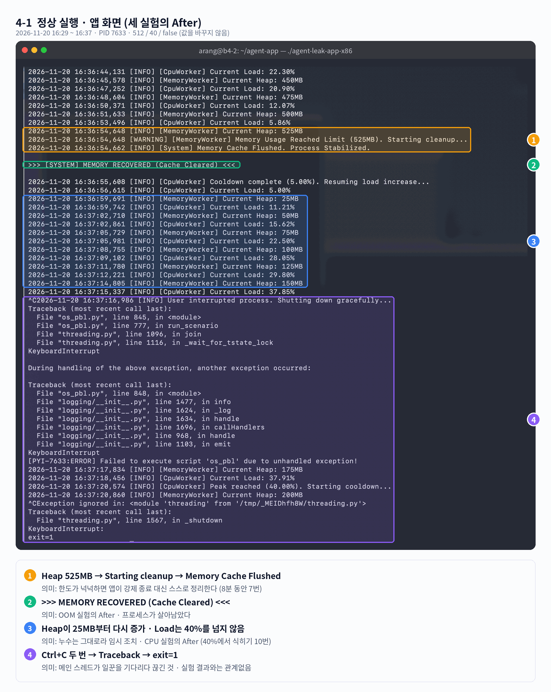

📸 **4-2** monitor.sh - 정리 순간 RSS 517MB → 67MB

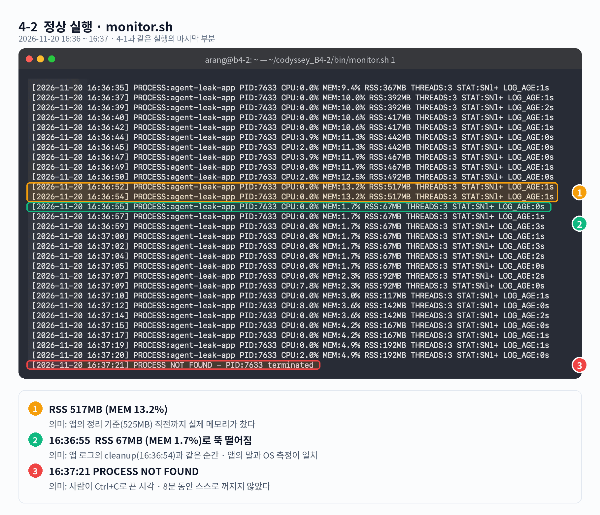

> 메모리 정리 7번, CPU 식히기 10번, 8분 내내 로그가 쌓였습니다(LOG_AGE 0~3초).
> 끌 때 Ctrl+C를 두 번 눌러야 했지만(`exit=1`) 실험 결과와는 관계없습니다.

### 결과 가져오기

```bash
# [MAC] 로그 8개를 Mac으로 → 레포 logs/에 올림
scp -r arang@192.168.64.5:~/results ~/Downloads/
```

---

## 하지 않은 것

- **보너스 (스케줄링 알고리즘 추론):** 정상 실행 로그의 `Thread-A/B/C ... Preempted ... Resumed`가 재료지만 범위에서 제외
- **B4-1의 서버 보안 설정** (SSH 포트, 방화벽, 계정 권한, cron, logrotate): B4-2 요구사항이 아님
